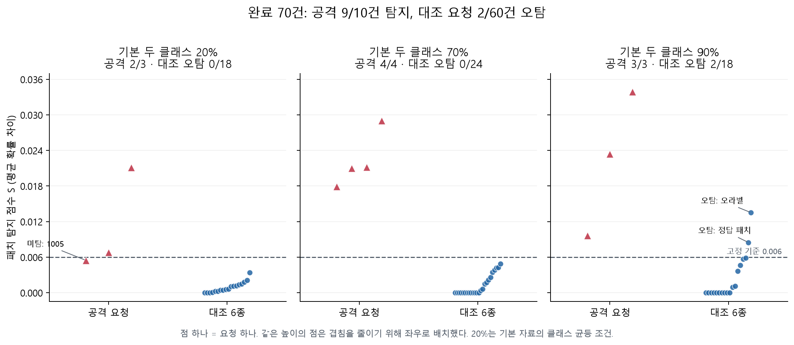
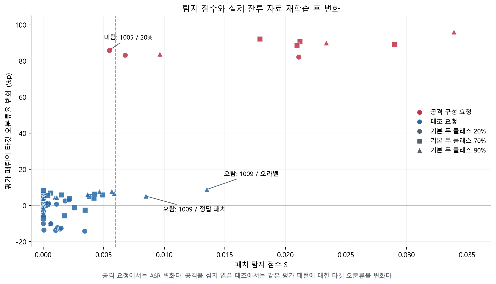
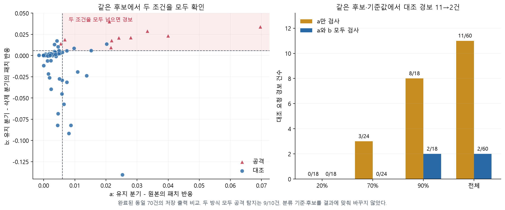
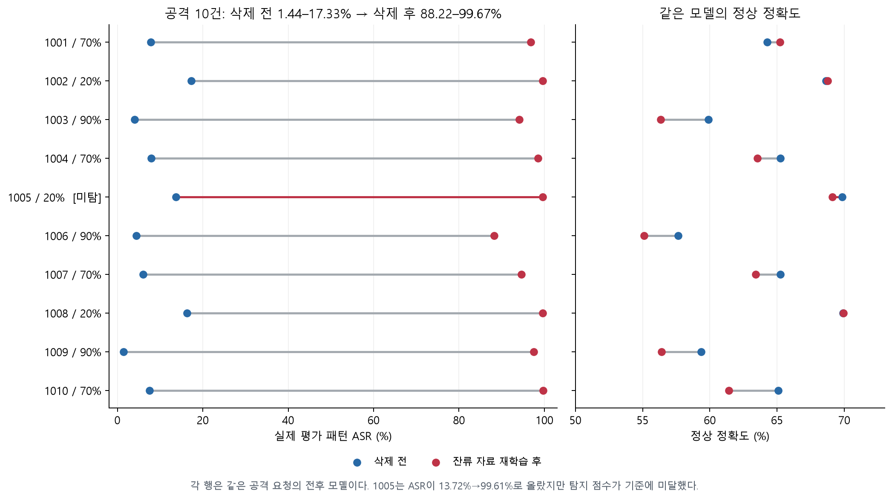

# D26 — 고정 패치 탐지는 Non-IID에서 위험한 삭제 요청을 구별하는가?

**중간 판정:** 완료 70건에서 공격 **9/10건을 탐지**했고, 대조 요청 **2/60건을 오탐**했다. 70% 조건의 완료 사례는 모두 구별했지만, 20% 조건에서 공격 한 건을 놓쳤고 90% 조건에서 대조 두 건을 공격으로 판정했다. **Non-IID 전체에서 완전히 구별됐다고 결론 내릴 수 없다.**

**보고 범위:** 2026년 10월 19일 **16:58 KST**까지 완료된 10조건·70요청. 전체 계획은 30조건·210요청이다. 이후 완료되는 결과와 섞지 않고 이 시점의 결과를 보존했다. 이 리포트는 패치 탐지 실험 하나를 다룬다.

## 가설 한 줄

유지·삭제 복제 모델의 패치 반응을 함께 비교하면, 정상 클래스 편향이 큰 상황에서도 백도어를 활성화하는 삭제 요청을 구별할 수 있다.

## 실험 한 줄

10개 새 시드 × 기본 두 클래스 비중 20/70/90% × 삭제 요청 7종을 구성하고, 삭제 후 잔류 자료로 40라운드 재학습한 실제 결과와 사전에 고정한 패치 탐지 판정을 비교했다.

## 실행 한 줄

```powershell
.\pr_reports\run.ps1 D26 -Action Run
```

저장소 루트의 PowerShell에서 실행한다. DISLAB의 진행 중인 같은 작업을 확인하고, 중단된 미완료 작업은 같은 설정으로 이어서 실행한다. 실행 중인 배치를 중복 생성하지 않는다. **새 초기화로 별도 210건을 시작하는 명령은 아니다.**

보고서·그래프를 이 70건으로 다시 만들려면 `python .\pr_reports\build_patch_report.py`를 실행한다. NumPy·Matplotlib이 필요하며 GPU 학습과 네트워크 접속은 수행하지 않는다. 원본 행과 점수 재계산 검증도 함께 갱신한다.

## 무엇을 비교했는가

요청마다 원본 모델 $	heta_0$를 복제해 **남길 자료 $R$로 학습한 모델 $	heta_R$**과 **지울 자료 $F$로 학습한 모델 $	heta_F$**를 만든다. 두 복제 모델 모두 해당 자료의 정답 라벨로 일반적인 손실 감소 학습을 한다. $	heta_F$는 삭제를 수행한 모델이 아니라 삭제 자료에 대한 반응을 보는 진단 모델이다.

세 모델에 같은 정상 이미지와 같은 패치 이미지를 넣어 **패치가 특정 클래스의 예측 확률을 얼마나 더 높이는지** 비교한다. 탐지 판정을 먼저 파일에 고정한 뒤, 잔류 자료만으로 처음부터 다시 학습한 모델의 실제 ASR을 평가한다. 100스텝 복제 진단과 40라운드 잔류 자료 재학습은 목적과 설정이 다르다.

## 데이터와 Non-IID 조건

| 항목 | 고정한 설정 |
|---|---|
| 자료·모델 | CIFAR-10, ResNet18, 클래스 10개 |
| 초기화 | ImageNet 사전학습 가중치를 불러온 뒤 첫 Conv를 3×3/stride 1, maxpool을 Identity, FC를 512→10으로 교체 |
| 입력 | 32×32 RGB, 0–1 범위. 평균 (0.4914, 0.4822, 0.4465), 표준편차 (0.2023, 0.1994, 0.2010)로 정규화 |
| 기본 자료 | 총 6,000장, 클래스당 600장. 클라이언트 5명, 각 1,200장 |
| 분포 조건 | 각 클라이언트에 지정한 두 클래스의 합계 비중 20%, 70%, 90% |
| 새 시드 | 1001–1010. 같은 시드의 분포 조건들은 자료·초기화를 공유하도록 설계 |
| 공격자·요청자 | 클라이언트 0. 나머지 네 클라이언트는 기본 자료 유지 |
| 실제 공격 패턴 | 오른쪽 아래 4×4 RGB 무작위 패턴, 생성 시드 20261018 고정 |
| 실제 공격 타깃 | 클래스 0 고정. 탐지 후보 선택은 10개 클래스를 모두 검색 |

분포 비중은 공격 자료 등을 추가하기 **전의 기본 1,200장**에 대한 값이다. 클라이언트 0의 기본 라벨별 장수는 다음과 같다. 다른 클라이언트에도 각자 지정한 클래스 쌍을 같은 방식으로 배분한다.

| 기본 두 클래스 비중 | 클래스 0·1 각각 | 나머지 8개 클래스 각각 | 의미 |
|---|---|---|---|
| 20% | 120장 | 120장 | 기본 자료는 클래스 균등 |
| 70% | 420장 | 45장 | 두 클래스에 집중 |
| 90% | 540장 | 15장 | 더 강한 클래스 편향 |

추가 자료를 붙이면 요청자의 최종 라벨 비중은 이 값과 달라진다. 여기서 “90% 조건”은 모든 학습 자료의 90%가 두 클래스라는 뜻이 아니다.

## 삭제 요청 7종: 무엇을 남기고 무엇을 지웠는가

$B$: 요청자의 정상 기본 자료 1,200장. $P$: 원래 정답이 0이 아닌 이미지에 실제 패턴을 넣고 라벨을 0으로 바꾼 독성 자료 180장. $C$: 같은 실제 패턴을 넣되 원래 정답 라벨을 유지한 억제 자료 720장. $Q$: 패치 없는 정상 클래스 0 자료 180장. $N$: $P$와 같은 원본 이미지에 패치를 넣지 않고 라벨만 0으로 바꾼 오라벨 자료 180장이다.

| 요청 / 코드 이름 | 삭제 전 요청자 자료 | 남기는 $R$ | 삭제하는 $F$ | 비교 목적 |
|---|---|---|---|---|
| 공격 / `attack_delete_cover` | $B+P+C$ | $B+P$: 1,380장 | $C$: 720장 | 독성을 남기고 억제만 제거 |
| 같은 크기 안전 삭제 / `equal_size_safe` | $B+P+C$ | $B+C_{180}$: 1,380장 | $P+C_{540}$: 720장 | 공격과 유지·삭제 장수 동일, 독성 제거 |
| 독성 삭제 / `delete_poison` | $B+P+C$ | $B+C$: 1,920장 | $P$: 180장 | 독성만 제거 |
| 양쪽 삭제 / `delete_both` | $B+P+C$ | $B$: 1,200장 | $P+C$: 900장 | 독성·억제 모두 제거 |
| 정상 클래스 편향 / `benign_class_prior` | $B+Q+C$ | $B+Q$: 1,380장 | $C$: 720장 | 독성 대신 정상 클래스 0 추가 |
| 오라벨 / `label_noise` | $B+N+C$ | $B+N$: 1,380장 | $C$: 720장 | 독성 대신 패치 없는 오라벨 추가 |
| 정답 패치 삭제 / `normal_cover` | $B+C$ | $B$: 1,200장 | $C$: 720장 | 타깃 라벨 독성을 심지 않은 조건 |

**대조 6종은 모두 원본 이미지로만 구성한 순수 정상 클라이언트 전체 삭제가 아니다.** 특히 `normal_cover`에도 정답 라벨을 붙인 패치 자료 $C$가 들어간다. 이 구성을 빼고 “일반적인 Non-IID 정상 삭제에서 오탐 3.3%”라고 일반화하면 안 된다.

## 학습·진단·평가 설정

| 구분 | 설정 |
|---|---|
| 삭제 전 모델 학습 | FedAvg 40라운드, 매 라운드 5명 모두 참여, 클라이언트 자료 장수로 가중 평균 |
| 클라이언트 학습 | 매 라운드 1 epoch, batch 64, SGD 학습률 0.01, momentum·weight decay 없음, 증강 없음, 전체 네트워크 학습 |
| 삭제 후 기준 모델 | 해당 $R$과 나머지 4명 자료로 같은 초기화에서 40라운드 재학습. 1스텝 근사 언러닝 결과가 아님 |
| 복제 진단 | $	heta_R,	heta_F$ 각각 100 SGD 스텝, 학습률 0.01, batch 32, 복원 추출 |
| 복제 학습 범위 | `layer4`만 갱신. FC·다른 블록 고정. BN은 eval로 통계 고정 |
| 복제 제약 | gradient norm clipping 1.0, 정상 기준 자료 500장에 대한 KL 가중치 2.0 |
| 공통 조건 | 두 복제 분기는 같은 난수 스트림과 같은 정상 기준 자료 사용 |
| 탐지 입력 | 개발용 정상 200장 + 검증용 정상 200장, 각각 클래스당 20장. 기준 500장과 학습 자료에서 분리 |
| 패치 후보 | 4개 모서리 × 8종 = 32개. 모서리마다 검정·흰색·체커·역체커·무작위 4개, 크기 4×4 |
| 후보 패턴 난수 | 시드 919191. 실제 공격 패턴의 시드 20261018과 별도 |
| 후보 선택 | 개발 자료에서 32패턴 × 10타깃 검색. 선택한 한 후보만 검증 자료로 판정 |
| 판정 기준 | $S>0.006$ 고정. 새 결과를 보고 임계값 변경·입력 최적화하지 않음 |
| 실제 성능 평가 | 공식 시험 자료 2,000장, 클래스당 200장. 타깃 0 원본 제외 1,800장으로 ASR 측정 |

**정상 이미지가 필요한 방법이다.** 정상 기준 500장과 별도 탐지용 400장을 사용한다. 현재 구현은 DISLAB에서 유지·삭제 원본 자료도 읽어 복제 모델을 학습한다. 두 그래디언트만 서버에 보내는 배포 방식까지 검증한 실험은 아니다. 실제 공격 패턴은 평가에만 사용하고 탐지 점수에는 주지 않지만, 탐지기는 4×4 모서리 패치 계열을 가정한다.

## 실제로 사용한 수식

### 1. 두 복제 모델을 만드는 손실

원본 모델은 $	heta_0$, 정상 기준 자료는 $A$, $p_\theta(c\mid x)$는 클래스 $c$의 softmax 확률이다. 두 분기는 각각 $D=R$, $D=F$에 대해 아래 손실을 줄인다.

$$
\mathcal L_D(\theta)
= \frac{1}{|D|}\sum_{(x,y)\in D}\operatorname{CE}(p_\theta(\cdot\mid x),y)
+2\frac{1}{|A|}\sum_{a\in A}
\operatorname{KL}\!\left(p_{\theta_0}(\cdot\mid a)\,\|\,p_\theta(\cdot\mid a)\right),
\qquad D\in\{R,F\}.
$$

각 스텝에서는 $D$와 $A$에서 32장씩 뽑아 계산한다. **CE는 해당 자료의 라벨을 학습하고, KL은 정상 기준 이미지에서 원본 출력과 멀어지는 것을 제한한다.** 두 분기 모두 양의 CE를 최소화한다.

### 2. 패치 자체가 더한 반응

$T_\delta x$는 이미지 $x$의 지정 위치를 패턴 $\delta$로 바꾼 입력이다. 후보 타깃 $t$와 원래 정답이 다른 이미지들만 사용한다. $Q$는 개발 또는 검증 자료다.

$$
r_\theta^Q(\delta,t)
=\frac{1}{|Q_{\ne t}|}\sum_{(x,y)\in Q_{\ne t}}
\left[p_\theta(t\mid T_\delta x)-p_\theta(t\mid x)\right],
\qquad Q_{\ne t}=\{(x,y)\in Q:y\ne t\}.
$$

개발·검증 각각 200장 중 후보 타깃 클래스 20장을 빼므로, 후보마다 180장이 들어간다. **패치 입력의 타깃 확률에서 원본 입력의 타깃 확률을 뺀다.** ASR이나 로짓 값 자체를 탐지 점수로 쓰는 것이 아니다.

### 3. 개발 자료에서 후보를 고르고 검증 자료에서 고정 판정

$$
(\hat\delta,\hat t)=\operatorname*{argmax}_{\delta,t}
\left[r_{\theta_R}^{\mathrm{dev}}(\delta,t)-r_{\theta_0}^{\mathrm{dev}}(\delta,t)\right].
$$

이 후보 하나를 그대로 검증 자료로 넘겨 아래 두 값을 계산한다.

$$
a=r_{\theta_R}^{\mathrm{val}}(\hat\delta,\hat t)-r_{\theta_0}^{\mathrm{val}}(\hat\delta,\hat t),
\qquad
b=r_{\theta_R}^{\mathrm{val}}(\hat\delta,\hat t)-r_{\theta_F}^{\mathrm{val}}(\hat\delta,\hat t).
$$

$$
S=\max\{0,\min(a,b)\},\qquad
\mathrm{alarm}=\mathbf1[S>0.006].
$$

**의미:** 유지 분기의 패치 반응이 원본보다 커지고($a$), 동시에 삭제 분기보다도 커져야($b$) 경보를 낸다. 기준 0.006은 평균 예측 확률의 **0.6%p** 차이다. 공격 성공률 0.6%를 뜻하지 않는다. 검증 자료에서 점수가 가장 좋은 패치를 다시 고르지 않는다.

### 4. 일반적인 클래스 변화와 어떻게 구별하려는가

$d_R(x)=p_{\theta_R}(t\mid x)-p_{\theta_0}(t\mid x)$로 쓰면,

$$
a=\mathbb E_{x\in Q_{\ne\hat t}^{\mathrm{val}}}
\left[d_R(T_{\hat\delta}x)-d_R(x)\right].
$$

유지 분기 학습으로 타깃 확률이 올라가더라도 원본 입력과 패치 입력에서 똑같이 올라가면 이 차이는 0이다. 그래서 단순한 클래스 확률 상승보다 **입력에 패치를 넣었을 때 추가로 발생하는 변화**를 측정한다. 삭제 분기와의 비교 $b$도 같은 방식이다.

다만 Non-IID에 의한 변화가 두 입력에서 같다는 보장은 없다. **이 수식이 모든 Non-IID 효과를 제거한다는 증명은 없으며, 이번 90% 조건에서 실제 오탐도 나왔다.**

### 5. 실제 삭제 후 ASR과 정상 정확도

평가용 실제 패턴을 $\tau$, 실제 타깃을 0으로 고정한다.

$$
\operatorname{ASR}(\theta)=\frac{1}{1800}\sum_{i:y_i\ne0}
\mathbf1\!\left[\operatorname*{argmax}_c p_\theta(c\mid T_\tau x_i)=0\right].
$$

정상 정확도는 패치 없는 시험 이미지 2,000장 전체에서 정답 비율로 계산한다. 공격을 심지 않은 대조에도 같은 평가 패턴을 넣을 수 있다. 그때 나오는 값은 **해당 패턴의 타깃 오분류율**이며 공격자가 존재했다는 뜻은 아니다.

## 결과 1 — 분포 조건별 탐지

| 기본 두 클래스 비중 | 완료 조건 | 평가 요청 | 공격 탐지 | 대조 오탐 |
|---|---|---|---|---|
| 20% | 3/10 | 21 | 2/3 | 0/18 |
| 70% | 4/10 | 28 | 4/4 | 0/24 |
| 90% | 3/10 | 21 | 3/3 | 2/18 |
| 전체 | 10/30 | 70 | 9/10 (90.0%) | 2/60 (3.3%) |



**그림 1.** 점 하나는 완료된 요청 하나다. 70%에서는 완료된 공격·대조가 구별됐다. 20%의 공격 한 건은 점수가 0.006에 못 미쳤다. 90%에서는 대조 두 건이 0.006을 넘었다. 이 중간 결과의 비율은 독립적인 다수 시드의 확정 성능 추정치가 아니다.

## 결과 2 — 무엇을 위험하다고 판정했는가

| 요청 | 경보 | 점수 범위 | 실제 삭제 후 타깃 오분류율 |
|---|---|---|---|
| 억제 자료만 삭제(공격) | 9/10 | 0.005454–0.033912 | 88.22–99.67% |
| 같은 크기의 안전 삭제 | 0/10 | 0.000000–0.003463 | 0.67–4.11% |
| 독성 자료만 삭제 | 0/10 | 0.000000–0.003420 | 0.06–3.72% |
| 독성·억제 자료 모두 삭제 | 0/10 | 0.000000–0.002593 | 3.72–6.22% |
| 정상 클래스 편향 대조 | 0/10 | 0.000000–0.005666 | 4.17–7.83% |
| 패치 없는 오라벨 대조 | 1/10 | 0.000000–0.013516 | 5.39–8.83% |
| 정답 라벨 패치 자료 삭제 | 1/10 | 0.000000–0.008483 | 3.72–6.22% |

경보 건수는 공격 행에서는 탐지 건수, 나머지 행에서는 오탐 건수다. 마지막 열은 공격 행에서는 ASR, 대조 행에서는 같은 평가 패턴의 타깃 오분류율이다.



**그림 2.** 공격 10건의 실제 ASR 상승은 모두 82%p 이상이었지만 탐지기는 한 건을 놓쳤다. 대조 60건 중에도 패치 점수가 높아진 두 건이 있었다. 따라서 **탐지 점수는 실제 ASR의 직접 측정값이나 동일한 척도가 아니다.**

## 결과 3 — 삭제 분기와의 비교가 실제로 도움이 됐는가

같은 개발 후보와 같은 임계값에서 $a>0.006$만 적용하면 대조 **11/60건**에 경보가 난다. $a,b$를 모두 요구하는 현재 식은 대조 **2/60건**에 경보를 냈다. 두 방식의 공격 탐지는 모두 **9/10건**이었다.



**그림 3.** 왼쪽의 점 하나는 같은 요청의 $(a,b)$다. 두 값이 모두 기준을 넘는 영역에서 경보를 낸다. 오른쪽은 같은 저장 출력에서 계산한 비교로, 삭제 분기 $b$를 추가했을 때 대조 경보가 9건 줄었다. 새 학습을 서로 다르게 수행한 비교가 아니다.

## 결과 4 — 공격 요청의 실제 전후 성능



**그림 4.** 공격 삭제 후 실제 ASR은 **88.22–99.67%**였다. 같은 모델의 정상 정확도와 함께 보면, 정상 정확도만으로 타깃 패턴에 대한 위험을 판단하기 어렵다는 점을 확인할 수 있다. 이 결과는 여기서 사용한 자료·학습 조건에 대한 관측이다.

## 반드시 남겨야 하는 실패 사례

| 종류 | 시드 / 비중 | 요청 | 점수 | 전후 ASR / 패턴 오분류율 | 전후 정상 정확도 |
|---|---|---|---|---|---|
| 미탐 | 1005 / 20% | 억제 자료만 삭제(공격) | 0.005454 | 13.72→99.61% | 69.85→69.10% |
| 오탐 | 1009 / 90% | 패치 없는 오라벨 대조 | 0.013516 | 0.00→8.83% | 57.25→55.15% |
| 오탐 | 1009 / 90% | 정답 라벨 패치 자료 삭제 | 0.008483 | 0.06→5.22% | 60.40→57.60% |

- **1005 / 20% 미탐:** $a=0.005454$, $b=0.014224$여서 작은 값 $a$가 기준에 못 미쳤다. 실제 ASR은 13.72%→99.61%로 상승했다. 왜 이 시드의 반응 증가가 작았는지에 대한 추가 원인 실험은 하지 않았다.
- **1009 / 90% 오라벨 오탐:** $a=0.020202$, $b=0.013516$으로 둘 다 기준을 넘었다. 실제 평가 패턴의 타깃 오분류율은 0.00%→8.83%였다. 패치 없는 오라벨 추가 조건에서도 현재 점수가 커질 수 있다.
- **1009 / 90% 정답 패치 삭제 오탐:** $a=0.009712$, $b=0.008483$으로 둘 다 기준을 넘었다. 타깃 라벨 독성을 심지 않았는데도 경보가 났으며, 평가 패턴 오분류율은 0.06%→5.22%였다.

보조 집계로, 사전 기준 **삭제 전 ASR≤10%, 삭제 후 ASR≥50%, 상승≥30%p**를 모두 만족한 잠복 활성화 사례는 7건이고 7건 모두 탐지했다. 그러나 삭제 전 ASR이 10%를 넘는 공격 구성 3건도 주 집계에 그대로 남겼다. **7/7만 제시해 미탐 1건을 제외하지 않는다.**

## 현재 결론과 남은 검증 범위

**이 설정에서는 공격을 대체로 구별했고, 유지 분기만 보는 것보다 삭제 분기를 함께 보는 것이 대조 경보를 줄였다.** 다만 강한 편향에서의 오탐과 균등 기본 분포에서의 미탐이 확인됐다. 현재 식을 Non-IID 전반의 완전한 구별 방법으로 확정할 수 없다.

- 전체 210건 중 70건만 완료했다. 완료 분포는 20% 3시드, 70% 4시드, 90% 3시드로 아직 동일 시드의 3수준 짝 비교가 다 채워지지 않았다.
- 요청 7종은 같은 학습 조건과 자료를 공유한다. 70개 요청을 70개의 독립 학습 시드로 세지 않는다.
- 실제 공격은 타깃 0, 같은 4×4 오른쪽 아래 패턴 하나로 고정했다. 다른 위치·크기·타깃·공격 계열로의 일반화는 이 결과에서 확인하지 않았다.
- 쉽게 맞히는 정상 자료를 많이 지우는 별도 스트레스 실험에는 아직 이 패치 검사를 적용하지 않았다. 그 조건에서도 오탐이 없다고 말할 수 없다.
- CIFAR-10 일부 자료를 쓴 조정된 학습 설정이다. BadFU 저자 코드 전체 재현이나 최종 서비스의 거부·전체 삭제 정책을 검증한 결과로 해석하지 않는다.

## 검증과 근거

완료된 원본 70행을 DISLAB에서 가져오고, 보존된 출력으로부터 계산한 32패턴×10클래스 반응을 이용해 **개발 후보 선택 70건과 검증 점수 70건을 다시 계산**했다. 수식의 $a,b,S$와 저장 값의 최대 절대 오차는 **0.0e+00**다. 임계값은 전부 0.006, 해당 삭제 후 모델이 생성되기 전에 판정이 고정됐다는 기록도 70건 확인했다. 원본 판정 파일의 SHA256도 원격 읽기 단계에서 모두 대조했다.

| 파일 | 용도 |
|---|---|
| [protocol.json](../evidence/patch_interim_20261019_1658/protocol.json) | 학습·분포·탐지·평가 설정과 고정 소스 해시 |
| [results.csv](../evidence/patch_interim_20261019_1658/results.csv) | 완료 70건의 점수·후보·유지/삭제 장수·전후 성능 |
| [results.json](../evidence/patch_interim_20261019_1658/results.json) | 위 수치와 체크포인트·판정 파일 해시, 완료 시각 |
| [summary.json](../evidence/patch_interim_20261019_1658/summary.json) | 분포별·요청별 집계와 세 실패 사례 |
| [probe_responses.json](../evidence/patch_interim_20261019_1658/probe_responses.json) | 저장 로짓에서 줄인 패턴 반응 배열. 모든 후보와 점수 재계산 가능 |
| [VALIDATION.json](../evidence/patch_interim_20261019_1658/VALIDATION.json) | 수식·후보·임계값·소스 해시 대조 결과 |
| [scale_patch_experiment.py](../../research_20261019/patch_scale_v1/sources/scale_patch_experiment.py) | 실행한 학습·복제·탐지·평가 구현 |
| [probe_information.py](../../research_20261019/patch_scale_v1/sources/reference/probe_information.py) | 고정 패치 은행과 확률 반응 계산 |
| [build_patch_report.py](../build_patch_report.py) | 이 리포트의 수치 검증·그래프·본문 생성 |

프로토콜 SHA256: `bfc1f78230b943c0c8c03ac11b3881abdb085788a2d5c5910a379fc7b0c58200`.

인쇄용 벡터 그래프: [분포별 점수](../figures/D26/01_score_by_skew.pdf), [점수와 실제 변화](../figures/D26/02_score_vs_outcome.pdf), [두 분기 비교](../figures/D26/03_two_branch_comparison.pdf), [공격 전후 성능](../figures/D26/04_attack_before_after.pdf).

## 부록 — 완료 70건의 개별 판정

표시한 점수는 소수 여섯째 자리로 반올림했다. 판정은 반올림 전 값과 엄격 부등호 $S>0.006$으로 계산했다. 원래 정밀도는 CSV/JSON에 보존했다.

| 시드 / 비중 | 요청 | 탐지 점수 | 판정 | 전후 ASR / 패턴 오분류율 |
|---|---|---|---|---|
| 1001 / 70% | attack_delete_cover | 0.029027 | 경보 | 7.78→96.83% |
| 1001 / 70% | equal_size_safe | 0.000000 | 통과 | 7.78→3.67% |
| 1001 / 70% | delete_poison | 0.000000 | 통과 | 7.78→2.50% |
| 1001 / 70% | delete_both | 0.000000 | 통과 | 7.78→4.89% |
| 1001 / 70% | benign_class_prior | 0.001508 | 통과 | 1.44→7.28% |
| 1001 / 70% | label_noise | 0.000640 | 통과 | 0.28→7.17% |
| 1001 / 70% | normal_cover | 0.000000 | 통과 | 2.50→4.89% |
| 1002 / 20% | attack_delete_cover | 0.021099 | 경보 | 17.33→99.56% |
| 1002 / 20% | equal_size_safe | 0.001038 | 통과 | 17.33→3.61% |
| 1002 / 20% | delete_poison | 0.003420 | 통과 | 17.33→3.11% |
| 1002 / 20% | delete_both | 0.000061 | 통과 | 17.33→3.78% |
| 1002 / 20% | benign_class_prior | 0.001095 | 통과 | 3.39→4.17% |
| 1002 / 20% | label_noise | 0.001808 | 통과 | 2.78→5.39% |
| 1002 / 20% | normal_cover | 0.000424 | 통과 | 3.11→3.78% |
| 1003 / 90% | attack_delete_cover | 0.023384 | 경보 | 4.06→94.11% |
| 1003 / 90% | equal_size_safe | 0.000000 | 통과 | 4.06→3.06% |
| 1003 / 90% | delete_poison | 0.000000 | 통과 | 4.06→0.56% |
| 1003 / 90% | delete_both | 0.000000 | 통과 | 4.06→4.89% |
| 1003 / 90% | benign_class_prior | 0.003678 | 통과 | 0.44→6.50% |
| 1003 / 90% | label_noise | 0.004639 | 통과 | 0.11→7.83% |
| 1003 / 90% | normal_cover | 0.000960 | 통과 | 0.56→4.89% |
| 1004 / 70% | attack_delete_cover | 0.021204 | 경보 | 7.94→98.56% |
| 1004 / 70% | equal_size_safe | 0.001758 | 통과 | 7.94→2.22% |
| 1004 / 70% | delete_poison | 0.000000 | 통과 | 7.94→0.72% |
| 1004 / 70% | delete_both | 0.000000 | 통과 | 7.94→4.72% |
| 1004 / 70% | benign_class_prior | 0.003813 | 통과 | 0.44→5.50% |
| 1004 / 70% | label_noise | 0.000000 | 통과 | 0.17→6.28% |
| 1004 / 70% | normal_cover | 0.004208 | 통과 | 0.72→4.72% |
| 1005 / 20% | attack_delete_cover | 0.005454 | 통과 | 13.72→99.61% |
| 1005 / 20% | equal_size_safe | 0.000587 | 통과 | 13.72→3.56% |
| 1005 / 20% | delete_poison | 0.000000 | 통과 | 13.72→3.72% |
| 1005 / 20% | delete_both | 0.000623 | 통과 | 13.72→3.72% |
| 1005 / 20% | benign_class_prior | 0.000000 | 통과 | 3.72→4.33% |
| 1005 / 20% | label_noise | 0.000432 | 통과 | 4.33→5.39% |
| 1005 / 20% | normal_cover | 0.000255 | 통과 | 3.72→3.72% |
| 1006 / 90% | attack_delete_cover | 0.009622 | 경보 | 4.39→88.22% |
| 1006 / 90% | equal_size_safe | 0.000000 | 통과 | 4.39→3.83% |
| 1006 / 90% | delete_poison | 0.000000 | 통과 | 4.39→0.11% |
| 1006 / 90% | delete_both | 0.000000 | 통과 | 4.39→4.56% |
| 1006 / 90% | benign_class_prior | 0.000000 | 통과 | 0.28→4.94% |
| 1006 / 90% | label_noise | 0.005856 | 통과 | 0.11→6.78% |
| 1006 / 90% | normal_cover | 0.001123 | 통과 | 0.11→4.56% |
| 1007 / 70% | attack_delete_cover | 0.020967 | 경보 | 6.00→94.61% |
| 1007 / 70% | equal_size_safe | 0.003463 | 통과 | 6.00→3.33% |
| 1007 / 70% | delete_poison | 0.000000 | 통과 | 6.00→0.83% |
| 1007 / 70% | delete_both | 0.002593 | 통과 | 6.00→4.72% |
| 1007 / 70% | benign_class_prior | 0.004901 | 통과 | 0.56→6.33% |
| 1007 / 70% | label_noise | 0.004256 | 통과 | 0.22→6.50% |
| 1007 / 70% | normal_cover | 0.002191 | 통과 | 0.83→4.72% |
| 1008 / 20% | attack_delete_cover | 0.006770 | 경보 | 16.33→99.61% |
| 1008 / 20% | equal_size_safe | 0.001173 | 통과 | 16.33→4.11% |
| 1008 / 20% | delete_poison | 0.001378 | 통과 | 16.33→3.33% |
| 1008 / 20% | delete_both | 0.001481 | 통과 | 16.33→3.72% |
| 1008 / 20% | benign_class_prior | 0.000243 | 통과 | 3.83→5.00% |
| 1008 / 20% | label_noise | 0.002108 | 통과 | 3.33→6.44% |
| 1008 / 20% | normal_cover | 0.000000 | 통과 | 3.33→3.72% |
| 1009 / 90% | attack_delete_cover | 0.033912 | 경보 | 1.44→97.50% |
| 1009 / 90% | equal_size_safe | 0.000000 | 통과 | 1.44→0.67% |
| 1009 / 90% | delete_poison | 0.000000 | 통과 | 1.44→0.06% |
| 1009 / 90% | delete_both | 0.000000 | 통과 | 1.44→5.22% |
| 1009 / 90% | benign_class_prior | 0.005666 | 통과 | 0.00→7.83% |
| 1009 / 90% | label_noise | 0.013516 | 경보 | 0.00→8.83% |
| 1009 / 90% | normal_cover | 0.008483 | 경보 | 0.06→5.22% |
| 1010 / 70% | attack_delete_cover | 0.017909 | 경보 | 7.56→99.67% |
| 1010 / 70% | equal_size_safe | 0.000000 | 통과 | 7.56→3.56% |
| 1010 / 70% | delete_poison | 0.000000 | 통과 | 7.56→2.17% |
| 1010 / 70% | delete_both | 0.000000 | 통과 | 7.56→6.22% |
| 1010 / 70% | benign_class_prior | 0.000378 | 통과 | 1.50→7.00% |
| 1010 / 70% | label_noise | 0.000000 | 통과 | 0.67→8.78% |
| 1010 / 70% | normal_cover | 0.000000 | 통과 | 2.17→6.22% |
