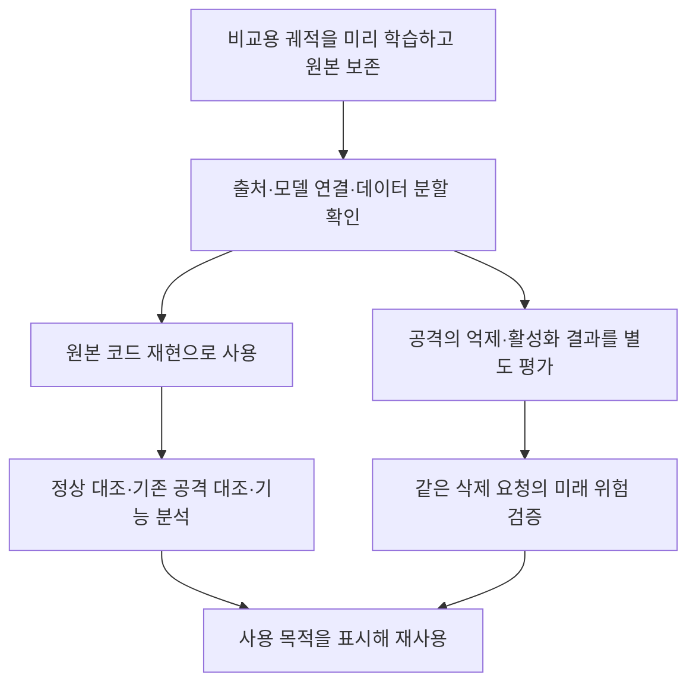
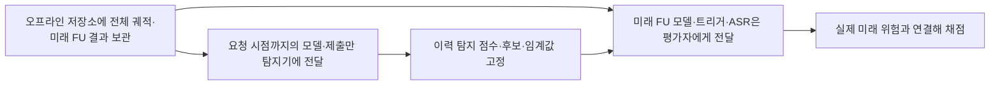

> **이 문서는 2026-10-20 판단의 보존 기록이다.** 현재 승인 여부·중단 상태·이번 전체 라운드 검사는 [2026-10-23 궤적 감사](../00_trajectories/README.md)를 따른다. 아래의 “현재”를 최신 상태로 해석하지 않는다.

# 미리 학습한 궤적의 재사용 판정

**향후 같은 조건에서 탐지·삭제·정화를 비교하려고 BadFU와 FUBA의 학습 궤적을 미리 저장한 것은 맞는 절차다. 현재 자료를 폐기하거나 전부 다시 학습할 이유는 확인되지 않았다.** 원본 코드대로 얻은 궤적을 보존하는 것과, 그 실행에서 논문의 잠복 공격이 성공했는지는 따로 판정한다.

우리가 잘못 해석한 부분은 원본 재현 궤적의 준비와 잠복 활성화 평가 집합의 준비를 같은 것으로 본 것이다. 앞선 설명에서 높은 삭제 전 ASR을 사전 학습 절차의 문제처럼 들리게 한 것도 바로잡는다. 독성만 넣은 양성 대조의 높은 ASR은 의도한 결과이고, 다른 공격 궤적의 높은 ASR은 그 실행의 억제 성능을 나타내는 관측이다.

## 궤적은 무엇을 저장했고 어디까지 확인했는가

기록기는 매 라운드의 전역 시작 모델, 실제 참여자의 제출 모델, 집계 가중치, 전역 종료 모델과 BN 버퍼를 포함한 전체 상태를 저장한다. 저장 시 모델의 유한성·차원·이전 라운드와의 연결을 검사한다. 미래에 같은 시작점을 불러와 여러 방법을 비교하기 위한 자료다.

이번에는 **10개 저장 구간의 600라운드**에 대해 완료 상태, 연속 라운드 번호, 모든 체크포인트의 존재와 파일 크기를 확인했다. 각 구간의 초기·첫·마지막 파일 총 30개의 해시도 다시 확인했다. 모든 중간 라운드를 새로 해시 검사하거나 재집계한 감사는 아니므로, 실제 소비 시에는 기존 전체 궤적 검증기를 함께 사용한다. 600라운드는 600번의 독립 학습이 아니다. [원본 점검 기록](TRAJECTORY_SOURCE_AUDIT.json)

## 우리가 만든 차이와 원래 코드에 있는 차이

| 항목 | 확인 결과 | 판단 |
|---|---|---|
| 매 라운드 모델을 기록한 것 | 실제 제출과 집계를 보존하는 기록 추가 | 비교를 위해 의도한 절차 |
| BadFU의 독성·위장 참여자 분리와 정상 자료 복제 | 고정한 저자 원본 `badfu.py`에 이미 있음 | 우리가 임의로 만든 구성 오류가 아님 |
| FUBA 공격자·위장자 학습 | 실행한 핵심 `train_method_iba.py`가 고정한 저자 원본과 바이트 단위로 동일 | 우리가 공격을 일반 IBA로 바꿔 실행한 근거 없음 |
| FUBA의 시드 고정·CIFAR 분할 자료형 보정 | 재현 실행기에 추가한 조건 | 명시할 구현 조건이며, 공격·정상에 동일 적용 |
| 높은 ASR을 모두 잠복 성공 사례로 취급 | 삭제 전부터 높은 공격과 잠복 활성화를 혼동 | 우리의 평가 해석을 고쳐야 함 |
| 높은 ASR 때문에 궤적 자체가 쓸모없다고 판단 | 저장 목적과 공격 성립 여부를 혼동 | 원본은 보존하고 용도를 바꿔 표시 |

BadFU 원본 기준은 `0a2117fe...`, FUBA는 `bc233610...`이다. FUBA 공격 학습 함수의 실제 실행본과 원본 SHA-256은 모두 `91e0e47c...`로 일치한다. BadFU 실행본은 기록·경로 처리가 삽입돼 파일 해시는 다르지만, 참여자 분리 문장이 고정 원본에도 있음을 확인했다. [출처 검사](TRAJECTORY_SOURCE_AUDIT.json) · [BadFU 공개 코드](https://github.com/BingguangLu/BadFU) · [FUBA 공개 코드](https://github.com/stcebra/FUBA)

전체 프로그램이 계측 없이 실행됐을 때와 비트 단위로 동일하다는 대조까지 수행한 것은 아니다. 확인한 것은 핵심 공격 함수의 보존, 기록 방식, 분할 일관성, 저장된 모델의 점검 범위다.

FUBA의 `non-IID, α=0.5`는 실행기에 명시한 우리의 비교 조건이다. 공개 파서의 α 기본값은 1.0이고 non-IID도 선택 옵션이므로, 이를 논문 전체 설정과 완전히 같은 실험이라고 부르지는 않는다. 공격·정상 시드 42에 같은 α와 같은 분할을 적용한 비교 조건으로 기록한다.

## 현재 궤적별 사용 판정

| 궤적 | 학습한 의도와 현재 상태 | 앞으로 사용할 곳 | 추가로 필요한 것 |
|---|---|---|---|
| BadFU `clean5` 40R | 정상 non-IID 대조 | 정상 이력·모델 변화 기준 | 같은 삭제 방법의 정상 FU |
| BadFU `bd5` 40R | 독성만 있는 양성 대조, 최종 ASR 100% | 이미 활성화된 공격, 위장 없는 재학습 기준 | 별도 초기화라는 차이 표시 |
| BadFU `cover5` 40R | 같은 참여자에 독성·위장, 최종 ASR 13.96% | 이력 분석과 샘플 삭제 비교의 출발점 | 이 모델에서 위장만 삭제하는 FU |
| BadFU `full6` 40R | 저자 코드의 참여자 분리형, 최종 ASR 81.21% | 공개 코드 재현·이미 활성화된 공격 대조 | 논문식 잠복 양성으로 사용할 때 별도 검증 |
| BadFU `fu_remove5` 20R | 분리형에서 위장 참여자 전체 삭제 | 저자 코드 FU 비교 | 위장+복제 정상 자료를 함께 삭제했다는 범위 표시 |
| BadFU `fu_remove1` 20R | 혼합형에서 정상 client1 삭제 | 공격이 포함된 모델의 정상 요청 대조 | 순수 정상 학습 모델 대조와 구분 |
| FUBA 공격 42, 100R | 저자 공격자·위장자 학습, 최종 ASR 98.18% | 원본 구현 재현·기능 분석·기존 공격 대조 | 같은 분할의 FU와 잠복 성립 여부 검증 |
| FUBA 정상 42·43·44, 각 100R | warmup=100으로 공격 분기가 실행되지 않는 정상 학습 | 정상 non-IID 대조 | 같은 분할·방법의 정상 FU |

**지금 필요한 조치는 원본 궤적을 다시 만드는 일이 아니라, 위 용도를 명시하고 빠진 삭제 결과를 같은 출발점에 연결하는 일이다.** 논문 조건이나 수정 구현을 추가할 때는 원본을 덮어쓰지 않고 별도 변형으로 학습한다. [재사용 판정 목록](TRAJECTORY_CATALOG.json)

| 하려는 비교 | 새로운 FL 학습이 필요한가 |
|---|---|
| 같은 공개 코드 조건에서 이력·모델 기능 검사 | 기존 궤적 재사용 |
| 같은 저장 분할과 같은 pre 모델의 FU 추가 | FL 재학습 없이 FU 결과 추가 |
| 다른 α·시드·독성/위장 배치·위장 생성 방법 비교 | 해당 새 조건의 FL 학습 필요 |
| FUBA의 γ·consistency 항을 바꾼 구현 비교 | 원본을 남기고 수정 조건을 새로 학습 |
| 낮은 사전 ASR에서 활성화되는 공격의 검증 | 그 조건을 충족하는 FL·FU 대응쌍 필요. 현재 고ASR 실행만으로 대체하지 않음 |

따라서 기존 자료를 전부 다시 학습하자는 판단도, 기존 자료만으로 모든 잠복 비교가 끝났다는 판단도 하지 않는다. 무엇을 바꾼 실험인지에 따라 추가 학습 범위가 정해진다.

`cover5`는 마지막 모델에서 억제됐어도 18라운드에 ASR이 51.61%까지 올랐다. 미리 저장한 전체 궤적은 이런 일시적 변화와 마지막 시점만 보는 검사의 차이를 분석하는 데 쓸 수 있다. 서버가 실제 ASR을 볼 수 있다는 뜻은 아니며, 공개 입력에서 계산한 이력 신호가 그 변화를 설명하는지는 별도 실험이다.

## FUBA가 원래 의도한 학습 단계인가

현재 실행은 첫 5라운드 정상 학습 후 공격자 0~3과 위장자 4가 함께 작동하는 학습이다. 위장자는 해당 단계 이후 34개 라운드에 참여했다. 공개 코드의 기본 분기에서 공격자 학습과 위장자 학습이 나뉜다. 따라서 높은 삭제 전 ASR을 ‘지금은 독성만 학습하고 위장은 나중에 학습할 예정이라서’라고 설명할 수 없다.

논문의 공격 설계는 FL 중 위장자가 억제하고, 이후 위장자의 삭제로 드러나는 구조다. 현재 최종 ASR 98.18%는 이 실행에서 충분한 억제가 관측되지 않았다는 결과다. 원본 재현 궤적으로는 보존하고, 낮은 사전 ASR에서의 활성화 비교에 쓰려면 별도 성립 검증이 필요하다. [공식 저장소의 공격 설명](https://github.com/stcebra/FUBA)

선택·제출 γ의 불일치와 0 consistency 항은 실행 원본에도 있다. 우리가 계측하면서 넣은 변화가 아니다. 다만 저자가 0 계수를 의도한 변형인지, 어떤 공개 버전이 논문 표를 생성했는지까지 코드만으로 확정할 수는 없다. 수정 효과를 측정하려면 원본과 수정본을 분리한 대조가 필요하다. [수치·코드 재검증](badfu/PRE_ASR_REAUDIT.md)

## 향후 FU를 연결할 때 고쳐야 할 구체적인 부분

FUBA 저장 분할은 네 MPI 작업자 사이에 모두 일치했고, 공격 42와 정상 42도 동일한 50,000장 분할을 썼다. 이 부분은 정상적으로 준비됐다.

하지만 공개 `unlearn_method/federaser.py`와 `retrain.py`는 저장된 Dirichlet 분할을 읽지 않고 `seed=522`로 균등 크기 분할을 새로 만든다. 현재 궤적을 그 함수에 그대로 연결하면 다음 문제가 생긴다.

| client4의 범위 | 표본 수 |
|---|---:|
| 실제 FL 때 학습한 client4 | 1,306장 |
| 기본 FU 코드가 새로 만든 client4 | 2,500장 |
| 두 집합의 공통 표본 | **72장** |
| 원래 client4 중 새 삭제 집합에 없는 표본 | **1,234장** |

이 상태에서 ‘같은 참여자의 기여를 지웠다’고 비교하면 잘못이다. **향후 FU 실행기는 저장된 `split_rank*.json`의 인덱스와 참여 이력을 사용해야 한다.** 새 FU가 아직 없는 현재 FL 궤적을 오염된 자료라고 판단할 근거는 아니다. 이 위험을 발견한 시점에 연결 방식을 바로잡으면 FL을 다시 학습할 필요가 없다. [분할 재검사](TRAJECTORY_CATALOG.json)

FUBA는 이 궤적에서 저자 형식의 별도 legacy 모델 파일을 내보내지 않았지만, 실제 전역·참여자 모델은 저장돼 있다. FU에 필요한 입력 형식으로 바꾸면서 미참여자 상태의 의미와 요청 범위를 보존하면 된다. 입력 파일 형식이 없는 것과 모델을 구할 수 없는 것은 다르다.

## 미리 계산한 미래 모델과 탐지기의 관측 범위

미래 모델을 미리 계산해 디스크에 두는 것은 평가 준비다. 실제 FU 전 위험을 예측하는 탐지기가 그 모델·미래 ASR·실제 트리거를 읽으면 정보 누출이다. 실제 FU 결과를 검사하는 방법은 그 시점에 모델이 생성돼 있으므로 접근할 수 있다. 비교를 위해 모델을 만드는 시점과 탐지기에 정보를 허용하는 시점을 구분한다.

서버가 개별 제출을 볼 수 있으면 마지막 제출분을 제외한 모델은 직접 계산할 수 있다. 이것은 실제 전체 기여 삭제 모델이 아니다. BadFU의 같은 참여자 안에 있는 위장만 제외한 모델은 참여자 제출 한 개만으로 정확히 복원할 수 없어, 클라이언트의 삭제 계산이나 실제 FU 결과가 필요하다.

## 이어서 진행할 탐지 정리

[1단계 탐지 방법과 필요한 궤적](../03_detection/STAGE1_METHODS.md)에 이력 예측, 구할 수 있는 비교 모델, 패치·FC·Conv, 정상 non-IID 검증을 연결했다. 기존 궤적을 어떤 실험에 넣을지 이 문서의 판정과 함께 사용한다.
