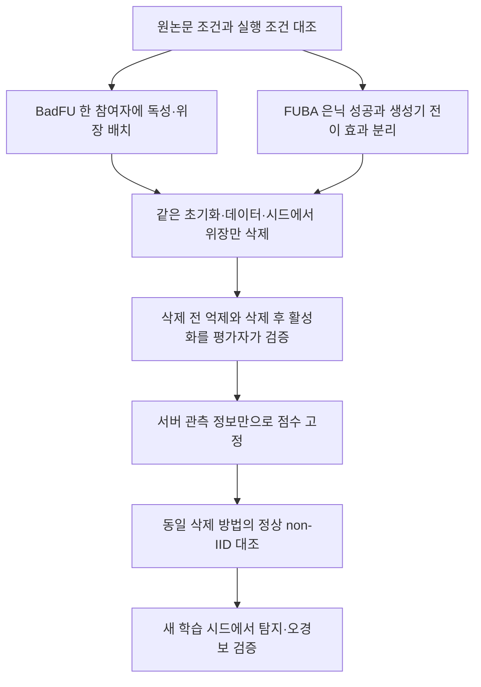

# BadFU와 FUBA의 삭제 전 ASR 원인 재검증

## 현재 우선순위: 탐지보다 BadFU 원논문 재현 검증

**가설: 동일한 실험 조건에서 학습한 5인 BadFU는 논문처럼 삭제 전 ASR을 억제하고 위장 삭제 후 ASR을 높인다.**

2026년 10월 20일 새 실행의 **31/40라운드 고정 체크포인트**를 다시 추론했다. 아래는 정상 시험 10,000장·공격 시험 9,000장 전체 평가이며, 기존 시드42의 최종 결과와 섞지 않는다.

| 조건 | 삭제 전 ASR | 정상 정확도 | 비교 판정 |
|---|---:|---:|---|
| 논문 Table I, 5인·Dominant·ResNet18·BadNet | 21.55% | 84.84% | 3회 평균의 최종 기준값 |
| 현재 5인 혼합형, 31라운드 | **16.43%** | **85.02%** | 사전 억제와 양립하는 관측; 재현 일치 판정은 보류 |
| 현재 6인 분리형, 31라운드 | **73.93%** | **84.52%** | 높은 사전 ASR은 확인됐지만 논문과 참여자 구성·자료 노출·삭제 단위가 다름 |

[원논문 Table I](https://arxiv.org/html/2508.15541v1#S7.T1) · [고정 모델 전체 재평가](../../stage1_fresh_20261020/paper_full_test_round_0031.json) · [가설별 판정](../../stage1_fresh_20261020/paper_first_validation.json).

- **삭제 전 ASR이 0이 아니라는 이유로 비정상이라 판단하지 않는다.** 현재 5인 값은 논문 21.55%보다 낮다. 현재 1회·중간 모델과 논문 3회 평균·최종 결과의 통계적 동등성은 아직 검증할 수 없다.
- 전체 시험 재평가에서도 5인과 6인 ASR 차이가 **57.50pp**였다. 현재 31라운드 모델에서는 평가 분모 선택이 이 차이를 설명하지 못한다.
- 현재 5인은 31라운드까지 ASR 최고 **24.48%**, 6인은 **79.30%**다. 논문의 대응 라운드별 ASR 곡선이 제시되지 않아, 우리 학습 중 변동을 ‘논문에서는 발생하지 않는 현상’이라고 단정할 수 없다. 아래의 기존 시드42에서 관측된 51.61%와 현재 실행도 구분한다.

**가설: 현재 사용한 PGD 위장 자료는 논문 식 (6)의 모델 비의존 위장 자료와 동일하다.**

- 판정: **현재 자료에서는 기각**. 원본 독성 이미지에서 추출한 동일 3×3 트리거를 정상 원본에 적용한 이미지와, PGD 전 원본 위장 이미지가 850장 모두 일치했다. 라벨도 원래 라벨과 일치했다.
- 현재 실제 사용한 PGD 위장은 그 원본 위장과 **850장 모두 다르고, 최대 픽셀 차이는 2/255**였다. 독성·PGD 파일 해시와 인덱스는 현재 실행 manifest와 일치했다. 따라서 잘못된 실험의 파일을 비교한 것이 아니다.
- 이는 **생성 절차 차이의 검증**이다. ASR 차이 중 얼마가 PGD 때문인지는 아직 분리하지 못했다. 학습 배치도 논문32와 현재64로 다르므로 두 효과를 함께 원인으로 확정하지 않는다.
- [원논문 V-C](https://arxiv.org/html/2508.15541v1#S5.SS3) · [실제 입력 바이트와 라벨 검사](../../stage1_fresh_20261020/paper_input_alignment.json).

**가설: 논문식 위장·배치32·5인 구성을 맞추면 현재 설정 차이를 줄인 재현 기준을 얻을 수 있다.**

- 현재 FL과 결과는 보존한다. 종료 후 전체 시험 사전 평가 → 현재 공격 유지 자료 재학습 → 정상 유지 자료 재학습 → 논문 조건에 맞춘 새 기준 실행 순서로 연결했다. 전후 탐지 진단은 기본 실행에서 보류하고 재현 검토 후 별도 실행한다.
- 새 기준은 같은 초기화에서 `독성+단순 위장`, `위장만 제외한 재학습`, `정상 학습`, `위장은 남기고 정상850장만 삭제한 재학습`을 각각 40라운드 수행한다. 각 가설과 원문·공개 코드로 결정한 조건을 프로토콜에 기록한다.
- 정상 삭제는 client1의 고정 무작위 850개다. 원문 Table V는 이 정확한 요청 크기를 명시하지 않으므로 동일 표의 완전 재현으로 표시하지 않는다. 먼저 1개 시드이며, 논문의 3회 평균과 같다고 선언하지 않는다. 정확한 통신 라운드·시드·일부 데이터 자산 선택 등 확인되지 않은 조건도 남긴다.
- DISLAB에서 위장850개 해시·원래 라벨·삭제850개·초기 모델·배치32 데이터 준비 검사를 통과했다. 새 기준은 아직 학습 완료 결과가 아니다.

아래부터는 먼저 수행했던 **보존 시드42 실행**에 대한 분석이다.

2026년 10월 20일. 새로 실행한 검증은 BadFU 보존 모델 6개의 전체 시험 재평가, 원본 설정과 데이터 해시 대조, 같은 시작 모델에서 위장 배치를 바꾼 한 라운드 학습, FUBA 생성기의 정상 모델 전이 대조다.

**앞서 보존된 공격 모델을 한데 묶어 “삭제 전 ASR이 높다”고 설명한 것은 부정확했다. BadFU의 한 참여자 혼합형은 약 14%, 두 참여자 분리형은 약 81%다.** 분리형도 저자 코드의 원본 재현 자료로 보존·재사용할 수 있다. 이를 원논문의 잠복 공격이 성립한 자료와 동일하게 해석하면 안 된다는 것이 핵심이다. 새 대조에서도 위장의 위치만 옮기자 ASR이 35 percentage points 낮아졌다. FUBA에는 생성기가 정상 학습 모델까지 공격하는 평가상의 구분 문제도 있다.

향후 비교를 위해 궤적을 미리 학습·저장한 절차 자체의 판정은 [궤적 재사용 검토](../TRAJECTORY_DECISION.md)에 정리했다. 이 문서의 ASR 차이가 사전 학습 전체를 잘못 수행했다는 뜻은 아니다.

## 원논문이 말하는 삭제 전 ASR

원논문은 삭제 전 ASR을 반드시 0%로 요구하지 않는다. CIFAR-10·ResNet-18·BadNet의 Dominant 조건은 21.55%에서 FedEraser 후 90.76%, 재학습 후 99.32%다. Dirichlet 조건은 5.65%에서 각각 90.20%, 98.15%다. 위장 수를 늘리면 삭제 전 ASR이 낮아지는 민감도 실험도 있다. 따라서 ‘0%가 아니다’와 ‘위장이 작동하지 않았다’를 구분해야 한다. [원논문 Table I·III, VII F](https://arxiv.org/html/2508.15541v1)

이 연구에서 사용했던 `삭제 전 ASR ≤10%`는 강한 잠복을 평가하기 위한 자체 기준이다. 논문의 Dominant 대표값 21.55%까지 실패로 분류하는 기준이므로, 원논문의 정의처럼 사용하면 안 된다. 앞으로 강한 잠복과 부분 억제 조건을 별도 표시하고, 기준을 넘긴 실행도 공격 구성 실패율에 포함한다.

## 실제로 사용한 설정과 α

| 항목 | 보존 BadFU 실행 | 보존 FUBA 실행 |
|---|---|---|
| 데이터와 분할 | CIFAR-10, Dominant 70% | CIFAR-10, Dirichlet |
| Dirichlet α | **해당 없음** | **0.5** |
| 참여자 수 | 혼합형 5명, 삭제 실험 분리형 6명 | 20명 중 매 라운드 8명 |
| 학습 라운드 | 40회, 공개 코드 설정 | 100회 |
| 학습 시드 | 42 | 공격 42, 정상 42·43·44 |
| 독성·위장 수 | 각 850장, 비율 1:1 | 공격 역할 0~3, 위장 역할 4 |
| 독성 비율 | 원본 50,000장의 1.7% | IBA 입력 생성기 방식 |
| 로컬 학습 | SGD 0.01, 5 epoch, **batch 64** | 공개 IBA 학습 경로 |
| 평가 batch | 32 | 32 |
| 목표 클래스 | 0 | 8 |
| 입력 교란 | 위장 생성 ε=2/255 | 생성기 출력의 L∞ 제한 0.04 |

논문의 Dirichlet α는 MNIST 0.3, CIFAR-10 0.5다. Dominant의 0.7은 α가 아니라 지배 클래스 배정 비율이다. 논문 batch는 32인데 공개 BadFU 코드의 실제 학습 loader는 64를 사용한다. [원논문 VI E](https://arxiv.org/html/2508.15541v1#S6.SS5)

데이터 생성기의 **PGD α는 별개**다. 실제 학습 PC에 남은 생성 기록에서 α=0.25, ε=2, PGD 40 step, 사전 미세학습 1 epoch, 위장 최적화 1 epoch를 확인했다. 코드는 α와 ε를 255로 나누므로 실제 스텝은 **0.25/255 ≈0.0009804**, 제한은 **2/255 ≈0.0078431**이다. 위장 생성 모델은 기본 `convnext_tiny`다. 이 설정을 non-IID α=0.5와 혼동하면 안 된다.

[전체 설정과 클래스별 분포](../../stage1_20261020/configuration_audit.json) · [학습 PC의 생성 기록](../../stage1_20261020/assets/remote_generation_metadata.json) · [PGD 환산 코드](../../../upstream/data_prepare/uba/uba_inf_cover.py) · [실제 실행 코드](../../stage1_20261020/assets/badfu_runtime.py)

## 높은 ASR은 어느 코드 갈래에서 생겼는가

| 갈래 | 데이터 배치 | 원본 전체 시험 ASR |
|---|---|---:|
| 정상 5명 `clean5` | 정상 데이터만 | 1.39% |
| 독성만 5명 `bd5` | client0에 독성 추가 | 100.00% |
| 혼합형 5명 `cover5` | client0에 독성+위장 추가 | **13.96%** |
| 분리형 6명 `full6` | client0에 독성, client5에 위장+client0 정상 데이터 복제 | **81.21%** |
| 분리형에서 client5 삭제 | 위장 850장과 복제 정상 9,695장의 기여를 함께 삭제 | 99.54% |
| 혼합형에서 정상 client1 삭제 | 위장 데이터는 남음 | 12.06% |

원본 지표는 정상 시험 10,000장과 타깃 클래스 제외 공격 시험 9,000장에서 계산됐다. 이번에도 같은 전체 자료로 다시 추론했고, ASR 차이는 최대 0.0112pp, 정상 정확도 차이는 최대 0.02pp였다. GPU·Torch 버전 차이로 경계 입력 몇 장의 판정이 달랐으며, 81%라는 현상은 그대로 재현됐다. 400장 표본 선택 때문에 높아진 결과가 아니다. [전체 재평가](../../stage1_20261020/badfu_full_evaluation_audit.json)

논문은 한 참여자의 위장 샘플만 삭제한다. 공개 코드의 분리형은 위장을 별도 참여자로 만들고 정상 9,695장을 중복 사용한다. 전체 학습 표본 노출 수가 50,000에서 **59,695**로 늘고, 삭제 단위도 위장 850장 대신 해당 참여자의 **10,545장**이 된다. 같은 위장:독성 비율 1:1이어도 로컬 최적화와 집계 경로가 달라진다.

혼합형과 독성만 갈래는 위장 삭제 전·후 재학습에 대응하는 데이터 구성을 갖는다. 다만 별도 초기화로 학습됐으므로 `cover5 → bd5`는 **위장 없는 재학습 기준쌍**으로 표시한다. 동일 초기화와 동일 요청에서 새로 수행한 삭제 실험으로 표시하지 않는다. 기존 `cover5 → fu_remove1`은 정상 참여자 삭제이며 위장 삭제의 양성 사례가 아니다.

혼합형도 학습 내내 낮은 ASR을 유지한 것은 아니다. 18라운드에는 **51.61%**까지 올라갔다가 최종 13.96%가 됐다. 최종 모델 한 개의 억제 여부와 학습 전 과정의 은닉 여부도 나눠 평가해야 한다.

## 같은 시작 모델에서 위장 위치를 바꾼 대조

기존 두 갈래는 초기화와 학습 이력까지 달라, 차이 전부를 데이터 배치 탓으로 돌릴 수 없었다. 이를 보완하기 위해 다음 대조를 새로 실행했다.

- 분리형의 39라운드 종료 모델을 모든 조건의 공통 시작점으로 사용했다.
- 실제 사용된 동일 독성 850장·위장 850장과 정상 데이터를 사용했다.
- 정상 참여자 1~4의 제출 갱신을 고정했다.
- 변경한 로컬 학습은 모두 SGD 0.01, batch 64, 5 epoch, 동일 시드로 실행했다.
- 같은 공개 평가 입력 400장, 공격 성공률 분모 360장을 사용했다.

| 조건 | 변경 내용 | ASR | 정상 정확도 |
|---|---|---:|---:|
| 분리 6명 | client0 독성, client5 위장+복제 정상 | **80.28%** | 88.50% |
| 합침 6명 | 위장만 client0으로 이동, client5의 정상 복제 유지 | **45.28%** | 87.75% |
| 합침 5명 | 위장을 합친 뒤 정상 복제 참여자 제거 | **33.06%** | 87.75% |

첫 두 조건은 참여자 수와 전체 표본이 같고 위장의 위치만 다르다. 이 변경으로 ASR이 **35.00pp** 내려갔다. 세 번째 조건에서 정상 복제까지 제거하면 첫 조건보다 **47.22pp** 내려갔다. 따라서 데이터 배치가 높은 ASR에 실질적인 영향을 주는 원인임은 이 시작점에서 확인했다.

이 대조는 이미 39라운드 학습한 모델에서 수행한 한 라운드 개입이다. 새 초기화에서 40라운드 전체를 반복했을 때의 효과나 여러 시드의 평균 효과까지 확정하지 않는다. 원논문의 단일 참여자 조건을 재현할 때는 초기 모델부터 데이터 배치를 맞춰야 한다. [결과와 조건](../../stage1_20261020/badfu_arrangement_intervention.json)

## 코드 오류와 설정 차이를 구별한 판정

| 확인 사항 | 삭제 전 높은 ASR과의 관계 | 판정 |
|---|---|---|
| 독성·위장을 두 참여자로 분리 | 같은 시작점 대조에서 위장 위치 이동만으로 35pp 변화 | **확인된 구성 차이이며 영향도 관측** |
| 정상 데이터 중복 및 위장 참여자 전체 삭제 | 데이터 노출 수·가중치·삭제 단위 변경 | **원논문 조건과 불일치** |
| 논문 batch32, 실행 loader64 | 로컬 학습 경로 변경 | 설정 차이는 확인, ASR에 미친 독립 효과는 미측정 |
| 논문은 트리거+원래 라벨, 준비 코드는 UBA-Inf 교란 추가 | 위장 생성 절차 변경 | 입력 생성 조건 차이는 확인, 독립 효과는 미측정 |
| FU를 첫 FL 라운드 모델에서 시작하고 과거 인덱스로 보정 | 삭제 후 모델에 영향 가능 | **삭제 전 81%의 원인은 아님** |
| 평가 분모·데이터·모델 매칭 | 전체 재평가로 높은 값 재현 | 큰 ASR 차이를 설명하는 평가 오류는 발견하지 못함 |

`pretrained=False`인 로컬 모델 생성자도 곧바로 전역 모델의 전체 상태를 읽는다. 이것만 보고 사전학습 가중치가 빠졌다고 판단하지 않는다. 전역 생성자는 ImageNet 사전학습을 사용하고 입력 합성곱·분류층을 교체한다.

## 위장 이미지의 출처 정합성

독성 및 공격 시험 이미지는 학습 때 기록된 해시와 일치했다. 반면 로컬 위장 이미지 **850장 모두**가 학습 PC의 위장 이미지와 달랐다. 이미지별 최대 픽셀 차이는 2였다. 같은 생성 설정과 시드가 파일까지 동일함을 보장하지는 않았다.

이번 대조에는 학습 PC에서 원본 해시와 일치하는 위장 850장을 새로 가져와 사용했다. 두 기존 학습 갈래는 학습 PC의 같은 위장 자료를 사용했으므로, **이 로컬 파일 차이가 기존 두 갈래의 ASR 차이를 만들었다고 보지는 않는다.** 새 대조에서 잘못된 자료를 사용하지 않도록 바로잡은 정합성 문제다. [해시 대조 결과](../../stage1_20261020/cover_image_provenance_audit.json)

## FUBA에서 별도로 확인한 문제

FUBA의 보존 원본 전체 시험 기록은 100라운드에서 ASR **98.18%**, 정상 정확도 73.62%다. ASR은 이미 11라운드에 50%, 26라운드에 90%를 넘었다. 논문의 은닉·활성화 취지를 검증하는 실행으로 곧바로 채택하기 어렵다.

학습된 마지막 개별 생성기 client4를 고정해 공격 모델과 정상 학습 모델에 똑같이 적용했다. 평가 입력 400장 중 타깃 클래스 제외 360장을 사용했다.

| 모델 | 학습된 생성기 eval | 학습된 생성기 train | 무작위 교란 ε=0.04 |
|---|---:|---:|---:|
| 공격 학습 42 | 99.44% | 99.44% | 0.83% |
| 정상 학습 42 | 96.11% | 96.39% | 1.39% |
| 정상 학습 43 | 73.06% | 70.83% | 0.56% |
| 정상 학습 44 | 85.00% | 83.61% | 0.56% |

정상 실행은 warmup=100, 총 100라운드여서 공격 분기를 실행하지 않는다. 그 정상 모델에도 학습된 생성기는 높은 성공률을 보였다. **이 평가에서는 입력 교란의 전이 공격성과 모델에 주입된 백도어 효과를 분리해야 한다.** 생성기의 train/eval 모드 변경만으로 이 현상은 사라지지 않았다. 무작위 생성기 대조도 낮은 성공률이었다. [생성기 대조](../../stage1_20261020/generator_controls.json)

실제 실행본 코드에는 다음 문제도 있다. 이들은 수정 대조가 필요한 후보이며 현재 높은 ASR의 단독 원인으로 확정하지 않았다.

| 실행 코드 | 확인한 문제 |
|---|---|
| `train_method_iba.py` 133행 | consistency 항이 `0 * l2_loss`로 사라짐 |
| 같은 파일 305~327행 | 탐색 γ는 0.1~1.0인데 제출 때 `선택 인덱스 ×0.1`로 복원해 0.1씩 어긋남 |
| 같은 선택 분기 | ASR≤10 후보가 없으면 인덱스 -1을 그대로 써 γ=-0.1 가능 |

작은 실행 검사에서도 γ=0.2로 평가한 후보를 γ=0.1로 제출하는 불일치와 후보가 없을 때 -0.1을 확인했다. 저장된 실행은 라운드별 선택 γ를 남기지 않아 실제 발생 빈도까지 복구할 수는 없다. Dirichlet **α=0.5**와 이 스케일링 **γ**는 다른 변수다. [실행본 코드와 검사](../../stage1_20261020/fuba_scaling_code_audit.json)

## 1단계 탐지 결과를 어떻게 해석할 것인가

서버가 가진 개별 제출 모델로 마지막 제출분을 제외한 집계 모델을 실제 계산했고, 패치·FC·Conv 변화도 측정했다. 아래 FUBA 표는 정상 42에서 임계값을 정하고 정상 43·44와 공격 42에 적용한 **실행 단위** 결과다.

| 마지막 제출분 제외 비교 | 공격 실행 경보 | 별도 정상 실행 오경보 |
|---|---:|---:|
| 패치 반응 | 1/1 | 1/2 |
| FC 기능 기여 | 1/1 | 2/2 |
| Conv 쪽 특징 기여 | 1/1 | 1/2 |
| FC 가중치 변화량 | 1/1 | 0/2 |

이 결과는 현재 모델에서의 이상 징후 비교다. 원논문의 잠복 공격 탐지를 검증했다고 부르지 않는다. BadFU의 원논문 조건에서는 한 참여자 안에 독성·위장이 섞여 있어, **그 참여자 전체 제출분 제외와 위장 샘플만 삭제는 다른 질문**이다. 서버가 계산할 수 있는 모델이라도 이 차이를 밝혀야 한다. Conv 쪽 특징 기여에는 BN 등 모든 상위 특징 경로가 포함되며 순수 Conv 가중치만의 인과 효과가 아니다.

이력을 전부 버릴 결론도 아니다. 최근 한 라운드의 실제 방송→집계 변화에서 FUBA의 패치·Conv 특징 점수는 공격 1개에 경보, 별도 정상 2개에 무경보였다. 다만 이미 공격 성공률이 높은 실행의 사후 신호이며, **미래 삭제 후 활성화 예측이나 전체 HRAC 검증 결과는 아니다.**

정상 입력의 변화 크기로 패치 점수를 보정한 후속 탐색에서는 정상 44의 경보가 사라졌다. 원점수를 확인한 뒤 고른 개발 결과이므로 새 시드에서 검증할 후보로 남긴다. FC 보정은 정상 두 실행 모두에 경보가 남아 단순 보정만으로 해결되지 않았다. [후속 탐색](../../stage1_20261020/exploratory_normalization.json)

## 다시 시작할 실험의 기준

BadFU는 논문 Dominant 70%와 Dirichlet α=0.5를 별도 조건으로 두고, 독성·위장을 한 참여자에 배치한 뒤 위장만 제거해야 한다. 논문식 트리거+원래 라벨 위장과 공개 코드식 UBA-Inf 위장은 서로 다른 조건으로 기록한다. 학습 loader의 32/64 차이도 고정해야 한다. 위장:독성 비율은 1:1을 출발점으로 하고 0.5·1·1.5·2배는 민감도 실험으로 분리한다.

FUBA는 γ 복원 오류와 0 consistency 항을 각각 한 항목씩 바꾸는 대조가 필요하다. 원본 실행도 보존하고, 모든 실행에서 선택 γ·후보 점수·학습된 생성기·분모·BN 모드를 기록해야 한다. 정상 학습 모델에 대한 동일 생성기의 성공률을 함께 측정해 백도어 학습 효과와 입력 자체의 공격성을 구분한다.

서버가 위장 샘플별 정보를 보지 못하면, 그 샘플만 제외한 모델을 혼자 정확히 만들 수 없다. 가능한 비교는 개별 제출분 제외, 협력 클라이언트가 제공하는 삭제 갱신, 실제 FU의 임시 결과 모델이다. **각 비교가 어떤 삭제 단위를 대표하는지**를 먼저 고정한다. 이력은 사전 위험 경보, 패치·FC·Conv 비교는 조건이 대응하는 모델의 검증으로 발전시킨다.

## 결과 파일

[재검증 기록 모음](../../stage1_20261020/README.md) · [동일 시작점 학습 코드](../../stage1_20261020/audit_badfu_mechanism.py) · [고정된 탐지 프로토콜](../../stage1_20261020/PROTOCOL.json) · [탐지 점수와 평가 결과 CSV](../../stage1_20261020/results.csv)
