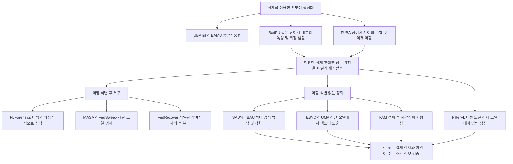

# BadFU와 FUBA 방어 방향을 결정하기 위한 선행 연구

조사 기준일 2026년 10월 20일. 핵심 질문은 **공격자와 위장 역할을 먼저 식별해야 정화할 수 있는가, 역할을 식별하지 않고도 삭제 후 모델을 안전하게 만들 수 있는가**다.

**판정:** 역할을 식별하지 않는 정화를 주 연구 후보로 두되, 그 자체를 신규성으로 주장하지 않는다. 이력 기반 추적, 두 모델 비교, 트리거 역추정, 신원 없는 정화, 정화 후 재활성화 검사는 각각 선행 연구가 있다. 차별점 후보는 **실제 삭제 요청으로 억제가 풀리는 기능을 찾아, 삭제 요구를 유지하면서 정화에 이용하는 것**이다. 이력이나 삭제 전 모델을 추가로 쓰는 이득을 강한 사후 정화법과 같은 예산에서 입증해야 한다.

아래 화살표는 연구 질문의 관계이며 논문 사이의 직접 인용 관계나 성능 순위가 아니다. 문헌의 실험 결과와 우리 가설을 구분한다. 본문을 읽을 수 있었던 논문도 모든 실험을 재현했다는 뜻은 아니다.

## 용어와 서버 관측 조건

| 용어 | 여기서 쓰는 뜻 | 혼동하면 안 되는 것 |
|---|---|---|
| 주입 역할 | 백도어를 학습시키는 기여 | 반드시 별도 클라이언트 한 명이라는 뜻은 아님 |
| 위장 또는 억제 역할 | 같은 공격 반응을 억제하다가 삭제 대상으로 삼는 기여 | 정직한 방어자와 다름 |
| 모델 공격 탐지 | 현재 모델이나 삭제 요청 결과의 공격 위험 판정 | 누가 주입했는지 식별하는 문제와 다름 |
| 역할 식별 | 주입 및 억제 기여의 주체를 추정 | 알려진 실험 역할을 결과에 붙이는 작업과 다름 |
| 정화 | 정상 기능을 유지하며 공격 동작을 줄이는 모델 수정 | 삭제 요구 충족이 자동으로 따라오지 않음 |
| 진단 언러닝 | 서버가 모델 복사본에서 정상 과제를 잊혀 반응을 관찰 | 실제 사용자의 삭제 요청을 수행한 모델과 다름 |
| 입력 변형 탐침 | 정상 입력에 정해진 변형을 적용해 모델 반응을 측정 | 실제 트리거나 역추정 트리거라고 단정하지 않음 |

기본 서버가 볼 수 있는 것은 전역 모델과 실제 FU 결과, 공개 검증 입력, 요청 메타데이터다. 개별 제출과 ID별 이력은 **개별 업데이트를 서버가 받으며 저장한다는 조건**을 추가해야 한다. 보안 집계에서는 자동으로 제공되지 않는다. 정상 정답 라벨도 별도 자원이다. 실제 트리거, ASR, 독성 및 위장 샘플 ID는 평가자 정보로 둔다.

BadFU 원논문의 기본 구조에서는 같은 악성 참여자가 독성 샘플과 위장 샘플을 가진다. 따라서 두 역할을 서로 다른 두 신원으로 고정하면 원문 문제를 바꾸게 된다. FUBA의 공식 설명에서는 Adv-attacker와 Adv-defender의 기여가 분리된다. [BadFU §V](https://arxiv.org/html/2508.15541v1), [FUBA 공식 초록](https://ieeexplore.ieee.org/document/11231135/)

## 가장 가까운 선행 방법 비교

표의 마지막 열은 우리 문제에 대한 분석이다. 해당 논문을 BadFU와 FUBA에 실행해 얻은 실패 결과가 아니다.

| 방법 | 필요한 정보 | 출력과 적용 단계 | 우리와 겹치는 부분 및 남은 질문 |
|---|---|---|---|
| [FLForensics](https://arxiv.org/html/2407.07221) | 잘못 분류된 의심 입력, 참조 입력, 체크포인트와 ID별 업데이트 | 공격 이후 악성 참여자 추적 | 이력과 기능 기여의 조합은 선행됨. 의심 입력이 없는 삭제 전 위험 예측은 별도 문제 |
| [MASA](https://arxiv.org/html/2411.01040v1) | 전역 및 개별 모델, 정상 proxy 자료 | 진단 망각 반응으로 악성 제출 필터링 | non-IID 혼동을 모델 융합으로 완화. 실제 삭제 후 활성화 판정과 다름 |
| [FedSweep](https://link.springer.com/chapter/10.1007/978-981-96-8173-0_11) | 작은 정상 자료, 개별 모델 | 역추정 입력으로 악성 참여자 식별 및 기능 정화 | 추정 트리거를 식별과 정화에 연결하는 구성이 이미 존재 |
| [FedRecover](https://arxiv.org/html/2210.10936) | 탐지된 악성 ID 목록, 과거 모델 및 업데이트, 일부 재계산 | 해당 참여자를 제외한 모델 복구 | 이력 기반 복구는 선행됨. 누가 악성인지 찾는 일은 별도 입력 |
| [FilterFL](https://arxiv.org/html/2308.11333v2) | 이전 및 새 전역 모델, 제출 모델 | 증분 지식에서 입력을 생성해 오염 모델 제외 | 두 모델 차이로 백도어 관련 입력을 얻는 아이디어가 매우 가까움 |
| [SAU](https://arxiv.org/html/2307.10562) | 공격 모델, 소량 정상 라벨 자료 | 원모델과 정화 중 모델의 공유 적대 입력을 이용한 정화 | 역할 및 실제 트리거 없이 정화하는 강한 직접 비교군 |
| [EBYD](https://arxiv.org/html/2410.19427) | 공격 모델, 소량 정상 자료 | 정상 기능의 진단 망각으로 공격 노출 후 탐지 및 제거 | 숨은 기능을 먼저 드러낸 뒤 정화한다는 구조가 선행됨 |
| [PAM](https://arxiv.org/abs/2410.09838) | 백도어 모델과 정화 과정의 모델 및 정화 자료 | 백도어 연결 경로를 고려한 정화 | 낮은 직후 ASR만으로 부족하다는 문제 제기와 대응법까지 선행됨 |

## 공격 문제를 정의하는 문헌

### BadFU

- **원문:** [Backdoor Federated Learning through Adversarial Machine Unlearning](https://arxiv.org/html/2508.15541v1), 2025년 arXiv v1. 검토 위치 §IV–V, §VII-G–H, Tables VI–VII.
- **원리:** 독성 기여와 위장 기여를 함께 학습한 뒤 위장 샘플을 삭제한다. 유지 데이터에 독성이 남으면 정확한 재학습도 공격 모델이 될 수 있다.
- **기존 방어 실험:** Median, Trimean 및 NC를 평가했다. 이 결과를 모든 사후 정화법의 실패로 확대하면 안 된다. NC 표는 FL 종료 모델에 대한 검사다.
- **검증 질문:** 실제 FU 이후 SAU나 EBYD 같은 정화를 적용하면 충분한가. 충분하다면 별도 이력 모듈의 추가 가치는 무엇인가.

### FUBA

- **원문:** [Backdoor Federated Learning via Federated Unlearning](https://ieeexplore.ieee.org/document/11231135/), IEEE TAI, 온라인 공개 2025년 11월 6일, 권호 2026년 5월. [저자 코드](https://github.com/stcebra/FUBA).
- **공식 초록의 원리:** Adv-attacker가 주입하고 Adv-defender가 억제한다. 후자의 기여 삭제로 활성화한다. 두 역할 모두 공격 체계 안의 역할이다.
- **검토 범위:** 이번 조사는 공식 초록과 공개 저장소를 근거로 한다. 전체 표 및 보충자료를 다시 열람하지 못했으므로 옛 노트의 방어 수치와 세부 가정을 새 확인 사실로 옮기지 않는다.
- **검증 질문:** FU 중 기존 독성이 드러나는 효과와 남은 공격자의 새 악성 업데이트 효과를 나누어 방어해야 하는가.

### UBA Inf와 BAMU

- [UBA-Inf USENIX Security 2024](https://www.usenix.org/conference/usenixsecurity24/presentation/huang-zirui): 영향 기반 위장을 삭제해 공격을 활성화하는 중앙집중형 선행이다. 위장 삭제라는 원리 자체가 BadFU에서 처음 생긴 것은 아니다.
- [Backdoor Attacks via Machine Unlearning AAAI 2024](https://ojs.aaai.org/index.php/AAAI/article/view/29321): 학습 데이터의 사전 오염 없이 삭제 집합을 고르는 접근과, 사전 오염 후 삭제로 활성화하는 접근을 제시한다. FL 서버의 관측 조건과 구분해서 읽는다.

## 역할 식별과 이력 기반 복구 문헌

### FLForensics

- **원문:** [Tracing Back the Malicious Clients in Poisoning Attacks to Federated Learning](https://arxiv.org/html/2407.07221), arXiv 최초 2024년, 최신 초록에 NeurIPS 2025 기재. [저자 코드](https://github.com/jyqhahah/FLForensics).
- **원리:** 체크포인트에서 의심 입력의 손실 기울기와 참여자 업데이트의 내적을 누적한다. 같은 클래스의 비공격 참조 입력 점수를 추가해, 해당 클래스를 많이 가진 정상 non-IID 참여자와 공격자를 구분한다. §4.2 식 3–5.
- **우리에게 주는 점:** 패턴 입력에서의 큰 기여만으로 공격이라고 판단하지 말고 정상 참조를 함께 봐야 한다.
- **경계:** 의심 입력을 이미 확보한 뒤의 추적이 출발점이다. 미지 트리거를 찾거나 특정 삭제의 미래 활성화를 예측했다고 자동으로 해석할 수 없다. 정리는 논문이 정의한 공격 및 영향 조건에 따른다.

### MASA

- **원문:** [Identify Backdoored Model in Federated Learning via Individual Unlearning](https://arxiv.org/html/2411.01040v1), arXiv 2024년, WACV 2025. [저자 코드](https://github.com/JiiahaoXU/MASA).
- **원리:** 정상 proxy 자료에서 개별 모델의 손실을 올리는 진단 망각을 수행하고 손실 동역학을 비교한다. non-IID로 생기는 개별 모델 차이는 진단 전 모델 융합으로 줄인다. §4 식 2와 Algorithm 1.
- **정보 조건:** 개별 제출과 주 과제에 충분히 관련된 proxy 자료가 필요하다.
- **경계:** 진단용 모델 변형을 실제 삭제 모델과 혼동하지 않는다. 공격자와 위장 역할의 분리 식별을 입증한 것으로 세지 않는다.

### FedSweep

- **원문:** [Unlearning Backdoors in Federated Learning](https://link.springer.com/chapter/10.1007/978-981-96-8173-0_11), PAKDD 2025. 공식 초록 확인, 유료 본문 미열람.
- **원리:** 작은 정상 자료에서 트리거를 역추정해 모의 독성 입력을 만들고, 개별 모델의 로짓 엔트로피로 악성 후보를 찾는다. 정상 및 모의 독성 자료의 특징과 예측을 교정한다.
- **우리에게 주는 점:** 패턴 후보 → 참여자 식별 → 정화라는 흐름의 직접 선행이다.
- **정정:** 공식 초록은 실제 트리거와 악성 신원을 사전에 안다고 가정하는 방식과 구분한다. 이 논문을 ‘실제 트리거를 알아야만 가능’이라고 설명하면 부정확하다. 역추정이 성공할 조건은 본문 확인이 더 필요하다.

### FedRecover와 업데이트 차감 계열

- [FedRecover](https://arxiv.org/html/2210.10936): 악성으로 탐지된 참여자를 제외한 복구에 과거 전역 모델과 제출을 이용한다. 일부 업데이트를 추정하고 재계산으로 보정한다. §III–IV. 탐지 자체와 복구를 구분해야 한다.
- [Unlearning Backdoor Attacks in Federated Learning](https://www.cse.psu.edu/~sxz16/papers/Federated-Unlearning.pdf): 과거 공격자 업데이트 차감과 지식 증류를 연결한다. 공격자 ID를 얻는 과정까지 자동 해결한다고 읽으면 안 된다.
- **우리 판단:** 역할 식별 방향은 식별 정확도만 보고 끝내기 어렵다. 정확한 ID가 복구에 주는 이득, 오지목 피해, 샘플 삭제가 섞인 BadFU에서의 적용 단위까지 확인해야 한다.

## 모델 비교와 패치 반응에 가까운 문헌

### Neural Cleanse

- **원문 및 구현:** [Neural Cleanse S&P 2019 저자 저장소](https://github.com/bolunwang/backdoor).
- **원리:** 각 출력 클래스로 오분류를 유도하는 입력 패턴과 마스크를 역추정하고, 비정상적으로 작은 패턴을 갖는 클래스를 검사한다.
- **경계:** 우리가 미리 정한 사각형을 붙여 반응을 재는 것은 트리거 역추정과 다르다. NC의 특정 BadFU 실험 실패가 모든 변형 탐침의 무효를 뜻하지 않는다.

### FilterFL

- **원문:** [Knowledge Filtering-based Data-Free Backdoor Defense for Federated Learning](https://arxiv.org/html/2308.11333v2), v1 2023년, v2 2025년. v1 제목은 Protect Federated Learning Against Backdoor Attacks via Data-Free Trigger Generation이다.
- **원리:** 이전과 새 전역 모델에서 배운 지식 차이를 합성 입력으로 추출하고, 분류에 미치는 효과로 트리거 관련 지식을 거른다. 그 입력에 민감한 제출 모델을 제외한다. §3.3–3.6.
- **우리에게 주는 점:** 구할 수 있는 두 전역 모델에서 의심 입력을 찾는 구성의 직접 선행이다.
- **경계:** FL 라운드의 새 지식과 실제 사용자 삭제로 풀리는 억제는 다른 인과 비교다. 이 차이가 탐지·정화를 실제로 개선하는지 확인해야 차별점이 된다.

### UMA와 EBYD

- [UMA AAAI 2024](https://ojs.aaai.org/index.php/AAAI/article/view/30183): 대상 클래스의 일반 특징을 진단적으로 제거한 뒤 동적 트리거 최적화로 백도어 스캔을 돕는다. 모델을 일부 잊혀 숨은 기능을 드러내는 탐지 선행이다.
- [EBYD arXiv 2024](https://arxiv.org/html/2410.19427): 소량 정상 자료에서 정상 기능을 잊히는 Clean Unlearning으로 백도어를 노출하고 탐지 및 제거에 연결한다. §IV-A, §V–VI. ICML 2023 선행의 확장임을 원문이 명시한다. [저자 코드](https://github.com/bboylyg/Expose-Before-You-Defend).
- **경계:** 이들 진단 모델은 사용자의 데이터 삭제가 완료된 실제 FU 모델이 아니다. ‘언러닝 전후’라는 말만으로 같은 실험으로 묶지 않는다.

### 우리 패치 점수의 정확한 위치

입력의 작은 영역을 바꾸는 변환은 다음과 같이 쓸 수 있다.

\[
T_\tau(x)=(1-m_\tau)\odot x+m_\tau\odot v_\tau.
\]

\(m_\tau\)는 위치와 크기를 정하는 마스크, \(v_\tau\)는 그 안에 넣는 패턴이다. 사전 지정한 \(\tau\)는 **입력 변형 탐침**이다. 최적화로 공격 동작을 복원한 경우에만 **트리거 역추정**이라고 부른다. 전체 영상 교란과 입력 의존 변환은 사각형 패치와 별도 탐색군으로 둔다.

우리의 모델 전후 비교 후보는

\[
B(f,\tau,k)=\mathbb E_{x\in Q}[p_{f,k}(T_\tau x)-p_{f,k}(x)],\qquad
D(\tau,k)=B(f_{post},\tau,k)-B(f_{pre},\tau,k)
\]

다. 이는 **입력 변형 반응의 모델 간 차이**다. 모델 하나에서 원본과 변형 입력만 비교하면 \(B\)이고 실제 FU 전후 차이는 아니다. \(D\)도 정상 non-IID와 자동으로 구별되는 통계는 아니다. 정상 삭제에서도 변형에 대한 민감도가 달라질 수 있다. 정규화와 정상 대조는 이 문제를 경험적으로 검사하는 설계다. [기존 정확한 정의와 코드 검토](../../../03_detection/PATCH_PROBING_SPEC.md), [입력 축과 모델 축](../../../03_detection/PATCH_VALIDITY.md).

## 역할 식별 없는 정화 문헌

### SAU

- **원문:** [Shared Adversarial Unlearning NeurIPS 2023](https://arxiv.org/html/2307.10562), §3.1–3.3, Propositions 1–3. [공식 학회 페이지](https://proceedings.neurips.cc/paper_files/paper/2023/hash/520425a5a4c2fb7f7fc345078b188201-Abstract-Conference.html).
- **원리:** 원래 공격 모델과 정화 중 모델이 같은 오답을 내는 공유 적대 입력을 찾고 그 반응을 교정한다. 소량 정상 라벨 자료를 쓰며 실제 트리거와 타깃을 알지 않는 설정이다.
- **이론:** 실제 트리거 변형이 허용 교란 집합에 포함된다는 조건 아래 백도어 위험의 상계를 구성한다. 최적화에서 사용하는 완화와 유한 탐색이 그 상계를 자동 인증하는 것은 아니다.
- **우리에게 주는 점:** 두 모델을 쓰는 정화와 트리거 없는 정화는 이미 선행됐다. SAU의 두 모델은 실제 FU 전후 쌍이 아니다.
- **우선 비교:** 동일한 FU 결과에서 SAU 단독과 이력 또는 실제 전후 정보가 추가된 정화를 비교한다.

### I BAU와 Fine Pruning

- [I-BAU ICLR 2022](https://arxiv.org/abs/2110.03735): 소량 정상 자료에서 적대 교란을 찾고 이를 언러닝하는 minimax 정화다. 고정 패치 교정만 제안한다면 반드시 넘어야 할 선행이다.
- [Fine-Pruning 2018](https://arxiv.org/abs/1805.12185): 가지치기와 미세조정을 결합한다. FC·Conv 변화가 큰 부분을 지우는 우리식 구현을 곧바로 이 논문의 재현으로 부르면 안 된다.
- **우선 비교:** 정상 자료 미세조정, 무작위 변형 증강, 원문 정화법을 같은 자료와 계산 예산에서 비교한다.

### TSBD와 OTBR

- [TSBD NeurIPS 2024](https://arxiv.org/abs/2405.20291): 정상 언러닝 중 뉴런 가중치 변화로 백도어 관련 후보를 고르고 재초기화 및 기울기 규제를 이용한 미세조정을 수행한다. FC·Conv의 변화에서 정화 위치를 찾는 발상과 가깝다.
- [OTBR AAAI 2025](https://ojs.aaai.org/index.php/AAAI/article/view/34828): 무작위 입력의 언러닝에 따른 가중치 변화로 가지치기한 모델을 만들고 최적수송 기반 모델 융합으로 효용을 회복한다. [저자 코드](https://github.com/linweiii/OTBR).
- **우리에게 주는 점:** 공격자 ID와 실제 독성 샘플 없이 내부 변화에 따라 정화하는 방법도 이미 있다. 정상 자료 접근을 완화하는 경우 OTBR을 추가 비교한다.

## 정화 후 재활성화와 FU 자체의 공격 문헌

### 정화 후 재활성화와 PAM

- [Breaking the False Sense of Security NeurIPS 2024](https://proceedings.neurips.cc/paper_files/paper/2024/hash/d06537b4b38ccf008a54559d2c56fa23-Abstract-Conference.html): 정화로 낮아진 ASR에도 잔존 백도어가 있고, 입력의 작은 변경으로 다시 활성화될 수 있음을 평가한다.
- [Superficial Safety와 PAM NeurIPS 2024](https://arxiv.org/abs/2410.09838): 정화 뒤 재학습 및 질의 기반 재활성화를 분석하고 Path-Aware Minimization으로 저항성을 높인다.
- **우리에게 주는 점:** ‘정화 직후 ASR만으로는 부족하다’는 주장은 선행됐다. 우리의 추가 검증은 **이후의 실제 합법적 삭제 요청으로 다시 활성화되는가**를 포함한다. 이것이 기존 평가와 다른 현상을 보여주는지는 아직 가설이다.
- **공정 비교:** 잔존 트리거 재탐색, 새로운 독성 재주입, 정상 자료 학습, 추가 합법적 삭제를 다른 스트레스 조건으로 기록한다.

### UnlearnGuard와 Malicious Forgetting

- [UnlearnGuard WWW 2025](https://arxiv.org/html/2501.17396v1): 이력으로 FU 중 업데이트를 추정하고 거리나 방향 검사를 통해 조작을 다룬다. Theorem 1은 강볼록·매끄러운 손실, 추정 오차 제한, FL 중 모든 악성 참여자의 효과적 탐지 등의 조건을 명시한다. 일반 신경망에서 잠복 백도어 제거를 무조건 보장하는 정리가 아니다.
- [Malicious Forgetting INFOCOM 2026 저자 페이지](https://wenwei-zhao.github.io/publication/conference-paper/3/): 준비한 백도어 서브네트워크를 능동 FU 중 융합하는 공격과 방향 부분공간 편차를 이용하는 탐지를 설명한다. 이번에는 공식 저자 초록까지만 재확인했다. 기존 노트의 SubID 수식·하이퍼파라미터·결과표는 본문 재대조 전 확정 인용하지 않는다.
- **경계:** FU 중 새로 조작한 제출을 검사하는 것과, 조작 없이 삭제만으로 드러나는 기존 위험을 다루는 것은 다르다. 반대로 새 악성 갱신이 계속 들어오는 환경까지 사후 정화 한 번으로 해결했다고 주장해서도 안 된다.

### non IID를 위한 다른 정상성 기준

[FedREDefense ICML 2024](https://proceedings.mlr.press/v235/xie24c.html)는 개별 업데이트가 실제 학습으로 재구성될 수 있는지 검사한다. non-IID에서 집단 평균과의 거리 대신 다른 정상성 기준을 세운 선행이다. 데이터 오염에 의한 학습도 실제 SGD일 수 있으므로, 재구성 가능성만으로 데이터의 악의가 없다고 결론내릴 수는 없다. 이는 우리 해석이며 BadFU 실측 실패 결과가 아니다.

## 최신 문헌의 추가 확인 목록

| 문헌 | 이번에 확인한 범위 | 신규성 판단에 반영할 점 |
|---|---|---|
| [FedPurify KDD 2026 공식 목록](https://kdd2026.kdd.org/papers/), [저자 대학 페이지](https://faculty.nuaa.edu.cn/cb4/en/lwcg/58179/content/40414.htm) | 제목과 발표 존재 확인. ACM 본문 접근 실패 | FL의 data-free 사후 정화와 겹칠 수 있어 본문 확보 우선순위가 높음. 구체적 기법·역할 조건·BadFU 평가 여부는 여기서 확정하지 않음 |
| [Double-Blind Cleanser DOI](https://doi.org/10.1109/TIFS.2026.3705336) | 검색 색인에서 발견. 이번 도구에서 IEEE 원문 확인 실패 | 후속 원문 확인 후보. 제목만으로 ‘자료가 전혀 필요 없다’거나 BadFU 방어가 된다고 추론하지 않음 |
| [Mitigating spurious forgetting](https://www.sciencedirect.com/science/article/pii/S092523122602758X) | 출판사 검색 결과에서 발견. 본문 열람 실패 | 클라이언트 망각 후 백도어 복원 문제와 직접 겹칠 수 있어 추가 확인 필요 |

이 항목들이 남아 있으므로 ‘이 문제를 다룬 논문은 없다’는 문헌 부재 주장은 보류한다. 특히 역할 식별 없는 FL 정화 자체의 최초성은 주장하지 않는다.

## 두 연구 방향의 선택

| 판단 기준 | 역할 식별 후 정화 | 역할 식별 없는 정화 |
|---|---|---|
| 가까운 선행 | FLForensics, MASA, FedSweep, FedRecover | SAU, EBYD, I-BAU, PAM, OTBR 및 최신 FedPurify 확인 필요 |
| 반드시 필요한 증거 | 주입 및 억제 역할 식별, 정상 non-IID 오지목, 식별 정보가 주는 정화 이득 | 기존 강한 정화보다 같은 효용·예산에서 위험을 더 줄이는지 |
| BadFU 기본 구조의 부담 | 같은 참여자 내부 샘플 역할은 ID 하나로 분리할 수 없음 | 두 역할의 신원을 분리하지 않아도 비교 가능 |
| FUBA에서의 부담 | 억제자만 제거하면 공격을 도울 수 있음 | 남은 공격자의 재주입은 별도 통제가 필요 |
| 연구 권고 | 보조 분석 및 정확한 역할을 준 상한 실험 | 주 연구 후보. 실제 삭제 정보의 추가 가치로 범위를 좁힘 |

전역 집계만 관측하면 역할 식별에 추가적인 식별 불가능성도 생긴다. 예를 들어 집계가 \(a\Delta_1+b\Delta_2\)일 때, 개별 제출을 보지 못하면 \(\Delta_1+v/a,\Delta_2-v/b\)도 같은 집계를 만든다. 따라서 같은 집계 모델과 그에 대한 입력 응답만으로 이 분해를 유일하게 복원할 수 없다. 이는 **집계만 보이는 경우의 대수적 예시**이며, 개별 제출을 관측하는 모든 식별법의 불가능성 정리는 아니다.

**삭제와 안전성의 기준도 분리한다.** 유지 집합에 독성이 남아 일반 재학습 모델의 ASR이 높다면, 그 재학습 분포와 매우 가까워야 하는 정확 망각과 아주 낮은 ASR을 동시에 요구할 수 없다. 고정 시험 분포에서 모델 분포 간 TV 거리가 \(\epsilon\) 이하이면 기대 ASR 차이도 \(\epsilon\) 이하라는 기본 부등식으로 확인된다. 안전한 학습 기준을 새로 정의할지, 삭제 후 추가 안전 처리를 별도로 둘지 명시해야 한다. [기존 조건부 명제와 증명](../../../04_theory/README.md).

## 선행 연구를 반증 기준으로 삼는 실험 카드

### 이력의 추가 가치

**가설 H1: 전체 이력은 최근 모델 쌍만 사용하는 방법보다 같은 정상 오경보율에서 삭제 후 공격 활성화를 더 잘 예측한다.**

- 조건: FU 전에 점수를 고정하고 실제 ASR·트리거·역할을 입력에서 제외한다. 개별 제출을 쓰면 그 저장 조건을 밝힌다.
- 비교: 마지막 모델, 인접 라운드, 이력 전체, 이력을 섞거나 제거한 대조. FilterFL의 비교 모델 출처와 FLForensics의 입력 확보 조건을 함께 대조한다.
- 결과: 미검증. 독립 정상 및 공격 학습 시드에서 평가하고 요청 수를 시드 수로 세지 않는다.
- 반증: 최근 모델 쌍을 넘는 이득이 없으면 전체 이력을 핵심 주장으로 삼지 않는다.

### 실제 삭제 전후 비교

**가설 H2: 실제 삭제 전후의 입력 변형 반응 차이는 사후 모델 반응만 사용할 때보다 정상 non-IID 삭제와 공격 활성화를 더 잘 구분한다.**

- 조건: 같은 정상 입력과 같은 변형을 실제 pre 및 post에 넣는다. 정상 삭제·학습 연장·클래스 편향 삭제를 대조한다.
- 비교: 사후 반응, 전후 원점수, 정상 입력 변화로 보정한 점수. FC 및 앞단 특징 분해는 근거 분석과 추가 정보 여부를 따로 검증한다.
- 결과: 미검증. 탐색용 자료, 확인용 자료 및 정상 임계값 보정 실행을 분리한다.
- 반증: 정상 삭제와 겹치거나 추가 정보가 없으면 전후 차분의 우월성을 주장하지 않는다.

### 역할 식별 없는 정화

**가설 H3: 삭제 요청과 이력에서 선택한 기능적 위험 정보는 역할 식별 없이도 같은 예산의 SAU·EBYD·PAM보다 정화 후 위험을 더 줄인다.**

- 조건: 실제 FU 결과와 같은 정상 자료·정답·탐색 범위·학습 예산·효용 제약을 쓴다. 과거 저ASR 모델을 무조건 안전한 교사로 삼지 않는다.
- 비교: 정상 미세조정, 무작위 변형 증강, SAU, EBYD, PAM, 정보가 추가된 후보. 자료 가정이 달라지면 OTBR을 별도 비교한다.
- 결과: 미검증. 공격 성능 외에 클래스별 정상 성능, 삭제 품질, 비용과 추가 제거량을 보고한다.
- 반증: 기존 정화로 충분하거나 정보 추가 이득이 없으면 새로운 알고리즘의 근거가 약하다.

### 다시 억제한 것인지 확인

**가설 H4: 제안 정화는 직후 ASR을 맞춘 기존 정화보다 이후 합법적 삭제에서 백도어가 다시 활성화되는 정도를 줄인다.**

- 조건: 삭제된 위장 자료를 복원하지 않는다. 이후 요청도 서버가 실제 수행할 수 있는 FU로 실행한다.
- 비교: 직후 ASR과 효용을 가능한 한 맞춘 정화들에 같은 추가 요청을 적용한다. PAM의 재활성화 문제와 구별되는 조건을 기록한다.
- 결과: 미검증. 이후 삭제, 정상 학습, 공격자 재주입, 질의 기반 재탐색을 별도 곡선으로 그린다.
- 반증: 이후 다시 터지면 ‘제거’보다 ‘일시적 재억제’로 해석한다. 유한 검사 통과를 영구 제거 증명으로 바꾸지 않는다.

### 역할 식별이 필요한지 확인

**가설 H5: 추정 역할을 이용한 정화는 역할 없이 수행한 정화보다 같은 정상 효용에서 추가 이득을 준다.**

- 조건: 같은 post 모델, 자료, 계산 예산을 쓴다.
- 비교: 역할 없음, 실제 추정 역할, 잘못된 역할, 평가자가 준 정확한 역할. BadFU의 참여자 내부 역할은 별도 단위로 평가한다.
- 결과: 미검증. 식별 지표와 전체 과정 정화 지표를 함께 보고한다.
- 반증: 정확한 역할조차 이득이 작으면 역할 식별을 필수 단계로 강제하지 않는다.

## 교수 미팅에서 사용할 주장

> 기존에는 이력 기반 악성 참여자 추적, 모델 변형을 통한 백도어 노출, 신원 없는 정화와 재활성화 방어가 각각 제안돼 있습니다. 저희는 역할 식별 자체보다 실제 삭제가 풀어 놓는 위험 기능에 초점을 맞추려 합니다. 삭제 요청과 이력 정보가 기존 사후 정화에 추가 가치를 주는지, 정상 non-IID와 구별되는지, 삭제 요구를 유지한 채 이후 삭제에도 안전성이 이어지는지 검증하겠습니다.

발표 순서는 **BadFU·FUBA의 정확한 공격 조건 → FLForensics·FilterFL과 입력 확보의 차이 → SAU·EBYD·PAM 대비 가설 → 가설별 반증 실험**이다. ‘기존 방법은 전부 안 된다’와 ‘아직 아무도 안 했다’는 표현은 쓰지 않는다.
