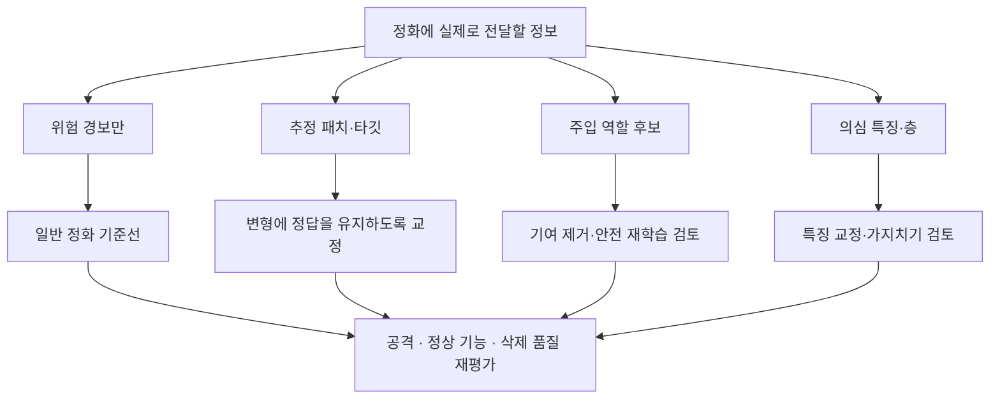
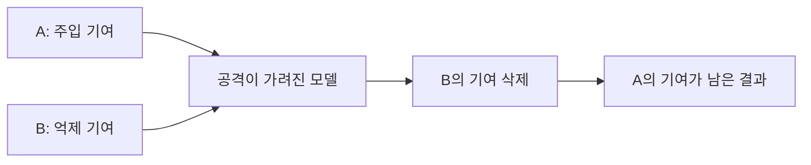

# 3단계 — 얻은 정보로 어떤 정화를 할 수 있는가

전체 과정은 [공격 탐지 → 역할 식별 → 정화](../RESEARCH_STAGES.md)다. 여기서 ‘정보를 얻었다’는 말은 **원래 제공받은 메타데이터**, **알고리즘이 추정한 후보**, **평가자가 제공한 정답** 중 무엇인지 구분해야 한다.

## 1 지금의 방법이 주는 정보

| 방법 또는 자료 | 실제로 제공·출력하는 정보 | 자동으로 알게 되지 않는 것 |
|---|---|---|
| 삭제 요청 | 요청자 ID·선언된 삭제 범위 | 악의, 위장 역할 여부, 남은 독성의 위치 |
| 이력 HRAC | 참여자별 의심 점수·공개 패턴 좌표·후보 출력 클래스 | 확정된 주입자와 위장자 역할, 내부 독성 ID |
| 기존 패치 사전 진단 | 경보·선택 패치·후보 타깃·분기 반응 차이 | 공격자 신원·위장자 신원·원래 심어진 트리거 |
| 실제 pre/post 비교 | 실제 삭제 전후의 관측 변화 | 그 변화의 주체·악의·자료 ID |
| FC·특징 분해 | 분류층과 앞단 표현 변화가 출력에 준 성분 | 악성 뉴런 목록, 공격자 ID |
| 실험 설정의 `role`·P/C ID·실제 트리거 | 평가자가 아는 정답 | 서버 탐지로 얻은 정보로 승계할 수 없음 |

HRAC의 `score_requests()` 뒤에 붙는 `role`은 `label()`이 정답 설정에서 읽은 값이다. 패치 진단의 `target`은 탐색 결과이고 실제 공격 타깃의 정답은 아니다. 이 두 가지를 혼동하면 2단계가 이미 해결된 것처럼 보인다.

R/F 진단은 원자료 또는 신뢰 가능한 현지 계산을 추가로 요구한다. 실제 FL 서버에 기본 제공되는 정보가 아니다. 공격자가 임의로 보낸 응답을 받는 것과 그 응답의 계산·내용을 검증한 것은 다르다.

## 2 정보가 늘어날 때 가능한 정화

| 얻은 정보 | 가능한 조치 | 필요한 조건과 검증 |
|---|---|---|
| 모델이 위험하다는 신호만 | 독립 정상 자료의 미세조정·기존 정화와 비교 | 정상 자료가 공격 기능을 드러내는가. 경보 자체는 제거 위치를 주지 않음 |
| 검증한 후보 패치·타깃 | 정상 자료에 후보 변형을 붙여 원래 정답으로 교정하는 후보 | 변형이 의미를 보존해야 함. 다른 패치·실제 트리거에서도 감소하는지 확인 |
| 주입 역할의 참여자·갱신 후보 | 새 악성 갱신 제한, 과거 기여를 제거하는 재학습 후보 | 미래 참여 제한만으로 과거 오염이 사라지지는 않음. 오지목과 추가 제거 범위 평가 |
| 위장 역할 후보만 | 남은 주입 기여의 조사·정화 범위 선택에 활용 | 억제 기여를 찾은 것만으로 남은 공격을 제거할 수 없음 |
| 검증한 의심 특징·층 | 가지치기와 미세조정, 제한된 특징·분류층 교정 후보 | 변화가 크다는 사실만으로 악성이라고 정하지 않음. 정상 기능 손실·재탐색 위험 평가 |
| 실제로 식별한 독성 자료 ID | 독성 자료까지 정리한 재학습 | 서버가 어떻게 ID를 알아냈는지 검증. 알려준 ID라면 오라클 결과로 보고 |

[Fine-Pruning](https://arxiv.org/abs/1805.12185)은 가지치기와 미세조정의 결합을 검토할 비교법이고, [SAU](https://proceedings.neurips.cc/paper_files/paper/2023/hash/520425a5a4c2fb7f7fc345078b188201-Abstract.html)는 공유 적대 예제를 이용한 정화의 비교법이다. 위 정보 연결은 우리 조건에서 시험할 가설이며, 이 논문들이 BadFU·FUBA의 두 역할을 이미 찾아 정화했다는 주장이 아니다.

## 3 위장자만 찾으면 왜 충분하지 않은가

FUBA의 역할 분담을 설명용 정답으로 알고 있다고 하자. A는 주입하고 B는 억제한다. B의 삭제 뒤 A의 기여는 남을 수 있다.

따라서 B를 위장 후보로 찾았다는 사실은 A를 찾아냈다는 뜻이 아니다. B의 삭제를 취소하거나 B의 자료를 다시 학습해 공격을 가리는 것은 삭제를 충족한 정화로 세지 않는다. BadFU는 A/B의 역할이 같은 참여자 내부에 있을 수 있어, 그 참여자 ID를 알아도 남은 P와 삭제할 C가 바로 분리되지 않는다. [BadFU 원문](https://arxiv.org/html/2508.15541v1), [FUBA 공식 설명](https://github.com/stcebra/FUBA#abstract)

## 4 정보가 정화를 실제로 개선하는지 검증

같은 실제 FU 모델과 같은 정상 자료·계산·정상 성능 제약에서 다음을 비교한다.

1. **추정 정보 없음:** 일반 정화 기준선.
2. **실제 추정 정보 사용:** 우리 방법의 주입·위장 후보, 패치·타깃·특징 정보를 사용.
3. **잘못된 정보 사용:** 정상 참여자를 오지목하거나 틀린 패치·역할을 제공해 피해를 측정.
4. **정답 정보 사용:** 평가자가 제공한 정확한 역할·독성 ID·트리거. 가능성을 확인하는 오라클이며 실제 성과와 분리.

추정 정보가 정답 정보와 얼마나 다른지와 그 차이가 정화에 미치는 영향을 연결한다. 주입 정보만·위장 정보만·양쪽 정보를 나눈 소거 비교도 둔다. 역할 두 개를 맞혔어도 실제 정화가 개선되지 않으면 3단계의 추가 가치를 주장하지 않는다.

정화 후 실제 ASR뿐 아니라 정상·클래스별 정확도·삭제 품질·추가 제거량·비용을 보고한다. 1단계에서 놓치거나 2단계에서 오지목한 사례를 전체 과정 성능에서 제외하지 않는다. 현재 위 표의 정보별 정화 성공을 새로 실측한 상태는 아니다.
