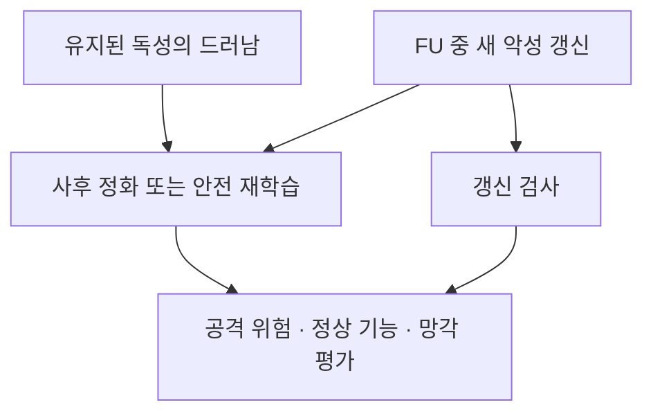

# BadFU와 FUBA 방어의 첫 가설

두 공격을 막았다고 부를 방법은 아직 확정하지 않는다. 먼저 공격이 **유지된 독성의 드러남**인지 **FU 중 새 악성 갱신**인지 나누고, 공격 억제·정상 기능·망각의 목표를 고정한다.

현재는 [세 단계 연구 기준](../RESEARCH_STAGES.md)의 3단계다. 위험 경보, 추정 역할, 추정 패치 등 실제 얻은 정보를 구분하고 [그 정보별 정화](DETECTION_TO_PURIFICATION.md)의 추가 가치를 평가한다.

[서버 관측 조건과 부분 해결](../03_detection/COMMON_ATTACK_SURFACE.md)에서 소량 정상 자료·변형 범위·검사 예산을 추가한 첫 방어 가설을 구체화했다. 삭제 전 모델을 이용한 선택과 사후 모델만 이용한 정화는 망각 보장의 가정이 다르며, 해당 문서에 조건부 후처리 명제도 적었다.

## 기본 가설과 반증 실험

| 가설 | 지지한다면 볼 현상 | 반증하거나 구분할 비교 |
|---|---|---|
| 위장 삭제의 위험은 유지 독성과의 조합에서 생긴다 | C만 삭제하면 공격 증가, P까지 삭제하면 감소 | N·N∪P·N∪C·N∪P∪C와 동일 예산 무삭제 학습 |
| 관측 증가 중 일부는 부정확한 FU에서 생긴다 | 정확 재학습과 저자 FU 결과가 크게 다름 | 같은 유지 집합과 평가 정의로 두 경로 비교 |
| FUBA의 재학습형 결과에는 새 주입이 기여한다 | FU 중 악성 학습에서 더 강한 공격 | 같은 삭제 전 모델에서 FU 중 정직한 학습으로 교체 |
| 정상 입력 보존만으로 미지 트리거 안전을 판정할 수 없다 | 정상 출력이 같아도 다른 입력에서 공격 차이 | 정상 출력만 보는 검사와 변형 탐색 검사 비교 |
| 안전 검사는 모델 변경 크기보다 변형 입력의 마진을 봐야 한다 | 같은 변경 크기라도 타깃 마진 반응이 다름 | 곡률·입력 방향을 통제한 선형 구성 예와 신경망 대응 |

앞의 세 가설은 이미지 실험으로 확인할 항목이다. 네 번째의 제한된 관측 모형과 다섯 번째의 조건부 마진 명제는 [수학 문서](../04_theory/README.md)에서 증명했다. 어느 것도 비볼록 신경망 전체의 공격 성공을 보장하지 않는다.

## 방어 후보의 적용 범위

| 후보 | BadFU에 대한 역할 | FUBA에 대한 역할 | 필요한 추가 가정과 검증 |
|---|---|---|---|
| FU 중 갱신 검사 | 정직한 FU로 독성이 드러나면 이것만으로 충분하지 않음 | FU 중 새 악성 갱신을 막는 후보 | 관측 가능한 갱신과 정상 FU 분포. UnlearnGuard 정리의 조건 점검 |
| 정상 데이터 기반 사후 정화 | 유지 독성의 효과를 줄일 후보 | 남은 독성과 새 주입을 줄일 후보 | 같은 데이터·계산·정상 성능 예산에서 미세조정·Fine-Pruning·SAU 비교 |
| 입력 변형에 대한 강건 마진 검사 | 삭제 결과가 안전한지 공개 전 검토 | 동일 | 실제 트리거를 포함하는 변형 범위와 검증 가능한 기준 마진 |
| 독성 식별 후 데이터 정화와 재학습 | 유지 독성 자체를 제거하는 후보 | 남은 공격자의 영향 또는 데이터 제거 후보 | 독성 식별의 오탐·권한·공격 정보 유출을 별도로 평가 |
| 안전 학습 알고리즘 자체를 재설계 | 재학습 기준도 안전하게 바꿀 수 있음 | 동일 | 기존 학습 알고리즘의 정확한 재현과 다른 목표임을 명시 |

## 수학적으로 구분할 두 요구

기존 학습 알고리즘의 유지 데이터 재학습이 위험하다면, 그 결과와 매우 가까워야 한다는 요구와 낮은 ASR 요구가 충돌할 수 있다. 이때 안전한 학습 알고리즘으로 기준을 바꾸거나 허용하는 차이를 명시해야 한다. “FU를 더 정확히 하면 해결된다”를 기본 방어 가정으로 두지 않는다.

삭제를 거부하거나 삭제 전 모델로 돌아가는 것은 삭제 목표를 충족한 정화가 아니다. 삭제한 위장 샘플을 다시 학습시켜 공격만 잠재우는 것도 삭제와 양립하는지 별도 검토한다.

## 처음 비교할 순서

일반 활성 백도어에서 단순 미세조정·삭제 후 자기증류와 정식 Fine-Pruning·SAU를 연결한다. 이후 유효성이 확인된 BadFU·FUBA 삭제 모델에 적용한다. 이 비교가 정리된 뒤에야 전후 모델이나 이력을 추가한 새 방어를 설계한다.

트리거 특징을 알고 지우는 [선형 오라클 진단](../04_theory/linear_example_results.json)은 가능성 확인용이다. 실제 트리거·타깃을 모르는 두 공격의 방어 성능으로 사용하지 않는다.
