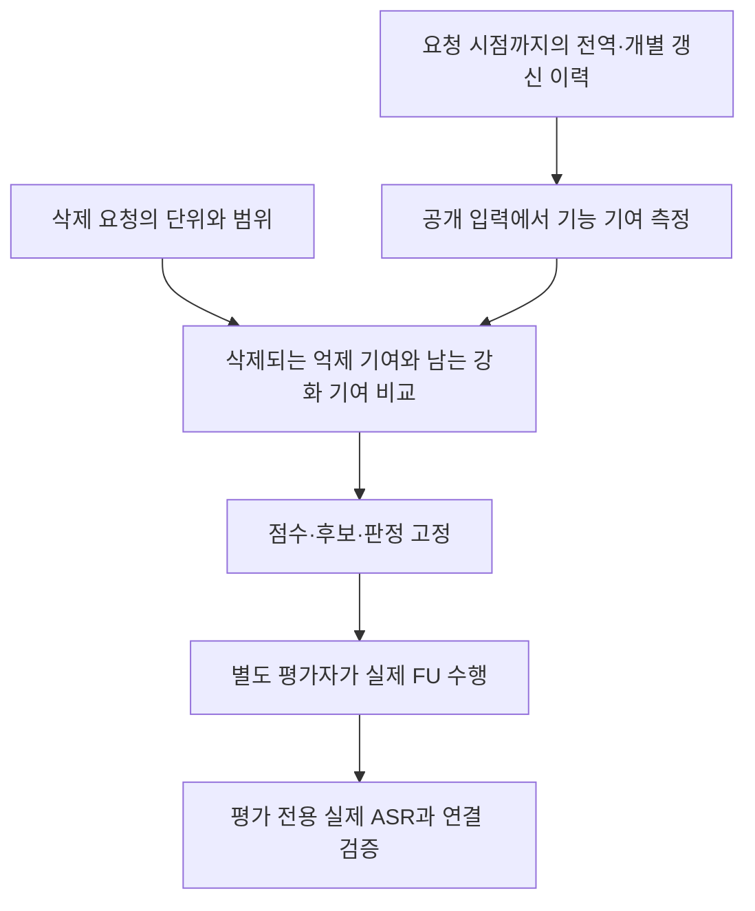

# 방법 1 — 이력으로 삭제 후 위험을 예측

**질문:** 삭제 요청이 들어왔을 때, 그 시점까지의 학습 이력만으로 실제 삭제 후 백도어 위험을 예측할 수 있는가.

전체 궤적과 미래 결과를 미리 저장해 두는 것은 평가 준비다. 탐지기에 전달하는 입력만 요청 시점까지로 제한한다. [궤적의 재사용 판정](../../01_reproduction/TRAJECTORY_DECISION.md)과 [방법별 연결 정리](../STAGE1_METHODS.md)를 따른다. 기존 공격을 찾은 관측과 미래 활성화를 예측한 근거를 구분하며, 이력 전체를 폐기하지 않는다.

발전 후보는 **실행 전체 공통 RMS 보정 HRAC**다. 원래 HRAC도 같은 정상 보정 자료에서는 성능이 같아 우월성을 확정하지 않는다. [후보 선택과 분리 여부](../BEST_CANDIDATES.md)에서 관측 집합의 간격과 새 실제 FU 검증을 구분했다.

## 기존에 한 실험과 가정

HRAC는 과거 개별 갱신이 공개 원본·패턴 입력의 클래스 출력에 준 반응을 기록하고, 요청이 억제 방향 기여를 선택적으로 없애는지 점수화했다. 정상 상쇄를 구분하기 위해 전체 크기 보정·시계열 GLR·정상 설명 집합을 검토했다. 실제 트리거와 타깃은 사후 채점용이었다.

이는 **과거 국소 반응의 관계**다. 다른 라운드에서 측정한 반응의 합이 실제 FU 결과와 같다는 가정은 별도 검증이 필요하다. BadFU의 동일 참여자 내부 P/C는 개별 클라이언트 이력만으로 분해되지 않을 수 있다.

## 기존 근거가 닿은 범위

- FUBA 정상 43·44의 40요청에서 기존 경보 12건, 공통 크기 보정 후 2건이었다. 다만 정상 보정 자료를 맞춘 교차 검증에서는 기존·보정 모두 60요청 중 2건 경보였다.
- 억제 참여자를 찾은 것과 실제 공격 타깃을 찾은 것은 달랐다. 해당 FUBA 기록에서 실제 타깃의 점수 순위는 낮았다.
- 정상 설명 집합을 적용한 비교 11건은 모두 미판정이었다. 안전하다고 판단한 11건이 아니다.
- 같은 요청의 동결된 이력 점수를 실제 FU 후 ASR·ASR 증가량과 연결한 충분한 대응 검증은 남아 있다.

[기존 이력 결과와 원본 연결](../../../research_audit_20261019/detection/history.md) · [기여 가산성 검사](../../../review_BadFU_defend/experiments/detection/hrac_matched/results/code_audit_v1/REPORT.md)

## 이번에 다시 검증할 핵심

요청자 신원 정답 대신 **같은 요청의 실제 삭제 후 위험**을 주 평가 대상으로 둔다. 삭제 전 시점에서 점수·후보·임계값을 고정하고 실제 FU 결과는 평가자만 읽는다. 이력 전체가 최근 모델·최근 한 라운드·단순 갱신 크기보다 추가 예측 정보를 주는지 비교한다.

새 기록에는 과거 점수의 크기뿐 아니라 정상 자료의 정확도·손실 변화 이력도 비교 기준으로 넣는다. 이 신호가 실제 위험보다 일반적인 학습 불안정성을 찾는지, 동일한 정상 대조에서 확인한다.

[두 경로의 원리와 검증 공백](../TWO_ROUTE_REVIEW.md)
