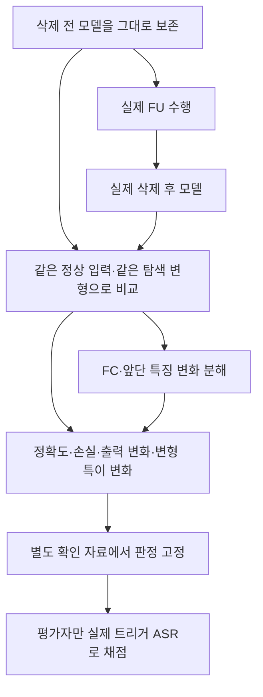

# 방법 2 — 실제 언러닝 전후로 위험 발생을 감지

이 폴더는 모델 비교 중 실제 FU 전후 조건을 다룬다. 서버가 만들 수 있는 제출분 제외·공개 자료 진단 모델도 비교 후보로 사용할 수 있으며, 그 구성과 의미는 [1단계 방법 정리](../STAGE1_METHODS.md)에서 구분한다. 이 대안들을 실제 FU 결과로 부르지는 않는다.

**질문:** 실제 삭제 전후 모델만 주어졌을 때, 원래 트리거를 모르는 서버가 백도어 활성화의 관측 신호를 찾을 수 있는가.

이 갈래에는 **패치 반응 비교와 FC·Conv 분석**을 함께 둔다. 보존된 진단 실험에서 가장 좋았던 후보와 확실한 분리가 아니었던 근거는 [후보 비교](../BEST_CANDIDATES.md)에 있다. FC·Conv의 실제 전후 분석 커널은 [하위 폴더](fc_conv/README.md)에 구현했다. 과거 R/F 진단과 실제 FU 전후라는 관측 차이는 유지한다.

**실제 비교의 정의:** 삭제 전 모델을 그대로 보존하고, 같은 시작점에 실제 FU를 수행한 결과와 비교한다. R만으로 추가 학습한 모델을 삭제 후 모델이라고 부르지 않는다. F로 추가 학습한 모델도 삭제 모델이 아니다. 기존84요청 순위로 실제 FU 전후 탐지의 우열을 확정하지 않는다.

## 원리

일반적인 모델 변화와 변형 입력에서만 커지는 타깃 반응을 구분한다. 예를 들어 B(f,τ,k)를 같은 자료에서 변형 입력과 원본 입력의 클래스 k 반응 차이라고 하면, 비교량은 B(f_post,τ,k)−B(f_pre,τ,k)다. 후보 τ·k는 탐색 자료에서 선택하고 별도 자료에서 확인한다.

이는 원래 공격 트리거의 ASR이 아니다. 정상 삭제·일반 적대적 취약성도 같은 반응을 낼 수 있어 실제 정상 FU 및 무삭제 처리 대조가 필요하다. 사후 모델 검사보다 전후 정보가 추가 가치를 주는지도 같은 예산에서 비교한다.

## 기존 실험에서 구분할 것

- 실제 BadFU FU 사례는 정상 정확도 91.25%→95.00%에서 탐색 변형의 타깃 반응 2.78%→73.61%를 보였다. 원본 기록의 실제 트리거 ASR은 비어 있다. 80장짜리 감사 자료의 관측이며 대응 정상 실제 FU 대조도 부족하다.
- 누적 업데이트 차감으로 만든 FUBA 대용 모델은 정확도가 무너졌다. 그 변화를 실제 FU의 백도어 활성화 증거로 쓰지 않는다.
- 기존 84요청 패치 검사는 유지·삭제 자료로 진단 복제 모델을 학습한 **사전 보조 검사**다. 실제 pre/post 탐지를 이미 검증한 결과로 옮기지 않는다.

[실제 FU와 대용 모델의 비교](../../../research_audit_20261019/detection/normal_set.md) · [패치 보조 검사](../../../research_audit_20261019/detection/patch.md)

## 이번에 다시 검증할 핵심

정상 정확도·클래스별 정확도·CE·예측 전환·출력 분포 차이부터 비교한다. 그다음 변형 특이 변화의 추가 가치를 본다. 정확도와 CE에는 독립 정상 **라벨** 자료가 필요하고, 무라벨 출력 변화에는 정상 입력의 대표성이 필요하다.

이번 84요청 재분석에서는 단순 정확도 하락이 공격을 잘 분리하지 못했다. [실제 계산 결과와 범위](../TWO_ROUTE_REVIEW.md)를 참고한다. 손실·클래스별 변화·출력 분포의 효용까지 검증한 결과는 아니다.
