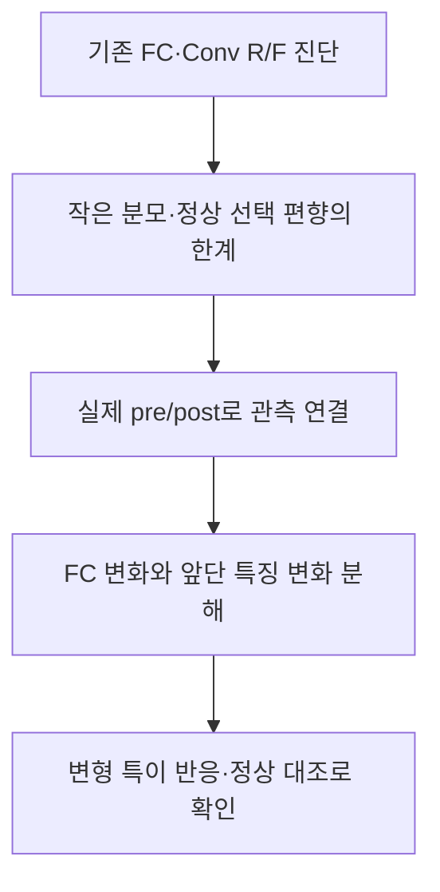

# 삭제 전후 갈래의 FC·Conv 분석

FC·Conv는 이력 기반 방법과 별개인 **삭제 전후 비교 갈래**에 둔다. ‘어떤 층을 보는가’와 ‘실제로 어떤 모델을 비교했는가’는 각각 표시한다.

| 자료 | 실제 비교 | 현재 역할 |
|---|---|---|
| [원래 크기 비율](../../derived/gradient_ratio/README.md) | 같은 삭제 전 모델에서 개인 R/F 평균 CE 기울기 | 초기 분리와 정상 오탐의 근거 |
| [직교 잔차](../../derived/gradient_ratio/variants/orthogonal_residual/README.md) | 위 기울기 방향의 직교 성분 | 비율 보정의 한계 확인 |
| 실제 FC·특징 변화 | 실제 pre/post의 분류층·공개 입력 특징 | 현재 구현한 진단 커널, 실제 탐지 성능 미검증 |

[발전 후보 비교](../../BEST_CANDIDATES.md)에 실제84요청·정상144요청의 결과와 결합 검사를 적었다. FC·Conv를 실제 FU 전후에서 측정한 것처럼 옛 결과의 의미를 바꾸지 않는다.

[pre_post_features.py](pre_post_features.py)는 같은 아키텍처·같은 입력·같은 마지막 특징 좌표와 일치하는 두 분류층을 가정한다. 배열의 모양·유한값·실제 출력 변화의 재구성을 검사한다. 출력은 FC 성분과 특징 성분이다. 특징 성분에는 BN 등도 포함되며 단독 Conv 인과 효과가 아니다. 실제 위험 판정은 반환하지 않는다.

[세 구성 예](constructed_cases.json)는 FC 단독 활성화·특징 단독 활성화·기능이 같은 재스케일링을 확인했다. 원본 입력에서 변화가 없더라도 미관측 입력의 위험을 배제할 수는 없다. 실제 FU 자료에서의 탐지 성능 검증은 남아 있다.
