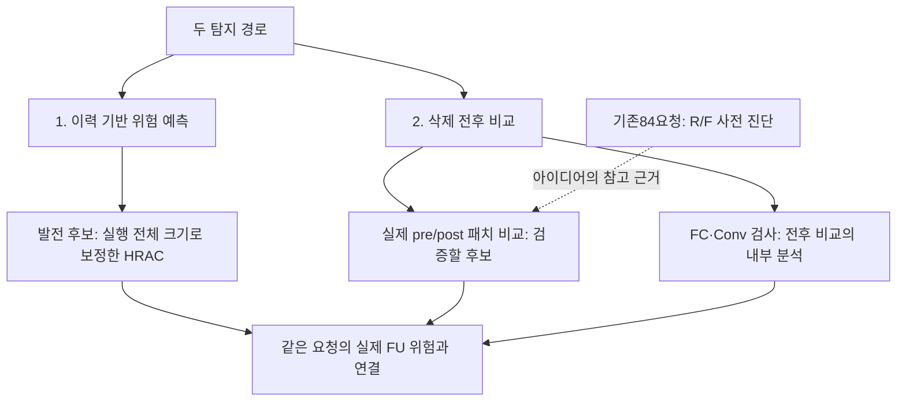
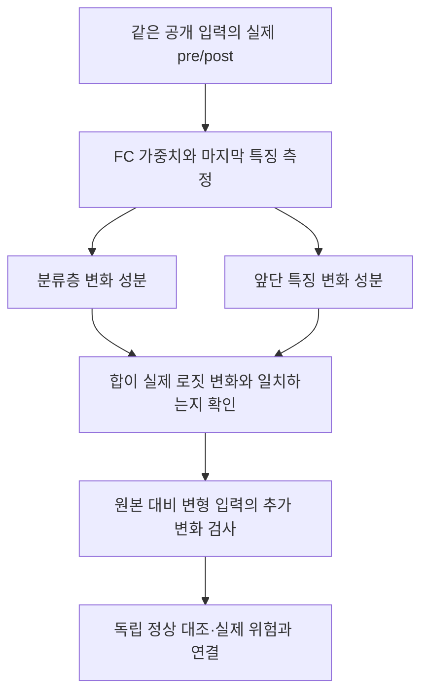

# 두 경로에서 남길 후보와 발전 방향

> **과거 후보 기록 — 현재 추천 아님.** 먼저 [실험 인덱스](../INDEX.md)와 [D01–D17 후속 판정](../EXPERIMENT_CARDS.md)을 읽는다. HRAC 보류, 큰 정상 non-IID 반례, FC·Conv 단순 변화량 추천 철회가 이 문서 뒤에 확인됐다. 아래 원 결과는 당시 조건의 기록으로 보존한다.

**보고 형식:** 이후 결과는 [한 줄 가설 정리 원칙](../EXPERIMENT_RULES.md)을 따른다. 현재 미팅용 주장은 [가설별 검증 카드](../05_meetings/20261020/CLAIM_BOARD.md), 기존 패치 구현과 차분 검증은 [입력 패치 진단 정의](PATCH_PROBING_SPEC.md)에서 확인한다.

2026년 10월 20일. ‘가장 좋았다’는 **보존된 같은 조건에서의 관측**을 뜻한다. 이력의 역할 식별과 실제 ASR 위험 예측, 진단 모델과 실제 FU 전후를 구분한다. 이번에는 후보별 원본 점수·고정 판정·정상 스트레스 결과를 재계산하고, 실제 전후 FC/특징 변화를 분해하는 작은 진단 커널을 구현했다.

**설명 정정:** 84요청의 패치·기존 FC·Conv 비교를 ‘실제 삭제 전후 탐지에서 패치가 가장 좋았다’로 읽으면 안 된다. 패치는 삭제 전 모델에서 R과 F로 각각 **추가 학습**한 진단이고, 기존 비율은 같은 모델에서 R/F 기울기를 측정했다. 실제 FU 전후 탐지의 최고 방법은 이 결과만으로 선정할 수 없다. 아래 순위는 보조 진단 실험 안의 비교다.

**새 실측의 해석:** [서버 관측 모델 비교와 삭제 전 ASR 원인 재검증](../01_reproduction/badfu/PRE_ASR_REAUDIT.md)에서 패치·FC·Conv의 정상 non-IID 겹침, 최근 라운드 이력, 공개 정상 변화 크기 보정을 측정했다. 원논문과 공격 배치·삭제 단위가 달랐고 FUBA 생성기의 정상 모델 전이도 확인돼, 이 실측을 잠복 활성화 탐지 성공으로 해석하지 않는다.

## 1 이력 쪽 — 공통 크기 보정 HRAC를 남긴다

과거 공개 패턴 반응에서 강화·억제 기여를 찾고, 억제 기여를 선택적으로 삭제하는 요청을 점수화한다. 실행 전체 RMS 하나로 나누는 보정은 실행 내부 순위를 유지하면서 실행 간 크기 차이를 줄인다. 창별·패턴별 보정보다 추가 조건이 적고, 보존된 억제 참여자를 놓치지 않았다는 이유로 발전 후보에 둔다.

| 방법 | 정상43·44 경보 | 억제자 경보 | 정상 실행 교차 검증 경보 |
|---|---:|---:|---:|
| 원래 HRAC | 12/40 | 1/1 | 2/60 |
| 실행 전체 공통 RMS 보정 | 2/40 | 1/1 | 2/60 |
| 창별 RMS 보정 | 0/40 | 1/1 | 1/60 |
| 패턴별 RMS 보정 | 0/40 | 0/1 | 1/60 |

창별 방식은 정상 경보가 적었지만 공격 실행의 정상 참여자를 억제자보다 높게 두었다. 패턴별 방식은 억제자를 놓쳤다. **정상 보정 자료를 맞추면 원래 HRAC와 공통 보정의 교차 검증은 같다.** 공통 보정이 항상 더 낫다는 결론은 아니다.

### 확실히 구별되는가

이번에 읽은 FUBA 역할 점수에서는 억제자 1개의 보정 점수가 5.4141, 정상 역할 75요청의 최댓값이 4.6937로, 그 관측 집합 안에서는 간격이 있다. 원래 HRAC도 전체 정상 자료를 모으면 간격이 있다. 점수 단위가 달라 두 간격의 크기를 직접 비교하지 않는다.

이는 **정상 학습 3회와 공격 학습 1회에서 역할을 사후 비교한 결과**다. 정상75요청은 정상 실행60요청과 공격 실행의 정상 역할15요청이며, 75개 독립 학습이 아니다. 새 공격에서의 분리, 낮은 사전 ASR에서의 활성화 예측, BadFU 내부 샘플 삭제의 분리까지 확정하지 않는다.

### 어떻게 발전시킬 것인가

1. 원래 HRAC와 공통 보정을 같은 정상 자료·관측 예산으로 고정한다. 과거 단순 음의 기여·최근 한 라운드도 비교에 남긴다.
2. 요청·실제 이력·삭제 단위가 같은지 먼저 확인한다. 내부 역할이 관측되지 않으면 미관측으로 둔다.
3. 전체 이력에서 찾은 같은 패턴·출력 방향이 뒤의 확인 구간과 별도 입력에서 유지되는지 검사한다. 실제 미래 ASR은 이 단계에서 읽지 않는다.
4. 실제 FU 전 점수·후보·판정을 동결한 뒤 평가자가 같은 요청의 FU 후 ASR과 연결한다. 역할 식별을 주 평가 정답으로 대신하지 않는다.
5. 분포가 맞는 독립 정상 실행이 부족하면 검증된 오탐 보장을 주장하지 않는다. 미판정을 별도 출력한다. 확인 구간 추가는 아직 성능 개선이 검증된 변경이 아니다.

시계열·정상 설명 조건을 한꺼번에 모두 추가하지 않는다. 기존 GLR과 설명 집합의 한계를 반복할 수 있으므로 추가한 정보 하나가 무엇을 개선했는지 소거 비교한다.

## 2 전후 비교에 참고할 사전 진단 — 패치와 FC·Conv

현재의 비교 가능한 84요청 결과에서는 패치 두 분기 대조가 가장 좋은 탐지·대조 경보 조합을 보였다. **유지·삭제 자료로 학습한 진단 복제 모델의 결과**이며, 실제 FU 전후 탐지의 검증 결과는 아니다. 이 반응 원리를 실제 pre/post로 옮기는 것이 발전 과제다.

| 기존 후보 | 공격 경보 / 12 | 대조 경보 / 72 | 기술적 AUROC |
|---|---:|---:|---:|
| 패치 반응 대조 | 11 | 3 | 0.9896 |
| FC 크기 비율 | 8 | 5 | 0.8171 |
| Conv 크기 비율 | 7 | 3 | 0.7766 |
| FC 직교 잔차 비율 | 6 | 5 | 0.8958 |
| Conv 직교 잔차 비율 | 6 | 3 | 0.9086 |

임계값은 과거 설정의 고정값이다. AUROC는 이 자료의 순위 설명이며 새 자료 성능 추정이 아니다. 필요 정보와 계산량도 달라 같은 자원 예산의 우월성 검증으로 세지 않는다. 특히 원래 FC·Conv 비율은 개인 R/F 자료의 평균 기울기를 같은 삭제 전 모델에서 측정했다.

12양성은 공격 구성 요청이며, 저장된 낮은 사전 ASR의 잠복 기준을 충족하는 것은8건이다. 공격 구성 전체를 잠복 성공 사례로 세지 않는다.

### 확실히 구별되는가

**아직 아니다.** 패치 공격 점수 범위는 0.00545~0.03784이고 대조는 0~0.01352로 겹친다. 실제 미탐1건과 대조 경보3건이 있다. FC·Conv 네 점수도 모두 범위가 겹친다.

더 강한 정상 대조에서는 FC·Conv 단독 판정의 문제가 커졌다. 저손실 정상 삭제36요청에서 FC 크기 비율35건, Conv36건에 경보했고, 직교 잔차도 각각28·33건에 경보했다. 공격 없는 정상 자료의 작은 삭제 기울기가 비율을 키울 수 있었다. 이 스트레스에는 패치 검사가 없으므로 패치가 해결했다고 채우지 않는다.

144요청은 공격을 심지 않은 학습 모델에서 만든 비공격 요청 구성의 검사다. 실제 삭제 후 재학습·ASR 측정은 하지 않았으므로, 여기서 모든 사후 위험이 낮았다고 확정하거나 실제 FU 후 오탐률로 바꾸어 보고하지 않는다.

### FC·Conv를 붙이면 바로 좋아지는가

같은84요청에서 기존 판정의 단순 결합을 다시 계산했다. 개발 자료에 대한 탐색이며 독립 검증이 아니다.

| 결합 | 공격 경보 / 12 | 대조 경보 / 72 |
|---|---:|---:|
| 패치 단독 | 11 | 3 |
| 패치 AND FC | 8 | 0 |
| 패치 AND Conv | 7 | 0 |
| 패치 OR FC | 11 | 8 |
| 패치 OR Conv | 11 | 6 |

AND는 오탐과 함께 진짜 공격도 제거한다. OR는 기존 패치 미탐을 구하지 못하고 대조 경보를 늘렸다. 그러므로 조합의 0/72만 골라 ‘완전 분리’라고 부르지 않는다. 불일치 사례는 안전으로 낮추지 말고 추가 확인 대상으로 보존한다.

## 3 FC·Conv 발전 — 크기만 보지 않고 실제 출력 변화를 분해

FC·Conv 관련 자료는 [삭제 전후 갈래의 하위 폴더](02_pre_post_detection/fc_conv/README.md)에 연결했다. 옛 R/F 진단이 실제 FU 전후를 측정했다는 뜻으로 바꾸지 않는다.

새 진단은 같은 공개 입력에서 실제 두 모델의 분류층과 마지막 특징을 측정한다. z₀=W₀h₀+b₀, z₁=W₁h₁+b₁이라 두면 다음과 같이 정확히 분해할 수 있다.

$$\Delta z=\underbrace{\Delta W\frac{h_1+h_0}{2}+\Delta b}_{FC\;성분}
+\underbrace{\frac{W_1+W_0}{2}\Delta h}_{특징\;성분}.$$

**증명:** 오른쪽의 두 행렬곱을 전개하면 교차항 W₁h₀와 W₀h₁이 상쇄되어 W₁h₁−W₀h₀+Δb가 된다. □

특징 성분은 Conv뿐 아니라 BN 등 분류층 앞의 모든 표현 변화를 포함한다. 순수한 Conv 인과 효과라고 이름 붙이지 않는다. 이 대칭 분배는 진단상의 선택이며 의미적·인과적 유일성을 주장하지 않는다. 서로 다른 특징 좌표 재표현에도 성분이 달라질 수 있다.

[구현한 커널](02_pre_post_detection/fc_conv/pre_post_features.py)은 개인 R/F 자료·실제 트리거·ASR·공격자 라벨을 받지 않는다. 두 모델의 공개 입력 특징과 분류층만 받아 출력을 분해한다. 정상 CE 기울기의 작은 분모로 나누지 않는다. 임계값이나 공격 경보는 아직 만들지 않았다.

[구성 예 검사](02_pre_post_detection/fc_conv/constructed_cases.json)에서는 다음을 확인했다.

- FC만 바뀌어도 정상 예측은 그대로인 채 트리거 예측이 바뀔 수 있다.
- FC가 고정돼 있어도 앞단 특징만 바뀌어 같은 일이 생길 수 있다.
- h를2배, W를절반으로 바꾸면 내부 변화량은 커도 출력은 완전히 같다. 두 성분이 정확히 상쇄됨을 확인했다.

세 예의 재구성 오차는0이었다. 선형 분류층과 구성된 특징의 검산이며 실제 CNN·BadFU·FUBA에서 탐지력이 개선됐다는 결과는 아니다.

## 4 실제 발전을 판정할 조건

첫 후속 비교는 원래 HRAC와 공통 보정 HRAC, 실제 pre/post 패치 반응, 실제 pre/post FC·특징 분해를 같은 요청에 연결하는 것이다. 사후 모델만의 검사와 정확도·CE·출력 변화도 남긴다.

두 공격 모두 같은 시작 모델의 실제 공격·정상 FU와 무삭제 처리를 두고, 낮은 사전 ASR 여부를 별도로 센다. 타깃·패턴·학습 시드를 개발과 확인에서 분리한다. 실제 ASR은 평가자 파일에만 둔다. FC·Conv의 추가 정보는 동일 오탐 수준에서 놓친 공격을 더 찾는지, 또는 동일 탐지 수준에서 정상 경보를 줄이는지로 판단한다.

**현재 판단:** 이력에서는 공통 보정 HRAC를 안정적인 발전 후보로 남긴다. 전후 갈래에서는 패치 반응을 주요 후보로 두고 FC·Conv를 내부 변화의 검증·설명으로 발전시킨다. 둘을 완성된 양쪽 공격 탐지기로 부르기에는 실제 FU와 새 조건의 검증이 부족하다.

탐지 신호·역할 후보·추정 패치가 각각 어느 정화로 연결되는지는 [정보별 정화 조건](../02_purification/DETECTION_TO_PURIFICATION.md)에서 따로 구분한다.

[이번 재계산 원본·해시·제약](validation_20261020/candidate_comparison.json) · [재실행 코드](validation_20261020/compare_candidates.py) · [기존 원리 검토](TWO_ROUTE_REVIEW.md)
