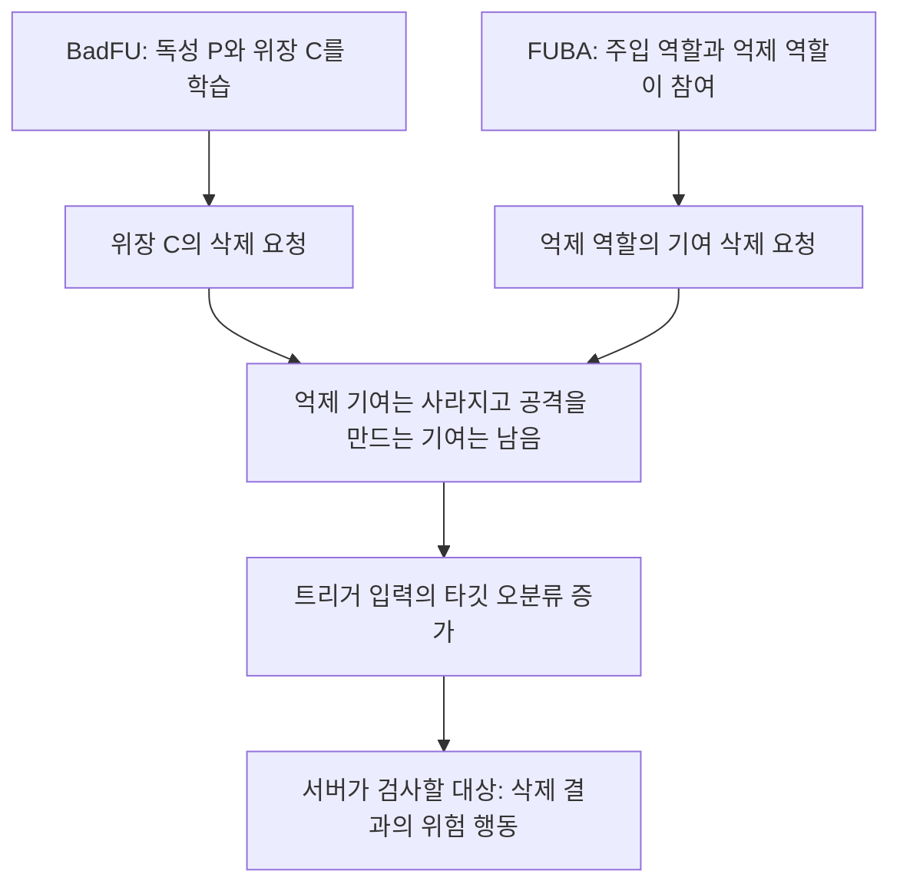
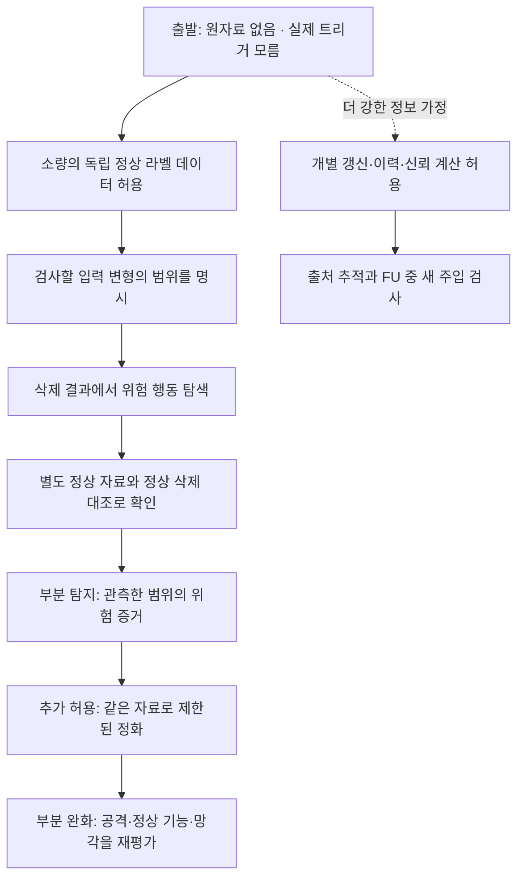
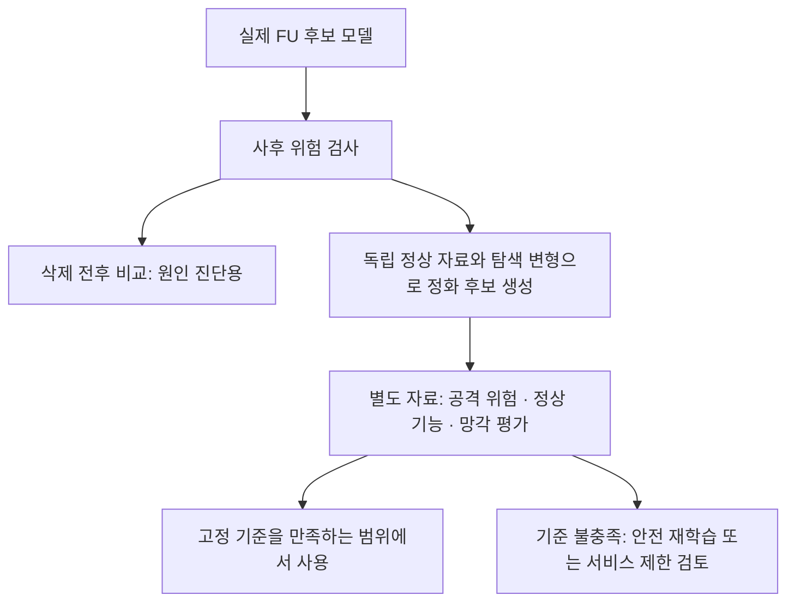

# BadFU와 FUBA의 공통 공격 구조를 서버에서 검사하기

작성 기준: 2026년 10월 20일. 여기서는 FedUBA를 공식 명칭 FUBA로 표기한다. 공격 구조는 원문·공식 공개 설명에 근거하며, 아래 탐지와 정화 설계는 **검증할 가설**이다. FUBA 전체 본문·보충자료 검토와 두 공격의 새 이미지 재현은 아직 완료하지 않았다.

연구의 두 경로는 [이력으로 위험을 예측하기와 실제 언러닝 전후로 감지하기](TWO_ROUTE_REVIEW.md)다. 이 문서는 두 공격의 공통 조건을 정리한 배경이며, 아래 사후 모델 검사가 이력 경로를 대체한다는 뜻은 아니다. 실제 ASR과 서버 관측 지표의 연결 검증은 별도다.

## 1 무엇이 공통이고 무엇이 다른가

[BadFU IV–V](https://arxiv.org/html/2508.15541v1#S4)는 한 참여자가 독성·위장 샘플과 위장 삭제를 제어하는 설정이다. [FUBA 공식 설명](https://github.com/stcebra/FUBA#abstract)은 주입 역할 Adv-attacker와 억제 역할 Adv-defender를 나눈다. Adv-defender도 공격 체계 내부 역할이다. 둘을 위 그림의 공통 구조로 읽는 것은 이 검토의 추상화이며, 동일 목적함수나 동일 업데이트라는 주장은 아니다.

특정 FU의 계산 오류가 없어도 유지된 공격 기여가 문제가 될 수 있다. [선형 구성 예와 증명](../04_theory/README.md)은 그 가능성을 정확한 재학습에서 보였다. FUBA 공개 재학습 코드처럼 FU 중 악성 학습이 추가되는 경로는 별도 분기로 평가한다.

## 2 서버가 볼 수 있는 것과 없는 것

기본 서버는 전역 모델을 관리하지만 클라이언트 원자료를 받지 않는다고 가정한다. 정상 기준 데이터, 과거 이력, 개별 업데이트는 기본 제공으로 넣지 않는다.

| 정보 | 일반 집계 서버 | 보안 집계 서버 | 해석의 경계 |
|---|---|---|---|
| 현재 전역 모델과 그 출력 | 볼 수 있음 | 통상 볼 수 있음 | 모델 접근만으로 실제 트리거·정상 분포를 알지는 못함 |
| 삭제 전후 전역 모델 | 삭제 전 모델을 보존한 경우 | 동일 | 사전 모델은 안전한 교사라는 보장이 없고, 보존·사용 정책도 필요 |
| 참여자별 로컬 모델·업데이트 | 해당 프로토콜이 수신하는 경우 | 표준 보안 집계에서는 직접 볼 수 없음 | 개별 갱신 검사와 전역 모델 검사는 다른 정보 접근 |
| 참여자별 과거 이력 | 실제로 기록한 범위 | 집계 이력만 남을 수 있음 | 현재 값으로 과거 이력을 만들어내지 않음 |
| 삭제 요청의 주체와 범위 메타데이터 | 프로토콜이 제공한 범위 | 동일 | 요청 메타데이터는 악의나 실제 원자료 내용의 증명이 아님 |
| 로컬 N·P·C의 실제 내용·라벨·중복 | 직접 볼 수 없음 | 직접 볼 수 없음 | 공격을 아는 실험 코드가 읽는 정보와 구분 |
| 실제 트리거·타깃·공모 관계 | 기본적으로 모름 | 기본적으로 모름 | 시험 정답이며 탐지 입력으로 제공하지 않음 |
| 독립적인 정상 라벨 데이터 | 별도 확보 필요 | 별도 확보 필요 | 클라이언트가 임의 제출한 자료를 신뢰 자료로 간주하지 않음 |
| 공격자가 보고한 손실·기울기 | 전달받을 수는 있음 | 프로토콜에 따라 다름 | 응답의 정직성·계산 정확성은 별도 문제 |

보안 집계는 개별 값을 노출하지 않고 집계하는 프로토콜이다. 따라서 개별 벡터를 필요로 하는 검사를 그대로 적용할 수 없다. 전역 모델 행동 검사는 원칙적으로 남는다. 이는 보안 집계의 결함 주장이 아니라 관측 범위의 차이다. [Bonawitz 외, CCS 2017](https://research.google/pubs/practical-secure-aggregation-for-privacy-preserving-machine-learning/)

## 3 공격에서 공략할 후보 지점

다음 표의 ‘공략’은 양쪽 공격에서 검증할 관측 가설이다. 아직 성공한 탐지법 목록이 아니다.

| 후보 지점 | 서버에서 측정할 것 | 양쪽 공격에 대한 의미 | 실패할 수 있는 이유 |
|---|---|---|---|
| 공격은 결국 어떤 입력을 타깃으로 보내야 함 | 제한한 입력 변형에서 삭제 후 타깃 쏠림·정답 마진 | 공격자 신원 없이 결과 모델을 검사 | 실제 트리거가 탐색 범위 밖이거나 탐색 최적화가 실패 |
| 잠복이 활성화로 바뀌는 전환 | **같은 입력·변형**에서 삭제 전후 예측 변화 | 단순 모델 크기 변화보다 현상에 가까운 비교 | 정상적인 삭제도 변형 강건성을 바꿀 수 있어 정상 대조 필요 |
| 여러 원본에 같은 변형이 작동하는 공격 | 여러 원본·클래스에 공유한 변형의 타깃 전환 | 단일 이미지의 일반 적대 예제와 구분할 추가 단서 | 일반적인 범용 적대 변형도 존재. 소스 한정·입력별 트리거에는 별도 설계 필요 |
| 일부 기여가 공격 행동을 떠받침함 | 개별 갱신·참여 집합을 바꾼 실제 재실행의 영향 | 출처를 좁힐 수 있는 추가 실험 | BadFU의 P와 C는 같은 참여자 내부일 수 있음. 벡터 반대 방향만으로는 분리 불가 |
| FU 중 새 악성 갱신이 들어옴 | 정직한 FU와 악성 FU의 대응 비교·갱신 검사 | FUBA 코드의 해당 경로에 추가 방어 후보 | 정직한 FU로 기존 독성이 드러나는 경로까지 막지는 못함 |

전후 감지 경로에서는 **결과 모델의 위험 행동 → 삭제 전후의 전환 → 필요할 때 출처 추적** 순서로 검사한다. 이력 경로에서는 별도로 실제 FU 전의 위험 예측을 검증한다. 어느 참여자를 제거할지 먼저 맞히는 문제를 공통 탐지의 필수 조건으로 만들지 않는다.

다음 조치만으로 두 공격을 해결했다고 부르지 않는다. 실제 학습에 참여한 데이터라는 확인은 정상적인 위장 삭제도 통과시킬 수 있다. 공모 참여자 탐지는 단일 참여자 BadFU를 빠뜨릴 수 있다. 평균 정상 정확도·업데이트 크기·삭제량만 보는 규칙도 트리거 입력의 안전성을 직접 검사하지 않는다. 추가 참여자나 P까지 임의로 지우는 조치는 원래 요청보다 삭제 범위를 넓힌다.

## 4 조건을 무엇부터 완화할 것인가

| 추가로 허용하거나 제한할 조건 | 새로 가능한 일 | 아직 해결하지 못하는 것 |
|---|---|---|
| 소량의 독립 정상 라벨 데이터 D₀ | 정상 기능·클래스별 반응·정답 마진 측정 | 데이터에 없는 도메인이나 드문 소스 클래스 |
| 트리거를 모르는 대신 변형 집합 Δ를 한정 | 작은 패치·제한된 블렌딩 등에서 모든 타깃을 탐색 | Δ 밖 의미적·입력별 트리거. Δ 설정에 실제 트리거 정답을 쓰면 안 됨 |
| 삭제 결과를 공개하기 전 검사 예산 | 실제 FU 후보를 복제 환경에서 평가하고 필요하면 정화 | 공개 지연만으로 삭제나 정화 성공이 되지는 않음 |
| 삭제 전 모델의 제한적 비교 사용 | 무엇이 새로 활성화됐는지 진단 | 사전 모델의 안전성, 아래의 망각 보장 문제 |
| 개별 갱신과 이력 접근 | 참여자별 동작·일부 공모·새 악성 갱신 조사 | 표준 보안 집계와의 직접 양립, 원자료 수준 역할 구분 |
| 검증된 정상 갱신 또는 신뢰 실행 | 클라이언트 응답 조작의 일부 통제 | 오염된 학습 데이터로 정직하게 계산한 갱신의 안전성 |
| 안전 정화를 포함하도록 재학습 기준 변경 | 위험한 유지 재학습과 다른 안전 목표를 정의 | 바뀐 기준의 망각·효용·보안을 다시 입증할 필요 |

첫 가설에서는 **개별 업데이트 공개나 원자료 수집을 요구하지 않고**, D₀·Δ·검사 예산을 추가한다. 그 조건에서 효과가 없으면 어떤 정보가 부족했는지 확인한 뒤 가정을 더한다. 완화에 따른 효과를 분리하기 위해 데이터 수·Δ 범위·탐색 예산을 각각 바꾼다.

## 5 구체적으로 무엇을 탐지할 것인가

삭제 전 모델을 f_pre, 실제 FU 결과를 f_post라 하자. 서버의 정상 데이터는 탐색용 D_search와 최종 확인용 D_confirm으로 분리한다. τ는 실제 트리거 정답이 아니라 서버가 Δ 안에서 찾는 공통 입력 변형이고 t는 전체 클래스 중 탐색하는 후보 타깃이다.

$$r(f,\tau,t;D)=\frac{\sum_{(x,y)\in D,\ y\ne t}\mathbf{1}[\arg\max_jf_j(T_\tau x)=t]}{|\{(x,y)\in D:y\ne t\}|}.$$

각 후보 타깃을 제외한 자료가 존재하도록 구성한다. 변형은 설정한 범위에서 정답 의미를 보존한다고 가정한다. 물체를 가리는 큰 패치처럼 이 가정이 깨지는 경우는 별도로 평가한다.

- **주된 위험 지표:** 삭제 후 r(f_post,τ,t)가 높은가. 타깃별·소스별로도 확인한다.
- **활성화 진단:** 같은 τ와 t에서 r(f_post,τ,t)−r(f_pre,τ,t)가 큰가. 두 모델에서 별도로 찾은 최댓값을 빼는 방식과 구분한다.
- **정상 기능:** 원래 입력의 정확도·클래스별 정확도·마진을 함께 본다. 정상 정확도가 높다는 이유로 위 위험을 무시하지 않는다.

τ·t는 D_search에서 찾고 고정한 뒤 D_confirm에서 검사한다. 임계값은 별도 개발 시드의 정상 삭제와 일반 적대 변형 반응으로 정한다. 여러 후보·요청의 반복 검사에서 생기는 선택 편향을 평가에 포함하며 확인셋에 반복 적응하지 않는다.

사전 모델을 확보하지 못해도 사후 위험 검사는 가능하다. 반대로 증가량이 작아도 사후 위험이 높으면 이미 활성 상태인 공격을 놓치지 않아야 한다. 이 지표는 **탐색한 변형에서의 위험 증거**이지, 발견한 변형이 원래 심어진 트리거라는 증명이나 요청자의 악의 증명이 아니다.

트리거 역합성과 타깃 탐색은 [Neural Cleanse 공식 구현](https://github.com/bolunwang/backdoor)의 기존 문제 설정과 연결된다. 위 전후 비교의 추가 가치와 신규성은 아직 입증하지 않았다. 같은 자료·탐색 예산의 사후 모델 검사 및 정식 기존법과 먼저 비교한다.

## 6 탐지 이후 무엇을 할 수 있는가

첫 정화 후보는 삭제 후 모델에 D₀의 정답 학습과 찾아낸 변형의 정답 학습을 적용하는 것이다. 고정된 변형만 외우는지 확인하기 위해 다른 탐색 초기값·위치·변형 계열을 최종 평가에 둔다. 정상 미세조정·자기증류·정식 Fine-Pruning·SAU보다 나은지는 별도 비교다. 미지 트리거 전체를 없앤다고 가정하지 않는다.

정화가 실패할 때 결과 모델의 공개를 제한하는 것은 위험 노출 관리다. 삭제 전 모델로 돌아가거나 C를 다시 학습시키는 행위는 삭제 완료의 대안으로 세지 않는다. 완화 여부는 사후 ASR·정상 기능·삭제 품질을 함께 평가한다.

### 망각 보장과 전후 모델 사용의 주의점

독립 자료 D₀와 사전에 고정한 규칙 K만 이용해 사후 모델을 정화한다고 하자. U의 분포가 유지 데이터 재학습 A(R)의 분포와 TV 거리 ε 이내면,

$$\operatorname{TV}(K(U,D_0),K(A(R),D_0))\leq\epsilon.$$

**증명.** D₀를 고정하고 K를 동일한 확률 커널로 본다. 임의의 출력 사건 E에 대해 K(θ,E)는 [0,1] 값 함수다. [기초 명제 1](../04_theory/README.md)의 부등식을 적용하고 E에 대해 상한을 취하면 된다. 독립 무작위 자료를 사용하는 경우는 그 자료에 대해 적분한다. □

이는 **정화한 재학습 기준 K∘A**와의 유사성이다. 원래 A(R)와의 유사성이나 안전성을 새로 보장하는 식이 아니다. 원래 FU의 ε를 이번에 인증한 것도 아니다. 이를 비교 기준 변경으로 명시해야 한다.

삭제 전 모델·삭제 자료·이력에서 정화 규칙, 교사, 후보 선택, 공개 여부를 결정하면 위의 독립적인 동일 K 조건이 자동으로 성립하지 않는다. 따라서 첫 보장 분석에서는 사전 모델 비교를 연구 진단에 한정하고, 공개 모델을 만드는 정화와 선택은 사후 모델·독립 자료·고정 규칙만 사용한다. 공개된 경보나 진단 기록까지 포함한 보장은 따로 분석한다.

## 7 먼저 반증할 질문과 최소 비교

**중심 가설:** 독립 정상 자료와 제한된 변형 탐색만으로, 공격자 신원을 모른 채 두 공격의 삭제 후 위험 행동을 정상 삭제보다 잘 찾아낼 수 있는가. 전후 모델 비교는 같은 계산 예산의 사후 검사보다 추가 이득이 있는가.

| 비교 축 | 처음 고정할 대조 | 이 비교가 답할 질문 |
|---|---|---|
| 공격 | BadFU, FUBA의 억제 기여 삭제 | 두 공격의 공통 현상을 실제로 포착하는가 |
| FUBA FU 행동 | 정직한 FU / 공개 코드의 악성 FU | 기존 기여의 활성화와 새 주입을 구분하는가 |
| 정상 요청 | 무작위·저손실·고손실·클래스 편향 삭제 | 정상 변화와 일반 취약성을 공격으로 오인하는가 |
| 탐지 입력 | 사후만 / 전후, 같은 데이터와 총 탐색 예산 | 전후 정보가 실제로 추가 가치를 주는가 |
| 접근 조건 | 개별 갱신 없음 / 추가 접근 | 프라이버시 가정을 더 풀어야만 가능한가 |
| 탐색 범위 | 여러 위치의 패치 / 제한된 블렌딩 / 범위 밖 공격 | 부분 해결의 경계가 어디인가 |
| 정화 | 없음 / 단순 미세조정 / 변형 기반 정화 / 기존법 | 탐지가 완화로 이어지는가 |

각 축을 한 번에 모두 확장하지 않는다. 먼저 두 공격에서 동일 지표와 정상 대조가 연결되는지 확인하고, 그다음 조건을 하나씩 바꾼다. 주요 결과는 고정 정상 오탐 수준에서의 탐지율, 사후 ASR, 정상·클래스별 정확도, 삭제 품질, 데이터·계산 비용이다.

**현재 판단:** 공통으로 시도할 첫 지점은 삭제 후 모델의 제한된 변형에 대한 위험 행동이다. 참여자 간 반대 방향 갱신은 추가 가정이 많은 보조 가설로 둔다. [UnlearnGuard의 정리](https://arxiv.org/html/2501.17396v1#S4.SS5)는 악성 참여자 탐지와 강볼록성 등의 조건을 둔 FU 재학습 근사 분석이며, 위 공통 문제를 해결했다는 근거로 사용하지 않는다.
