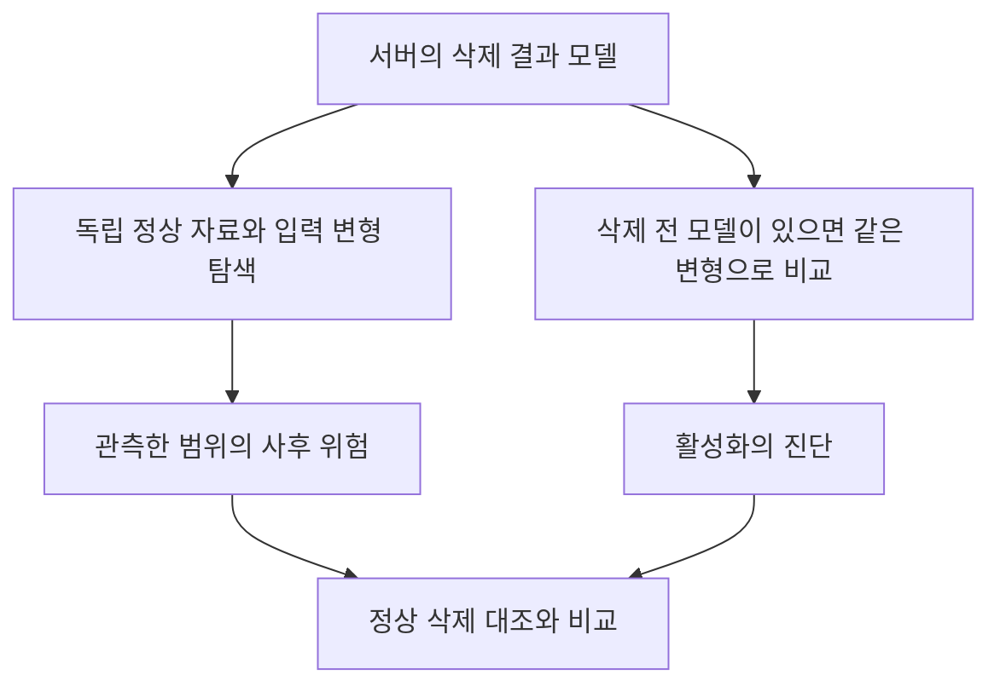

# 탐지의 첫 문제 정의

먼저 탐지 대상과 정보 접근을 고정한다. 공격자 신원·위험한 삭제 결과·트리거·타깃은 서로 다른 출력이다.

## 지금의 탐지 대상

삭제 후 특정 변형 입력에서 타깃 오분류가 높은 결과를 정상 삭제와 구별할 수 있는지 묻는다. 삭제 전후 증가량은 활성화의 진단으로 함께 보되, 이미 위험한 모델을 놓치지 않도록 사후 절대 위험도 검사한다. 공격자의 의도 자체를 완벽히 알아맞힌다고 가정하지 않는다. 같은 현상을 정상적인 분포 변화가 만들 수 있는지도 대조한다.

두 공격의 공통 탐지 지표와 부분 해결의 범위는 [서버 관측 조건 분석](COMMON_ATTACK_SURFACE.md)에서 구체화한다.

## 방어자가 받을 정보의 수준

1. 삭제 전 모델의 정상 입력 출력만 받는다.
2. 삭제 전후 모델을 질의하거나 가중치를 볼 수 있다.
3. 정상 기준 데이터와 입력 변형 탐색을 사용할 수 있다.
4. 학습 이력과 참여자별 갱신을 보존한다.
5. 요청자의 R/F 원자료 또는 현지에서 계산한 응답을 받는다.

이 수준은 비용과 가정이 다르다. 원자료를 보는 서버와 조작 가능한 응답만 받는 서버를 같은 방어로 취급하지 않는다. [정상 출력만 보는 식별의 한계](../04_theory/README.md)는 1번에 대한 명제이며 전체 가중치를 보는 2번의 불가능성 정리가 아니다.

## 처음 비교할 방법

클래스 구성·평균 손실·갱신 크기의 단순 통계와 정식 Neural Cleanse를 우선 비교한다. 정상 데이터에 대한 망각 동역학은 MASA의 가정과 함께 검토한다. 공격 타깃·실제 트리거를 지표나 임계값 선택에 제공하지 않는다.

정상 대조는 무작위 삭제만으로 끝내지 않는다. 클래스별 삭제 수를 맞춘 저손실·고손실 삭제와 클래스 편향을 포함한다. 이들을 추가하면 기존 임계값이 유지되는지 확인한다. 아직 어느 새 점수를 기본 해법으로 채택하지 않는다.
