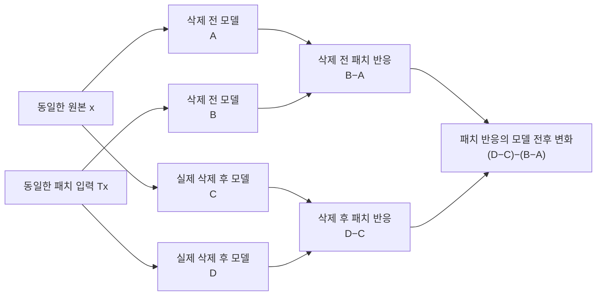

# 패치 실험의 두 비교 축과 타당성

**clean 이미지와 패치 이미지만 한 모델에 넣어 비교하면 언러닝 전후 실험이 아니다.** 처음 세운 전후 가설을 검증하려면 동일한 원본·패치 입력을 실제 삭제 전 모델과 실제 삭제 후 모델 모두에 넣어야 한다. 기존 84요청의 최고 점수는 실제 FU 모델 대신 R/F 진단 모델을 비교한 결과였다.

## 네 개의 출력을 구분한다

아래 값은 모두 동일한 후보 타깃 k에 대한 평균 예측 확률이다. 원본과 패치 입력은 같은 이미지에서 만들고 두 모델 사이에서 고정한다. 실제 공격 타깃을 서버에 알려주는 것은 아니며, 후보 선택 자료에서 패턴과 k를 선택한 뒤 별도 이미지에서 확인한다.

| 비교 모델 | 동일 원본 이미지 x | 동일 패치 이미지 Tx | 이미지 변형 반응 |
|---|---|---|---|
| 실제 삭제 전 모델 | A | B | B−A |
| 실제 삭제 후 모델 | C | D | D−C |
| 같은 입력의 모델 간 변화 | C−A | D−B | (D−C)−(B−A) |

$$\Delta_{\mathrm{patch}}=(D-C)-(B-A)=(D-B)-(C-A).$$

- **B−A:** 삭제 전 모델 하나의 입력 변형 민감도다. 모델 전후 비교가 아니다.
- **D−B:** 같은 패치 입력에 대한 두 모델의 반응 변화다. 모델 전후 비교다.
- **(D−B)−(C−A):** 패치 입력에서의 모델 변화를 원본 입력에서의 모델 변화와 대조한다. 두 축을 모두 사용한다.

모델의 행동 차이를 비교하는 데 가중치 벡터를 직접 뺄 필요는 없다. 다만 어떤 두 모델인지가 핵심이다. 정상 영향이 이 차분에서 모두 제거된다는 보장은 별도로 필요하다.

## 기존 구현을 정확히 부르는 방법

| 구현 | 실제 비교 모델 | 해석 |
|---|---|---|
| 한 모델의 패치 반응 | θ 하나 | 입력 민감도 검사 |
| 기존 84요청의 두 갈래 점수 | θpre, θR, θF | 모델 간 비교는 있지만 R/F 추가 학습 진단이며 실제 FU 전후 탐지는 아님 |
| 새 학습의 관찰 전용 점수 | 이전 전역 모델과 현재 전역 모델 | FL 라운드 간 모델 비교이며 실제 FU 전후는 아님 |
| 실제 FU 전후 실험 | θpre, 실제 반환 θFU | 처음 전후 가설을 직접 검증하는 실험 |
| 아래 보존 출력 재분석 | N+P+C 모델, N+P 유지 재학습 모델 | 삭제 후 기준을 처음부터 재학습한 전후 비교. 근사 FU 알고리즘의 실측과 구분 |

[기존 점수식](../../research_20261019/patch_scale_v1/sources/scale_patch_experiment.py)에서 θF는 F로 정답 손실을 낮추는 추가 학습 모델이다. 삭제 완료 모델이 아니다. 기존 판정에는 실제 미래 재학습 ASR 정답이 연결되어 있었지만, 판정 입력에 미래 모델이 들어간 것은 아니다. **미래 정답의 존재와 탐지 입력의 출처를 구별한다.**

## 왜 다른 패치를 넣어 볼 수 있는가

**가설: 실제 트리거와 다른 고정 패치도 백도어와 공유하는 입력 특징을 자극하면 삭제 후의 위험 반응 증가를 드러낸다.**

조건은 ‘임의 패치가 실제 트리거와 충분히 관련된 특징을 자극한다’는 것이다. 이는 검증할 연결 고리이며 자동 성립하는 사실이 아니다. 패치는 학습할 새 독성 자료가 아니라, 이미 학습된 모델에 추론 시 넣는 진단 입력이다.

단순 로짓 모형을 $z_\theta(x)=g_\theta(x)+a_\theta s(x)$로 놓으면, $s$는 가정한 트리거 관련 특징이고 $g$는 나머지 기능이다. 두 모델에서 동일한 s를 쓰는 이 단순 모형에서

$$\Delta_{\mathrm{patch}}=\underbrace{\Delta g(Tx)-\Delta g(x)}_{정상\ 기능\ 변화도\ 포함}+\underbrace{\Delta a\,[s(Tx)-s(x)]}_{트리거\ 관련\ 민감도\ 변화}.$$

패치가 s를 거의 자극하지 않으면 두 번째 항은 거의 0이다. 반대로 첫 번째 항만으로도 큰 값이 가능하다. 따라서 **후보가 위험 특징을 건드리는가**와 **정상 변화를 배제할 수 있는가**를 모두 검증해야 한다. 이 분해는 조건부 설명이며 실제 ResNet의 두 기능을 분리 추정했다는 주장은 아니다.

입력으로 모델을 진단하는 발상은 [Universal Litmus Patterns](https://arxiv.org/abs/1906.10842)에 있지만, 그 방법은 진단 패턴을 여러 모델에서 학습한다. [Neural Cleanse](https://bolunwang.github.io/assets/docs/backdoor-sp19.pdf)는 트리거를 최적화해 역추정한다. 어느 논문도 우리의 고정 32패치가 BadFU·FUBA에 충분하다는 보장을 대신 제공하지 않는다. [Adversarial Patch](https://arxiv.org/abs/1712.09665)는 정상 모델도 패치 공격에 반응할 수 있음을 보여준다.

## 보존된 실제 모델 전후 출력의 재분석

**가설: 선택된 고정 패치의 반응은 위장 삭제 후 유지 재학습 모델에서 삭제 전 모델보다 증가한다.**

- 조건: 기존 BadFU 형태의 통제 실험 시드 71. 삭제 전 N+P+C, 삭제 후 기준은 같은 초기화로 N+P 전체 FedAvg 재학습. 새 학습이나 새로운 원본 FU 실행은 아니다.
- 선택: 개발 200장에서 32패치×10클래스의 실제 전후 확률 반응 차이를 최대화. 선택은 오른쪽 아래 random1, 타깃 0이었다. 실제 트리거는 선택에 사용하지 않았다.
- 확인: 별도 확인 이미지 200장 중 타깃 클래스가 아닌 180장. 실제 post 모델을 선택에 썼으므로 **사후 진단**이며 미래 예측 결과로 보고하지 않는다.

| 모델 | 원본 입력의 평균 타깃 확률 | 같은 패치 입력의 평균 타깃 확률 | 패치−원본 |
|---|---:|---:|---:|
| 삭제 전 N+P+C | 6.23% | 7.41% | 1.18%p |
| 유지 재학습 후 N+P | 5.71% | 33.82% | 28.11%p |
| 모델 간 변화 | −0.52%p | +26.41%p | **이중 차분 +26.93%p** |

같은 확인 집합에서 **실제 트리거**의 타깃 예측 비율은 7.78%→77.78%, 선택된 **진단 패치**의 타깃 예측 비율은 6.11%→37.78%였다. 서로 다른 입력이므로 같은 ASR로 부르지 않는다.

판정은 **이 한 사례에서 지지**다. 실제로 두 모델의 동일 입력 반응을 비교할 수 있고, 실제 트리거와 다른 패치에서도 변화가 관측됐다. 같은 내부 백도어 회로를 활성화했다는 증명, 독립 공격에 대한 탐지 성능은 아니다.

## 같은 무늬의 위치 대조

**가설: 선택 무늬의 모델 전후 반응 증가는 위치와 관계없이 동일하다.**

선택된 random1 무늬를 고정하고 네 모서리에 옮긴 보존 출력의 확인 결과다. 타깃 0도 고정한다.

| 위치 | 공격 조건의 전후 차분 | 독성 P 없는 조건의 전후 차분 |
|---|---:|---:|
| 왼쪽 위 | 0.73%p | 0.36%p |
| 오른쪽 위 | 2.84%p | 0.48%p |
| 왼쪽 아래 | 6.08%p | 0.79%p |
| 오른쪽 아래 | **26.93%p** | **1.65%p** |

독성 없는 비교는 N+C→N 유지 재학습이다. **위치 불변 가설은 이 사례에서 지지되지 않는다.** 오른쪽 아래의 큰 차이는 실제 트리거 위치와 일치한다. 다른 세 위치에서도 작은 변화는 있으므로 틀린 위치에서 신호가 반드시 0이라고 주장하지 않는다.

정상 조건의 1.65%p도 0은 아니다. 이 실제 전후 점수에 기존 R/F 진단의 임계값 0.006을 그대로 이식하면 이 정상 조건도 경보한다. 점수 분포가 다른 방법의 임계값은 별도로 정상 보정해야 한다.

## 현재 근거의 범위와 다음 검증

### BadFU는 국소 패치 공격에 한정되지 않는다

BadFU는 독성 P와 위장 C를 함께 학습한 뒤 C를 삭제하는 절차이며, 트리거 변환 T는 그 절차 안의 선택이다. 원논문 VI C와 Table II·IV는 아래 두 종류를 모두 사용한다. [BadFU 원문](https://arxiv.org/html/2508.15541v1#S6.SS3).

| 구분 | 입력을 바꾸는 방식 | 기존 국소 패치 진단의 근거 |
|---|---|---|
| BadNet형 | 모서리의 작은 영역을 패턴으로 대체 | 통제 실험의 양성 근거가 있으나 다른 위치·무늬로의 일반화는 별도 |
| Blended형 | $T(x)=(1-\rho)x+\rho v$로 영상 전체에 워터마크 무늬를 혼합 | 고정 4×4 진단이 이를 탐지한다는 확인 결과 없음 |
| 보존 코드의 위장 교란 | 위장 데이터에 UBA-Inf의 최적화된 작은 입력 교란 추가 | 트리거 자체와 별개인 생성 단계. 보존 생성 설정은 ε=2/255이며 패치 영역만으로 제한하는 마스크는 해당 PGD 갱신에 없음 |

독성 자료의 라벨은 타깃, 위장 자료의 라벨은 원래 라벨이다. 같은 T를 쓴 두 자료의 역할이 다르다. 무작위 잡음을 넣어 정확도를 떨어뜨리는 공격으로만 설명하면 이 구조를 놓친다.

국소 패치를 적용하더라도 모델은 영상 전체를 처리한다. 문제는 시야가 국소 영역에 한정된다는 것이 아니라 **시험하는 입력 변형이 전역·분산 트리거의 특징을 충분히 자극하는가**다. 반응이 작다고 전역 백도어가 없다고 판정할 수 없다. 반대로 전역 잡음을 넣어 큰 반응을 얻어도 정상 모델의 일반 민감도일 수 있다.

**가설: 고정 국소 패치의 실제 FU 전후 반응 차분은 BadFU의 Blended형도 정상 non-IID 삭제와 구별한다.**

- 조건: 실제 pre/FU 모델과 동일한 clean·변형 입력 쌍을 사용. BadNet형과 Blended형을 각각 재현하고 임계값은 독립 정상 FU에서 고정.
- 결과: **미측정.** 기존 국소 패치 통제 결과로 대체하지 않는다.
- 판정: **미검증.** 이 조건을 통과하기 전에는 BadFU 전체를 탐지한다고 주장하지 않는다.

**가설: 전역 입력 변형을 추가하면 같은 정상 경보율에서 국소 패치 진단의 미탐을 줄인다.**

- 비교: 국소만·전역만·결합, 같은 실제 전후 모델과 입력·계산 예산. 전역 혼합 패턴·작은 분산 섭동의 후보 선택은 개발 자료에서만 수행.
- 대조: 동일 강도의 정상 잡음 민감도, 정상 non-IID FU, 학습에서 보지 않은 공격 패턴. 실제 공격 트리거는 평가자만 사용.
- 결과와 판정: **미검증.** 무작위 전역 노이즈를 추가했다는 사실만으로 공격 특징을 덮었다고 간주하지 않는다.

84요청의 공격 12건은 선택 패치가 모두 오른쪽 아래, 타깃이 모두 0이었다. 하지만 실제 공격 패턴도 모든 학습 시드에서 고정 시드 20261018로 생성한 동일한 오른쪽 아래 4×4 패턴이다. 진단 후보도 같은 크기의 네 모서리를 포함한다. 이는 해당 패턴 계열의 양성 근거이며, 미지의 위치·크기·패턴에 대한 일반화 근거는 아니다.

**가설: 기존 고정 패치 후보군은 학습에서 보지 않은 공격 트리거에서도 실제 FU 위험을 정상 non-IID보다 잘 구별한다.**

- 조건: 공격 트리거 무늬·위치·크기와 학습 시드를 바꿔 독립 확인. FUBA는 고정 국소 패치와 다른 입력 의존 변형을 별도로 평가.
- 비교: 동일 원본·변형 입력의 실제 pre/FU 네 출력, 정상 FU·독성 없는 패치 증강 삭제, 같은 면적의 위치·무늬 대조, 원본 출력 변화만 보는 기준선.
- 판정: **미검증.** 후보 미포함으로 인한 미탐과 정상 패치 민감도에 의한 경보를 모두 보고해야 한다.

현재 결론은 **패치 반응을 모델 사이에서 대조할 실험적 이유는 있지만, 고정 패치만으로 일반적인 백도어 활성화를 탐지한다는 주장은 아직 성립하지 않는다**이다.

[원본 출력의 네 칸 재계산](validation_20261020/patch_model_input_axes.json) · [기존 방식의 정확한 수식](PATCH_PROBING_SPEC.md) · [가설별 미팅 정리](../05_meetings/20261020/CLAIM_BOARD.md).
