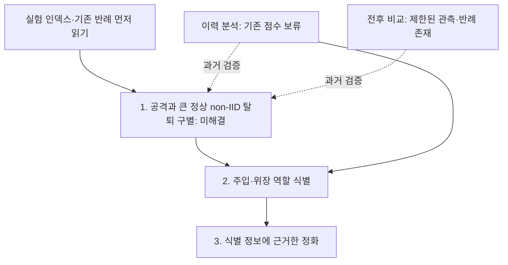

# 1·2단계 — 공격 탐지와 역할 식별

**필수 입구:** [연구 실험 인덱스](../INDEX.md) → [관련 카드와 원 보고서](../EXPERIMENT_CARDS.md). **큰 정상 non-IID 탈퇴는 단순 반응량·전후 차분·내부 변화량에서도 공격과 겹쳤다.** 같은 잔류 참여자와 추가 관측을 사용한 D08, 협조자 검증 D15까지 읽고 제안한다. 현재 트리거 종류에 독립적인 공통 구별은 확보하지 못했다.

전체 연구는 [공격 탐지 → 공격자·위장자 식별 → 정화](../RESEARCH_STAGES.md) 순서다. 이 폴더는 1단계의 정상 non-IID와 공격의 구별, 2단계의 주입·위장 역할 식별을 다룬다. [역할 식별](role_attribution/README.md)과 [정화에 전달할 정보](../02_purification/DETECTION_TO_PURIFICATION.md)를 따로 기록한다.

[1단계 탐지 방법과 필요한 궤적](STAGE1_METHODS.md)은 초기 설계 기록이다. 현재 판정은 인덱스를 우선한다. 이력은 요청 시점까지의 정보로, 모델 비교는 서버가 실제 구할 수 있는 모델로 수행한다. 실제 FU 전후, 제출분 제외, 진단 모델은 서로 다른 조건이다.

[이력 예측과 실제 언러닝 전후 비교](TWO_ROUTE_REVIEW.md)는 위 단계에 사용할 두 관측 방법이다. 실제 ASR은 평가자만 사용하는 정답이며 서버 관측 지표와 구분한다.

[당시 후보·분리 여부·후속 설계](BEST_CANDIDATES.md)는 과거 기록이다. FC·Conv는 [삭제 전후 갈래의 하위 분석](02_pre_post_detection/fc_conv/README.md)으로 보존하되, 단순 변화량을 새 탐지 방법으로 재제안하지 않는다. [추천 철회 D16](../EXPERIMENT_CARDS.md#d16)

- [방법 1 — 이력 예측](01_history_prediction/README.md): 과거의 선택적 상쇄가 같은 요청의 실제 미래 위험을 예측하는가.
- [방법 2 — 실제 전후 감지](02_pre_post_detection/README.md): 관측 변화가 일반적인 모델 손상과 구별되는가.
- [FC·Conv](02_pre_post_detection/fc_conv/README.md): 이전 R/F 기울기 진단과 실제 pre/post 출력 분해를 구분한다.
- [정확도와 ASR의 새 재분석](validation_20261020/accuracy_proxy_results.json): 저장된 BadFU 계열 84요청에서 단순 정확도 변화의 한계를 확인했다. FUBA·FedEraser 검증은 아니다.

[탐지 대상과 정보 접근](FOUNDATION_QUESTIONS.md), [두 공격의 공통 구조와 서버 관측 조건](COMMON_ATTACK_SURFACE.md)은 두 경로에 공통으로 적용할 배경이다. 공격자 신원·위험한 결과·트리거·타깃의 탐지는 각각 다른 문제다.

클래스 구성·손실·갱신 크기와 정식 Neural Cleanse를 기본 비교로 둔다. 정상 망각 동역학은 MASA의 가정과 함께 검토한다. 임계값과 후보 선택에는 실제 공격 트리거를 사용하지 않는다. 정상 오탐을 확인하기 위해 무작위 삭제 외에 저손실·고손실·클래스 편향 대조를 넣는다.

## 이전 탐색의 위치

아래는 과거 구현과 결과다. 특히 패치 두 분기는 진단 복제 모델의 비교이며 실제 FU 전후 감지와 구분한다. 이전 이력 점수의 보류와 이력 예측 방향 전체의 폐기를 혼동하지 않는다.

- [기존 기준선 정리](baselines/README.md)
- [패치 두 분기](derived/paired_patch/README.md)
- [기울기 크기 비율](derived/gradient_ratio/README.md)
- [직교 잔차](derived/gradient_ratio/variants/orthogonal_residual/README.md)
- [보류한 이력 검사](parked/history/README.md)
