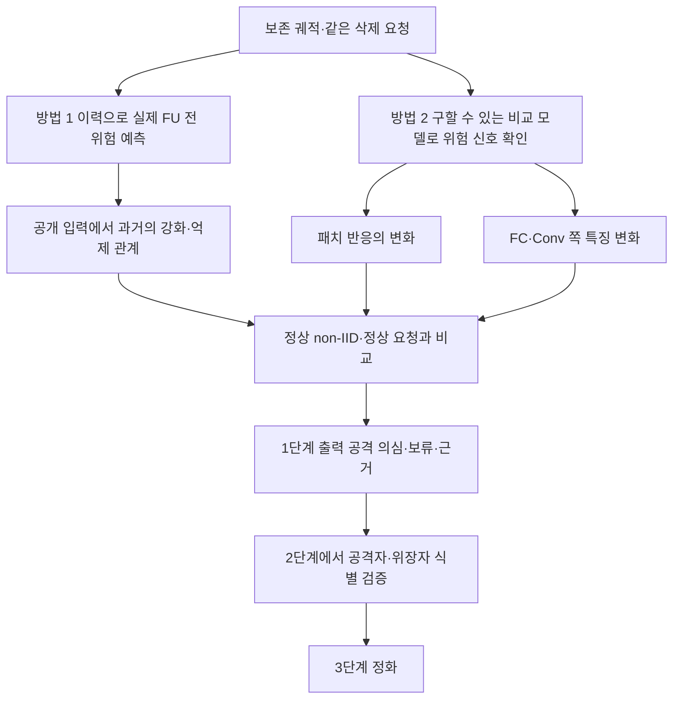

# 1단계 탐지 방법과 필요한 궤적

> **초기 설계 기록 — 자동 실행 지시 아님.** 먼저 [실험 인덱스](../INDEX.md), 관련 카드와 원 결과를 읽는다. 아래 패치·FC·Conv·이력 제안의 현재 판정은 후속 non-IID 반례와 추천 철회를 반영한 인덱스를 우선한다.

목표는 서버가 계산할 수 있는 정보로 공격 위험을 정상 non-IID 변화와 구별하는 것이다. **미리 학습한 궤적은 그대로 재사용한다.** 어떤 방법에 어떤 시점의 자료를 허용할지, 무엇을 탐지했다고 채점할지를 먼저 고정한다. [기존 궤적의 재사용 판정](../01_reproduction/TRAJECTORY_DECISION.md)

현재 공격이 의심스러운지 알아내는 것과, 특정 삭제가 앞으로 백도어를 활성화할지 예측하는 것은 같은 정답이 아니다. 삭제 전부터 ASR이 높은 실행은 기존 공격 대조로 쓰고, 잠복 활성화 예측의 성공 사례로 합쳐 세지 않는다. 기존 공격 구성이라는 사실과 현재 기능적 위험을 담은 평가값도 각각 기록한다.

## 방법 1 이력에서 강화와 억제 관계를 찾기

서버가 가진 과거 전역 모델, 참여자 제출, 집계 비중과 공개 입력을 사용한다. 실제 공격 트리거·타깃·미래 ASR은 입력으로 받지 않는다.

1. 같은 공개 입력에 패치 등 제한한 변형을 넣고 모든 출력 클래스를 탐색한다.
2. 과거 한 제출이 해당 변형 반응을 강화했는지 억제했는지 측정한다. 원본 입력의 일반 변화도 함께 측정한다.
3. 같은 변형·클래스에서 강화와 억제가 반복됐는지, 요청이 억제 쪽 기여를 선택적으로 지우는지 점수화한다.
4. 전체 실행의 정상 입력 변화 크기로 보정하고, 정상 non-IID에도 나타나는 상쇄 관계와 비교한다.
5. 점수를 고정한 뒤 평가자가 같은 요청의 실제 FU 결과와 연결한다.

이 갈래의 발전 후보는 기존 **실행 공통 RMS 보정 HRAC**다. 핵심 검증은 전체 이력이 최근 모델 하나·최근 한 라운드·단순 갱신 크기보다 미래 위험에 추가 정보를 주는지다. 과거 기능 반응의 합을 실제 삭제 후 모델로 취급하지 않는다.

FUBA처럼 역할이 참여자로 나뉜 조건에서는 특정 참여자의 억제 기여와 요청을 연결할 수 있다. BadFU 원논문처럼 한 참여자 안에 독성·위장이 섞이면 참여자 갱신에서 두 샘플 집합의 기여를 바로 분리할 수 없다. 이 경우 이력은 사전 경보로 남기고, 샘플 삭제 갱신이나 실제 FU 후보 모델을 추가로 받아야 한다.

**이력을 전혀 사용할 수 없다는 결론은 아니다.** 현재는 같은 요청의 실제 미래 활성화를 충분한 시드에서 예측했다고 입증하지 못한 상태다. 이미 활성화된 공격을 이력에서 찾은 결과를 그 예측의 증거로 바꾸어 쓰지 않는다. [기존 HRAC 근거](01_history_prediction/README.md)

## 방법 2 서버가 실제로 구할 수 있는 모델 비교

두 모델이 반드시 삭제 전후일 필요는 없다. 아래처럼 **구성 가능성과 비교가 대표하는 질문**이 설명돼야 한다.

| 비교 모델 | 어떻게 구하는가 | 측정하는 것 | 결과 해석의 범위 |
|---|---|---|---|
| 삭제 전 모델 ↔ 실제 FU 후보 | 같은 요청에 대해 프로토콜 실행, 결과 모델 수신 | 실제 삭제에 따른 변화 | 정상 FU와 같은 예산 대조 필요 |
| 실제 집계 ↔ 특정 마지막 제출분 제외 집계 | 개별 제출과 집계 가중치로 서버가 재계산 | 해당 제출분의 현재 기능 기여 | 전체 과거 기여나 샘플 삭제를 대표하지 않음 |
| 삭제 전 ↔ 유지 자료 재학습 기준 | 남은 클라이언트가 같은 기준으로 협력 재학습 | 삭제 후 기준 동작 | 초기화·학습 예산·잔존 자료의 대응을 기록 |
| 원모델 ↔ 공개 자료로 만든 진단 모델 | 서버가 모델 복사 후 공개 자료로 계산 | 반응의 민감도·안정성 | 실제 삭제 품질·활성화의 정답 모델로 쓰지 않음 |
| 유지 R·삭제 F 자료를 쓰는 기존 진단 | 자료 접근 또는 신뢰 가능한 현지 계산 추가 | 삭제 대상과 유지 자료의 기능 차이 | 기본 서버 정보만으로 가능하다고 가정하지 않음 |

개별 제출이 숨겨진 보안 집계에서는 두 번째 비교도 할 수 없다. 반면 실제 FU가 실행돼 서버가 후보 모델을 받는 조건에서는 첫 번째가 가능하다. 구할 수 없는 유지 자료의 재학습 모델을 서버가 이미 알고 있는 것처럼 넣지 않는다.

### 패치 반응

공개 입력 Q에서 변형 τ가 클래스 k에 만드는 반응을

$$B(f,\tau,k)=\mathbb E_Q[p_{f,k}(T_\tau x)-p_{f,k}(x)]$$

로 두고, 두 모델의 차이

$$D(\tau,k)=B(f_1,\tau,k)-B(f_0,\tau,k)$$

를 측정한다. 일반적인 출력 이동을 원본 입력으로 빼고, 변형에 특이적인 변화를 찾는 방법이다. 후보 변형·클래스와 방향은 탐색 자료에서 정하고 별도 확인 자료에서 점수화한다. 실제 트리거와 타깃을 정답으로 받아 고르지 않는다.

원본 입력의 변화 크기로 나누는 보정 패치를 우선 발전 후보로 둔다. 정상 학습이 불안정해 모든 반응이 커진 경우와 특정 변형만 커진 경우를 구별하려는 목적이다. 이미 본 정상 실행에서 경보가 줄어든 결과는 개발 관측이며 새 시드 검증으로 세지 않는다.

FUBA의 입력 의존 생성기를 겨냥하려면 고정 패치 외에 작은 전체 영상 교란 등 탐색 범위를 넓히는 후보가 필요하다. 정상 모델도 그 교란에 쉽게 속는지 반드시 함께 측정한다. 강한 입력 공격을 찾았다는 사실만으로 해당 모델에 악성 학습이 있었다고 단정하지 않는다.

### FC와 Conv 분석

이들은 모델 비교 갈래의 내부 분석이다. 마지막 특징 h와 FC의 W,b로 출력을 z=Wh+b라 두면, 두 모델 간 변화는 정확히

$$\Delta z=\underbrace{\Delta W\,\frac{h_0+h_1}{2}+\Delta b}_{FC\;기여}
+\underbrace{\frac{W_0+W_1}{2}\Delta h}_{앞단\;특징\;기여}$$

로 나뉜다. 같은 공개 입력에서 어느 항이 패치 반응 변화를 설명하는지 본다. 앞단 특징 항에는 Conv뿐 아니라 BN 등 모든 앞단 경로가 포함된다. 순수 Conv 가중치 변화량은 별도 기준선이다.

FC·Conv의 단순 변화량만으로 공격을 판정하지 않는다. 정상 non-IID에서도 크기가 커지고, 작은 가중치 변화로 기능이 크게 달라질 수도 있다. 역할 식별과 정화에는 후보 위치 정보가 될 수 있지만 공격자·위장자 신원을 바로 반환하는 검사는 아니다.

## 지금까지의 실측이 말하는 범위

아래는 FUBA 정상 42로 임계값을 정하고 정상 43·44와 공격 42에 적용한 **실행 단위** 결과다. 모든 요청 중 최댓값으로 실행의 경보를 정했다. 공격 실행은 이미 높은 ASR 상태이므로 이 표는 현재 이상 신호의 비교다.

| 비교와 점수 | 공격 실행 경보 | 별도 정상 실행 오경보 |
|---|---:|---:|
| 마지막 제출분 제외 · 패치 | 1/1 | 1/2 |
| 마지막 제출분 제외 · FC 기능 기여 | 1/1 | 2/2 |
| 마지막 제출분 제외 · Conv 쪽 특징 기여 | 1/1 | 1/2 |
| 마지막 제출분 제외 · FC 가중치 크기 | 1/1 | 0/2 |
| 마지막 제출분 제외 · 정상 정확도 변화 절댓값 | 0/1 | 1/2 |
| 최근 한 FL 라운드 · 패치 | 1/1 | 0/2 |
| 최근 한 FL 라운드 · FC 기능 기여 | 0/1 | 1/2 |
| 최근 한 FL 라운드 · Conv 쪽 특징 기여 | 1/1 | 0/2 |

정상 두 실행만으로 낮은 오경보율이 보장되지는 않는다. BadFU는 독립 정상 평가 시드가 없어 관측 범위의 겹침만 확인했다. 기존 84요청에서 좋았던 패치는 R/F 진단 조건의 결과로 남기며, 위 비교나 실제 FU에서 최고였다고 옮겨 쓰지 않는다.

후속 보정 패치는 FUBA 공격 1개 경보를 유지하면서 정상 43·44의 경보가 0/2가 됐다. 하지만 원점수를 확인한 뒤 적용한 방식이어서 **발전 후보**다. FC·Conv 기능 점수를 같이 보정한 것만으로 정상 경보가 모두 사라지지는 않았다. [보정 실측](../stage1_20261020/exploratory_normalization.json) · [기존 후보 비교](BEST_CANDIDATES.md)

현재 우선순위는 **정상 입력 변화 크기로 보정한 패치 비교를 주 후보**, **전체 이력의 공통 RMS 보정 HRAC를 사전 경보 후보**, **FC·앞단 특징 분해를 근거 분석**으로 두는 것이다. 어느 하나도 두 공격의 미래 활성화를 검증한 최종 탐지기로 선정하지 않는다. BadFU와 FUBA의 원점수와 임계값은 각 계열의 정상 자료로 보정하며 그대로 합치지 않는다.

## 기존 궤적으로 이어서 할 실험

| 순서 | 재사용할 자료 | 추가할 계산 | 검증 질문 |
|---|---|---|---|
| 1 | BadFU cover5, FUBA 원본 FL와 정상 궤적 | 같은 자료 분할·요청의 실제 FU | 비교용 원본과 삭제 결과가 대응하는가 |
| 2 | 같은 pre 모델과 저장 이력 | 이력 점수를 FU 전에 고정 | 실제 미래 위험을 예측하는가 |
| 3 | pre와 실제 FU 후보, 제출분 제외 모델 | 같은 예산의 패치·FC·Conv 계산 | 어떤 비교 모델의 점수가 실제 FU 위험과 연결되는가 |
| 4 | 정상 학습 궤적 | 정상 FU·학습 연장·클래스 편향 요청 대조 | non-IID 변화와 구분되는가 |
| 5 | 개발에 쓰지 않은 학습 시드 | 보정 패치·이력 점수 고정 적용 | 새 실행에서도 구분되는가 |

BadFU는 위장만 삭제, 독성만 삭제, 정상 자료 삭제와 무삭제 학습 연장을 구분한다. FUBA는 위장 참여자 삭제와 정상 참여자 삭제를 같은 저장 분할에서 실행하고, FU 중 공격자가 계속 악성 학습하는 조건도 분리한다. 정상 요청이라고 항상 안전하다는 정답을 미리 붙이지 말고 실제 결과로 채점한다.

ASR은 평가자만 읽는다. 요청 시점의 생성기를 고정한 평가에서는 공격 시험 입력을 한 번 생성해 보존하고 같은 픽셀 입력을 pre·post·정상 대조에 재사용한다. 생성기 상태·BN 모드·batch 순서도 기록한다. 생성기도 바뀌는 적응형 공격 평가는 따로 둔다. 기존 FUBA 라운드 로그는 개별 생성기가 바뀌며 공격 참여자가 없을 때 무작위 생성기로 평가한 라운드도 있어, 낮은 로그 ASR 하나를 잠복 체크포인트 선정 근거로 삼지 않는다.

한 궤적의 많은 라운드·요청을 서로 독립된 시드처럼 세지 않는다. 변형 선택용 공개 자료, 확인용 공개 자료, 정상 임계값 보정 실행, 새 시드 평가를 분리한다. 라벨이 있는 정상 자료를 제공한다면 정확도·클래스별 손실·출력 전환을 기본 비교로 넣는다.

## 1단계가 다음 단계에 전달할 정보

출력은 공격 의심 여부, 보류 여부, 근거가 된 변형·클래스·시점·모델 비교 범위다. 참여자별 비교에서 높은 점수를 받은 ID는 의심 후보이며, 공격자나 위장자 역할의 확정 정답이 아니다. 역할 정보가 얼마나 맞는지는 [2단계](role_attribution/README.md)에서 검증한 뒤 [3단계 정화](../02_purification/DETECTION_TO_PURIFICATION.md)에 전달한다.
