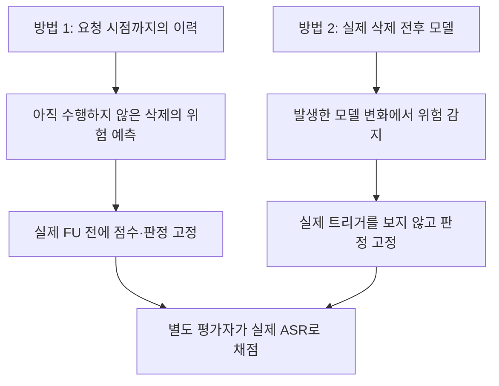
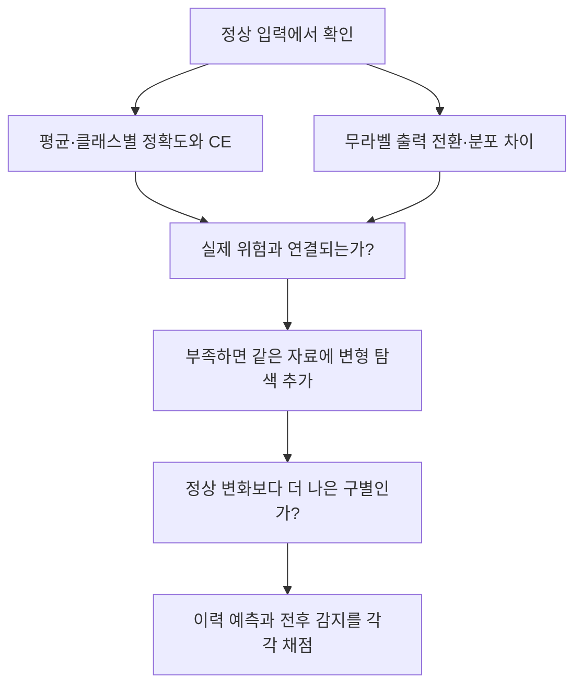

# 두 탐지 경로의 원리와 빠진 검증

2026년 10월 20일. 연구의 두 갈래는 **이력으로 실제 삭제 후 위험을 예측하는 방법**과 **실제 언러닝 전후로 위험 발생을 감지하는 방법**이다. 기존 실험·코드를 다시 읽고, 저장된 84요청에서 정상 정확도와 실제 ASR의 관계를 새로 계산했다. 새 FL·FU 학습이나 모델 추론을 수행한 보고서는 아니다.

현재 전체 연구 순서는 [① 공격과 정상 non-IID 구별 → ② 공격자·위장자 식별 → ③ 정화](../RESEARCH_STAGES.md)다. 이 문서의 두 방법은 그 과정의 관측 경로다. 역할 정보가 어떻게 정화로 이어지는지는 [정보별 정화 조건](../02_purification/DETECTION_TO_PURIFICATION.md)을 따른다.

후속 [후보 선택과 발전 검토](BEST_CANDIDATES.md)에서는 이력의 공통 RMS 보정 HRAC와 전후 갈래의 패치 반응을 주요 후보로 남겼다. FC·Conv는 [전후 갈래의 하위 분석](02_pre_post_detection/fc_conv/README.md)에 넣고, 과거 R/F 진단에서 실제 pre/post 분석으로 이어지는 조건을 명시했다.

## 1 두 방법이 답해야 하는 질문

| 구분 | 방법 1: 이력 예측 | 방법 2: 전후 감지 |
|---|---|---|
| 판정 시점 | 실제 FU 전 | 실제 FU 후보 생성 후 |
| 핵심 정보 | 참여·집계·개별 갱신과 기능 반응 이력, 요청 범위 | 실제 pre/post 모델과 같은 기준 입력 |
| 원리 가설 | 요청이 과거의 억제·강화 관계를 끊으면 미래 위험이 커짐 | 정상 입력 변화와 구별되는 변형 특이 변화가 활성화를 드러냄 |
| 가장 중요한 연결 | 과거 기능 기여 → 같은 요청의 실제 FU 위험 | 전후 관측 변화 → 원래 트리거에서의 실제 위험 |
| 단순 비교 기준 | 최근 모델만, 최근 한 라운드, 갱신 크기, 정상 성능 이력 | 정상 정확도·손실·출력 변화, 같은 예산의 post-only |
| 기본적으로 쓰면 안 되는 입력 | 미래 FU 모델·ASR·미래 공격 생성기 | 실제 공격 트리거·타깃·실제 ASR |

ASR은 ‘못 보니 평가하지 않는 값’이 아니다. **평가자는 알고 서버는 모르는 정답**으로 둬야 관측 신호가 위험을 설명하는지 검증할 수 있다. 공격자 역할 라벨만 맞히는 평가와 실제 위험 예측 평가도 구분한다.

## 2 방법 1: 어떤 원리로 무엇을 실험했는가

### 과거의 상쇄 관계를 찾는 HRAC

기존 관측은 라운드 시작 모델에 한 참여자의 실제 집계 비중만큼 갱신을 적용해, 공개 원본·패턴 입력의 중심화 로짓 변화를 측정했다. BN 저장 통계는 라운드 시작 값으로 고정했다. 실제 트리거를 쓰지 않고 원본 대비 공개 패턴 반응을 비교했다.

이를 라운드·참여자별 기능 기여 e라고 하자. 과거에 타깃 방향을 올리는 기여와 내리는 기여가 함께 있었고, 삭제 요청이 후자만 없애는 관계를 점수화했다. 이후 전체 크기 보정·GLR 누적·정상 설명 집합으로 확장했다.

**원리의 빈자리:** 과거 각 시점의 국소 반응을 합한 값이 미래 FU의 변화와 같지는 않다. ‘삭제하면 −Σe만큼 변한다’는 해석에는 기여 가산성·공통 기준점·이후 학습 경로의 조건이 필요하다. 실제 FU는 재보정·BN·유지 참여자의 후속 학습까지 바꿀 수 있다.

| 기존 실험 | 실제로 확인한 것 | 아직 연결하지 못한 것 |
|---|---|---|
| HRAC와 단순 기여·최근 라운드 비교 | 일부 조건에서 억제 역할의 요청자 순위·경보 | 같은 요청의 미래 ASR 상승을 어느 정도 예측하는가 |
| FUBA 정상 실행 보정 | 정상 43·44의 40요청 경보 12건 → 공통 보정 2건 | 자료 예산을 맞춘 우월성. 정상 3실행 교차 검증에서는 기존·보정 모두 2/60 |
| GLR | 저장 궤적에서의 변화점 후보 | 한 라운드 변화보다 나은 실시간 경보와 실제 FU 위험 예측 |
| 정상 설명 집합 | 비교 11건 모두 미판정 | 정상 기여를 충분히 설명하면서 공격 위험을 남기는가 |
| 실제 모델의 기여 가산성 감사 | 마지막 라운드의 같은 좌표에서도 개별 반응 합과 집계 반응이 달랐음 | 그 근사 오차가 오탐·미탐의 원인인지, 실제 FU까지 연결되는지 |

가산성 감사의 상대 RMS 오차는 예를 들어 FUBA 공격42의 100라운드에서 12.2%, BadFU full6의 40라운드에서 25.3%였다. 이는 **로짓 반응 근사 오차**다. 정확도 하락이나 ASR 오차로 해석하지 않는다.

현재 가장 큰 공백은 ‘누가 억제자인가’를 ‘이 요청을 실제로 삭제하면 위험이 커지는가’로 옮기는 대응 검증이다. FUBA의 일부 관측 궤적은 FL 중 이미 높은 ASR도 보여, 낮은 사전 위험에서 미래 활성화를 예측한 증거로 바로 세지 않는다. BadFU 내부 P/C를 분리하려면 삭제 단위에 맞는 더 세밀한 기록이 필요할 수 있다.

근거: [이력 실험 정리](../../research_audit_20261019/detection/history.md), [HRAC 관측·점수 정의](../../review_BadFU_defend/experiments/detection/hrac_matched/METHOD.md), [정상 보정 결과](../../review_BadFU_defend/experiments/detection/hrac_matched/results/refinement_v2/REPORT.md), [기여 가산성 감사](../../review_BadFU_defend/experiments/detection/hrac_matched/results/code_audit_v1/REPORT.md).

## 3 방법 2: 실제 전후 비교로 무엇을 보았는가

### 실제 FU와 진단 복제 모델을 구분

실제 pre/post 비교에서는 같은 입력과 변형을 두 모델에 적용한다. 예를 들어

$$B(f,\tau,k)=\mathbb E_Q[p_{f,k}(T_\tau x)-p_{f,k}(x)],\qquad
D(\tau,k)=B(f_{post},\tau,k)-B(f_{pre},\tau,k).$$

원본 입력에 나타난 변화보다 변형 입력에서 추가로 커지는 반응을 찾는 원리다. τ와 k는 서버가 탐색하며 실제 트리거·타깃을 받지 않는다. 탐색 자료에서 후보를 정하고 별도 자료에서 같은 후보를 확인한다. 실제 위험과의 연결은 별도 평가에서 확인한다.

| 기존 자료 | 실제 관측 | 해석 범위 |
|---|---|---|
| BadFU 실제 저자 FU 한 사례 | 정상 정확도 91.25%→95.00%, 탐색 변형 타깃 반응 2.78%→73.61% | 80장 감사 자료의 반응. 실제 트리거 ASR은 null이며 대응 정상 실제 FU 대조가 부족 |
| 누적 갱신 차감 대용 | FUBA 대용 모델 정확도 78.75%→10.00% 등 붕괴 | 모델 손상을 찾은 것일 수 있음. 실제 FU 활성화 실험으로 대체 불가 |
| 초기 실제 전후 차분을 이용한 정화 | 삭제 전 정보와 변형 반응 차이를 사용 | 정화 후 ASR 감소가 탐지 정확도·정상 오탐·망각 보장을 대신하지 않음 |
| 84요청 패치 두 분기 진단 | 유지·삭제 자료로 각각 진단 학습해 사전 예측, 공격 구성 11/12 경보·대조 3/72 경보 | 실제 FU 전후가 아닌 보조 검사. 개인 R/F 자료 또는 신뢰 가능한 현지 계산이 추가로 필요 |
| FC·Conv 기울기 비율·직교 잔차 | 같은 삭제 전 모델의 R/F 기울기와 과거 진단 모델 변화 비교 | 분류상 전후 갈래. 초기16요청 분리가 있었으나84요청·저손실 정상 대조에서 겹침. 실제 FU 전후 검증으로 바꾸어 세지 않음 |

특히 마지막 행은 원래 pre 모델·유지 진단 모델·삭제 진단 모델을 비교한다. 실제 미래 모델은 유지 자료의 세계를 초기 상태에서 다시 학습한 결과다. 진단 모델 중 하나를 실제 FU 결과라고 부르거나, 이력 예측 또는 실제 전후 감지의 검증을 완료한 것으로 세지 않는다. 보조 검사의 예측 신호가 있었던 사실은 유지한다.

코드의 `decide`는 진단 반응만 읽지만 저장된 prediction 메타데이터에는 평가용 pre-ASR도 포함된다. 새 실험에서는 서버 특징과 평가 정답 파일을 분리해, 저장돼 있다는 사실이 접근 허용으로 바뀌지 않도록 해야 한다.

근거: [실제 FU와 대용 비교](../../research_audit_20261019/detection/normal_set.md), [실제 FU 원본 점수](../../research_audit_20261019/evidence/remote/artifacts/deletion_comparison_v1/badfu_attack_actual/scores.json), [패치 진단 원리·결과](../../research_audit_20261019/detection/patch.md), [84요청 구현](../../research_20261019/patch_scale_v1/sources/scale_patch_experiment.py).

## 4 정확도 문제가 생기면 알아낼 수 있었는가 — 이번 재분석

원본 CSV의 84요청을 읽고 정확도 변화와 평가용 실제 ASR 변화를 대응시켰다. BadFU 계열 축소 실험의 12개 seed·분포 조건, 10개 시드 라벨이다. 요청들은 모델을 공유하며 84회 독립 학습이 아니다. 72대조에는 공격 모델에서 독성을 삭제한 경우도 포함되어 순수 정상 학습만은 아니다.

| 관측 | 공격 구성 12요청 | 비공격 대조 72요청 |
|---|---:|---:|
| 삭제 후 실제 ASR 범위 | 84.94~99.67% | 0.06~8.83% |
| 정상 정확도 변화 범위 | −3.70~+0.95%p | −4.10~+2.70%p |
| 정상 정확도가 올라간 요청 | 4건 | 25건 |
| 정확도 1%p 초과 하락에 경보 | 7/12 | 32/72 |
| 정확도 2%p 초과 하락에 경보 | 4/12 | 22/72 |
| 정확도 3%p 초과 하락에 경보 | 2/12 | 9/72 |

정확도 하락을 위험 점수로 둔 기술적 AUROC는 0.5914였고, 변화의 절댓값은 0.5041이었다. 임계값 예시는 사후 설명용이며 배포 기준을 선택한 것이 아니다. 모집단 성능이나 오탐 보장을 추정하지 않는다.

12공격 구성 중 저장된 잠복 기준(pre-ASR≤10%, post-ASR≥50%, 증가≥30%p)을 충족하는 것은 8요청이다. 그중에도 정상 정확도가 0.95%p 올라간 한 요청이 있다. 나머지 4개 공격 구성을 모두 ‘낮은 사전 ASR의 잠복 공격’이라고 부르지 않는다.

**지금 확인한 결론:** 이 저장 조건에서 평균 정확도 하락만으로 공격을 분리하기 어려웠다. 정확도 문제가 생길 수 있다는 것과, 그 문제로 백도어를 식별할 수 있다는 것은 다르다. FUBA·FedEraser까지 같은 결론을 실측한 것이 아니며, 손실·클래스별 변화·출력 분포 지표의 성능도 이 CSV만으로 계산하지 않았다.

[재계산 결과와 한계](validation_20261020/accuracy_proxy_results.json) · [84요청 대응표](validation_20261020/accuracy_proxy_rows.csv) · [재실행 코드](validation_20261020/analyze_accuracy_proxy.py)

## 5 서버 관측 지표의 검증 순서

| 지표 | 서버가 계산하려면 | 필요한 반증 비교 |
|---|---|---|
| 전체·클래스별 정확도 | 독립 정상 입력과 정답 라벨 | 정확도가 유지·상승하는 공격, 희귀 클래스 정상 삭제 |
| CE·정답 마진·하위 분위수 | 같은 라벨 자료와 점수 출력 | 정확도는 같지만 신뢰도만 변한 정상 모델 |
| 예측 전환율·JS/KL·엔트로피·클래스 빈도 | 같은 정상 입력과 확률/로짓 출력. 정답은 불필요 | 일반 FU 이동·BN 보정·모델 손상으로도 커지는가 |
| 변형 특이 반응 | 기준 입력·제한한 변형·탐색 예산, 라벨 사용 시 그 접근 명시 | 정상 삭제의 일반 적대적 취약성, 탐색·확인 분리 |
| 이력의 기능 기여 | 개별 갱신·집계 비중·참여 이력 또는 적법하게 기록된 반응 | 정상 상쇄·근사 오차, 최근 한 시점보다 추가 가치 |

정확도는 서버가 자동으로 아는 값이 아니다. 신뢰할 라벨 자료가 없으면 정확도·CE부터 계산할 수 없다. 반면 출력 변화는 계산해도 변화가 공격이라는 해석이 추가로 필요하다. 정확도 하락 지표는 일차적으로 효용 손상 경보다.

수학적으로도 정상 입력에서 f_pre와 f_post의 출력이 모두 같으면 그 입력의 정확도·CE·엔트로피·KL 등은 구별 신호를 주지 못한다. 그런데 관측 밖 트리거 입력의 출력은 다를 수 있다. [기초 명제 4](../04_theory/README.md)의 두 특징 반례가 이를 보인다. 이는 정상 출력 관측의 한계이며, 가중치를 포함한 모든 탐지법의 불가능성 정리는 아니다.

## 6 약했던 검증을 보강하는 최소 실험

먼저 두 공격에서 **같은 시작 모델의 요청별 자료**를 만든다. 공격 요청, 크기·클래스를 맞춘 정상 요청, 저손실·고손실·희귀 클래스 삭제, 삭제 없는 동일 FU 처리를 둔다. 실제 FU와 유지 데이터 재학습은 각각 기록한다. FUBA의 정직한 FU와 악성 갱신 FU도 나눈다.

| 단계 | 방법 1: 이력 예측 | 방법 2: 전후 감지 |
|---|---|---|
| 입력 동결 | 요청 시점까지만 읽고 점수·후보·판정 해시 저장 | 실제 pre/post와 공개 기준 자료만 허용 |
| 단순 기준 | 정상 성능의 추세, 최근 한 라운드, 최종 모델만 | 정확도·CE·출력 변화와 post-only |
| 제안 정보 | 전체 이력의 선택적 상쇄 관계 | 같은 후보 입력의 변형 특이 전후 변화 |
| 실제 정답 | 평가자가 수행한 같은 요청의 FU 후 ASR·상승량 | 같은 실제 FU의 ASR·상승량 |
| 필수 대조 | 시간 순서·초기/후기 구간을 없애도 같은가 | pre를 없애도 같은가, 일반 변화만 잡는가 |

주 평가는 공격자 신원 대신 **실제 위험 수준과 활성화 여부**를 사용한다. 이미 위험한 모델과 낮은 사전 위험에서 활성화된 모델을 구분한다. 삭제 없는 FU 처리에서도 위험이 커지면 요청 자체의 추가 효과와 FU 처리의 효과를 나눠 해석한다.

두 방법 모두 새 시드·새 타깃·새 패턴을 개발 자료와 분리하고, 동일 정상 오탐 수준의 탐지율·미판정률·비용을 보고한다. 요청 단위와 독립 학습 단위 결과를 함께 적는다. 같은 모델·라운드·이미지 반복을 독립 학습 수로 세지 않는다. 서버 특징·임계값 설정 자료·실제 트리거 평가 자료를 파일과 접근 코드에서 분리한다.

약한 고리는 두 곳이다. **이력 점수와 실제 미래 위험의 연결**, 그리고 **실제 전후 변화가 일반적인 정확도·손실 변화보다 더 주는 정보**다. 기존 보조 진단의 좋은 숫자를 이 두 검증의 대체물로 사용하지 않는다.
