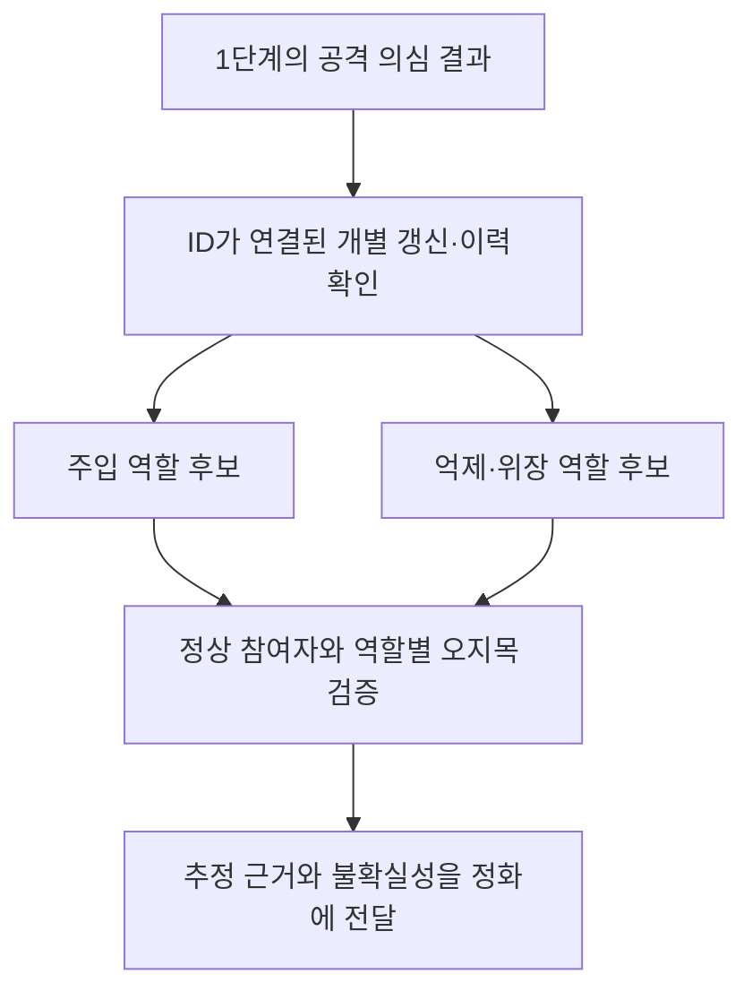

# 2단계 — 공격자·위장자 식별

전체 순서는 [세 단계 연구 기준](../../RESEARCH_STAGES.md)을 따른다. 공격이 의심되는지와 누가 어떤 역할인지의 판정은 별도다.

## 서버가 받는 정보와 추정할 정보를 구분

- 요청자 ID와 삭제 범위는 프로토콜 메타데이터다. 그 ID를 알고 있다는 사실은 위장자를 탐지한 성과가 아니다.
- HRAC는 ID가 연결된 개별 갱신과 기능 반응을 관측할 수 있다고 가정한다. 표준 보안 집계의 합계만 받는 서버가 같은 입력을 가진다고 가정하지 않는다.
- 같은 원본·변형 입력에서 어떤 기여가 강화를, 어떤 기여가 억제를 만드는지 추정할 수 있다. 그 부호만으로 악의나 실제 독성 샘플을 확정하지 않는다.
- BadFU는 한 참여자가 공격·위장을 함께 수행할 수 있다. 참여자를 두 종류로 강제 분류하지 말고 두 역할의 점수와 내부 해상도를 구분한다.

## 기존 코드가 실제로 출력하는 것

[HRAC `score_requests`](../../../review_BadFU_defend/experiments/detection/hrac_matched/replay.py)는 참여자 ID, 의심 점수, 공개 패턴 좌표, 후보 출력 클래스 등을 반환한다. `intra`는 기존 본 실험에서 미관측이다. 이후 `label()`이 설정 파일의 정답으로 `benign/suppressor/injector`를 붙인다. 결과표의 역할명은 추론 결과가 아니라 평가용 라벨이다.

패치 진단은 점수·선택한 패치·후보 타깃을 반환한다. 그 결과만으로 공격자와 위장자 ID를 반환하지 않는다. FC·특징 분해도 내부 출력 변화의 설명이며 참여자 식별기가 아니다.

## 검증할 출력

1. 주입 역할 후보 ID와 순위.
2. 위장 역할 후보 ID와 순위.
3. 같은 참여자의 내부 P/C를 구분했는지 또는 구분하지 못했는지.
4. 패치·타깃·특징 후보가 있다면 그 정확도와 범위.

성능은 역할별 오지목·누락과 두 역할의 동시 식별을 평가한다. 1단계가 놓친 공격을 포함한 전체 과정 성능도 보고한다. 이 정보가 어느 정화에 쓰일 수 있는지는 [3단계 연결표](../../02_purification/DETECTION_TO_PURIFICATION.md)를 따른다.
