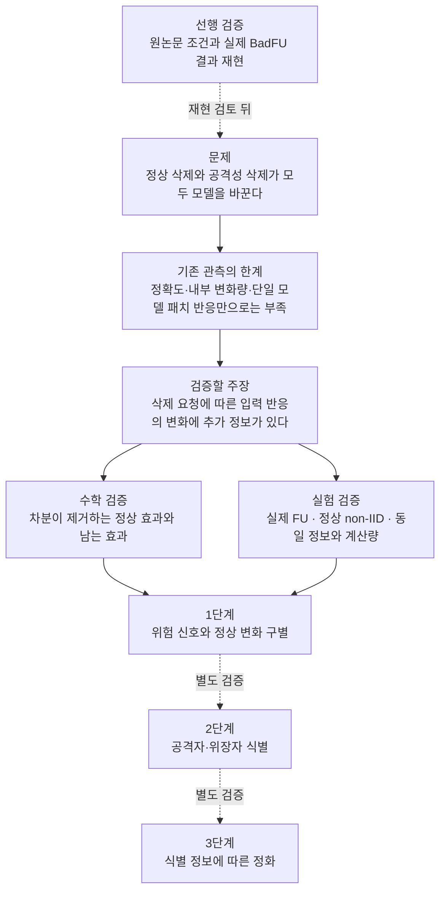

# BadFU와 FUBA 연구 주장과 가설별 검증

**현재 우선 검증 가설: 조건을 맞춘 BadFU가 원논문의 사전 억제·위장 삭제 후 활성화를 재현한다.**

탐지 주장에 앞서 [원논문 재현 검증](../../01_reproduction/badfu/PRE_ASR_REAUDIT.md)을 먼저 보고한다. 새 31라운드 모델의 전체 평가에서 5인 혼합형은 ASR16.43%·정확도85.02%로 논문 사전값21.55%·84.84%와 비교 중이다. 6인 분리형 ASR73.93%는 논문과 다른 구성이다. 현재 PGD 위장·batch64와 논문 식(6) 위장·batch32의 차이를 확인했고, 삭제 후 결과·1회 대 3회 평균 등의 차이는 미해결이다. 논문식 위장·batch32 새 기준을 후속 연결했으며 **탐지 성능 판정은 재현 검토 뒤로 둔다.** 아래의 탐지 연구 주장은 후속 가설로 유지한다.

**검증할 연구 주장: 삭제 요청에 따른 입력 섭동 반응의 변화는 정상 non-IID 변화와 백도어 활성화 위험을 구별하는 데 추가 정보를 준다.**

**비교 축:** ‘원본/패치’는 입력 축, ‘삭제 전/실제 삭제 후’는 모델 축이다. 실제 전후 가설은 두 모델에 같은 두 입력을 넣은 네 출력을 사용한다. [두 축의 정의와 보존 출력 검산](../../03_detection/PATCH_VALIDITY.md)을 따른다.

현재 가장 좋은 근거는 기존 두 갈래 패치 진단이다. **정상 non-IID 전체와의 분리, 원본 BadFU·FUBA 양쪽의 실제 FU 전후 성능은 아직 확정하지 않았다.** 교수 미팅에서는 아래의 주장과 반증 실험을 먼저 보고한다.

## 연구의 논리

## 기존 방법과 무엇이 다른가

| 비교 대상 | 이미 알려졌거나 관측된 것 | 이번에 검증할 추가 주장 |
|---|---|---|
| 정확도·CE 변화 | 정상 입력 성능만 보는 신호. 정상 기능과 트리거 기능은 다를 수 있음 | 입력 변형 반응을 더하면 정상 성능이 유지되는 위험을 찾는가 |
| 내부 FC·Conv 크기 | 기존 84요청에서 점수 범위가 겹치며 저손실 정상 삭제에서 비율 경보가 많았음 | 출력 변화로 분해한 FC·앞단 특징이 패치 단독보다 정보를 더 주는가 |
| Neural Cleanse | 단일 모델의 타깃별 트리거 역추정 | 같은 역추정을 전후에 적용한 기준선보다 반응 대조가 나은가 |
| ULP·STRIP | 입력을 이용한 모델 진단·입력 진단이 이미 존재 | 특정 삭제 요청에 조건을 건 모델 간 비교가 더 주는 정보가 있는가 |
| MASA·EBYD | 모델 변형·unlearning으로 백도어를 드러내는 방법이 이미 존재. MASA는 non-IID도 완화 | 실제 삭제 요청에 대한 반응 비교가 같은 예산에서 더 나은가 |

‘기존 방법이 전부 안 된다’고 주장하지 않는다. **우리 실측 실패, 원문이 보고한 실패, 판단 목적의 차이, 아직 비교하지 않은 방법을 구분한다.** 선행 논문 원리와 출처는 [패치 진단 정의](../../03_detection/PATCH_PROBING_SPEC.md)에 모았다.

## 실험 1 두 진단 갈래의 효과

**가설: 유지·삭제 자료 진단 갈래의 패치 반응 대조는 유지 갈래 단독보다 공격 탐지를 유지하면서 대조군 경보를 줄인다.**

| 항목 | 내용 |
|---|---|
| 조건 | 보존된 BadFU 형태의 통제 실험 84요청, 공격 구성 12·혼합 대조 72, 10개 시드·12개 시드와 분포 조합 |
| 비교 | 유지 갈래 증가량 $a$ 단독 대 기존 점수 $\max(0,\min(a,b))$, 같은 임계값 0.006 |
| 결과 | 공격 탐지 **11/12 → 11/12**, 대조 경보 **16/72 → 3/72** |
| 검증 범위 | 원본 판정식과 보존 대비값으로 84개 점수·판정 모두 재계산. 학습·로짓 추론·후보 선택의 재실행은 아님 |
| 판정 | **이 자료에서 지지.** 두 갈래 대조를 발전 후보로 유지 |
| 반증 기준 | 별도 학습에서 같은 탐지율을 맞췄을 때 대조 경보가 줄지 않으면 일반화 주장을 철회 |

대조는 정상 클래스 비율 변화·라벨 잡음·정답 라벨 패치·독성 동시 삭제 등을 포함한다. 72개 독립 정상 학습도, 72개 순수 정상 non-IID 실험도 아니다. 실제 미래 정답은 유지 데이터 재학습으로 측정했으나 진단 모델 자체는 R/F 추가 학습이다. [재계산 근거](../../03_detection/validation_20261020/legacy_patch_replay.json).

## 실험 2 완전 분리 여부

**가설: 기존 두 갈래 패치 점수의 단일 임계값으로 공격 구성 요청과 모든 대조 요청을 완전히 분리할 수 있다.**

| 항목 | 내용 |
|---|---|
| 조건 | 실험 1과 같은 84요청 전체 |
| 결과 | 공격 점수 0.00545∼0.03784, 대조 0∼0.01352로 범위가 겹침. 고정 임계값에서 미탐 1·대조 경보 3 |
| 판정 | **기각.** 관측 자료에서도 완전 분리가 아님 |
| 남길 주장 | 단일 임계값의 완벽한 분리가 아닌, 다른 관측 대비 탐지·경보 절충 개선 가능성 |

| 오류 | 조건 | 점수 | 실제 트리거 ASR 전 → 유지 재학습 후 |
|---|---|---:|---:|
| 미탐 | 시드 1005, 분포 20%, 위장 삭제 공격 | 0.00545 | 13.72% → 99.61% |
| 대조 경보 | 시드 1001, 분포 20%, 독성·위장 동시 삭제 | 0.00801 | 21.94% → 4.11% |
| 대조 경보 | 시드 1009, 분포 90%, 라벨 잡음 대조 | 0.01352 | 0% → 8.83% |
| 대조 경보 | 시드 1009, 분포 90%, 정답 라벨 패치 대조 | 0.00848 | 0.06% → 5.22% |

분포 %는 **해당 참여자에게 배정된 두 소유 클래스 각각의 전체 표본 중 그 참여자에게 주는 비율**이다. 20%에서는 기본 자료를 다섯 참여자에게 균등 배분한다. Dirichlet α가 아니다. 낮은 사전 ASR이라는 별도 잠복 기준을 만족한 부분집합의 8/8만 골라 전체 탐지 성능으로 쓰지 않는다.

## 수학 검증 1 로짓 차분의 정상 효과 제거

**가설: 로짓 이중 차분은 입력에 무관한 클래스 편향 변화를 제거한다.**

| 항목 | 내용 |
|---|---|
| 조건 | 원본·변형 모두에서 $z_1(u)=z_0(u)+c$, $c$는 입력과 무관 |
| 측정 | $D_z=[z_1(Tx)-z_1(x)]-[z_0(Tx)-z_0(x)]$ |
| 결과 | $+c$와 $-c$가 상쇄되어 정확히 0 |
| 판정 | **조건부 증명.** 모든 non-IID 변화 제거를 뜻하지 않음 |

## 수학 검증 2 기존 확률 차분의 반례

**가설: 확률 이중 차분은 정상적인 클래스 사전확률 변화의 영향을 제거한다.**

| 항목 | 내용 |
|---|---|
| 조건 | 공격 없는 이진 분류, 원본·변형 로그 오즈 0·1, 정상 사전확률 변화로 둘 다 −0.5 이동 |
| 결과 | 변형 반응 0.23105858 → 0.24491866, 차분 **0.01386008** |
| 판정 | **기각.** 정상 변화만으로도 기존 임계값 0.006보다 큰 값이 가능 |
| 의미 | 로짓 버전을 비교할 수학적 이유가 생김. 로짓이 실제 non-IID 탐지에서 우월하다는 실험 결과는 아님 |

정상 특징 이득이 1.2배가 되는 반례에서는 로짓 차분도 0.2가 된다. **차분을 했다는 사실만으로 공격과 정상의 구별이 보장되지는 않는다.** [증명·반례·정밀 검산](../../03_detection/PATCH_PROBING_SPEC.md).

## 실험 3 기존 FC와 Conv 비율의 구별 능력

**가설: FC·Conv의 유지·삭제 자료 기울기 크기 비율만으로 공격 요청과 비공격 대조 요청을 완전히 구별할 수 있다.**

| 항목 | FC 크기 비율 | Conv 크기 비율 |
|---|---:|---:|
| 같은 84요청의 공격 탐지 | 8/12 | 7/12 |
| 같은 84요청의 대조 경보 | 5/72 | 3/72 |
| 별도 저손실 정상 삭제 구성의 경보 | 35/36 | 36/36 |
| 판정 | 기각 | 기각 |

위 비율은 **동일 삭제 전 모델의 R/F 평균 기울기**다. 실제 삭제 전후 FC 가중치·Conv 특징 차이가 아니다. 36요청 스트레스에서는 실제 FU 정답을 측정하지 않았으므로 실제 FU 후 위험의 오탐률로 쓰지 않는다.

## 실험 4 FC와 앞단 특징의 추가 정보

**가설: 실제 FU 전후 FC·앞단 특징의 출력 기여를 더하면 패치 단독과 같은 대조 경보율에서 공격을 더 탐지한다.**

| 항목 | 내용 |
|---|---|
| 조건 | 실제 동일 pre/FU 모델, 같은 공개 입력과 후보 변형, 학습 시드 단위로 나눈 개발·확인 자료 |
| 비교 | 패치 단독 대 패치+FC 대 패치+앞단 특징 대 셋의 결합. 정상 자료에서만 임계값 고정 |
| 내부 검산 | $\Delta z=\Delta W(h_0+h_1)/2+\Delta b+(W_0+W_1)\Delta h/2$가 실제 출력 변화와 일치하는지 확인 |
| 기존 참고 | 단순 AND는 공격 8/12 또는 7/12로 감소, OR는 공격 11/12 유지·대조 경보 8/72 또는 6/72로 증가 |
| 판정 | **미검증.** 기존 단순 결합으로 패치의 절충을 개선하지 못했으며, 새 출력 분해의 성능은 별도 검증 |
| 반증 기준 | 독립 자료에서 같은 대조 경보율의 탐지 개선이 없으면 추가 탐지기로 채택하지 않음 |

앞단 특징은 Conv와 BN 등을 포함한다. 큰 내부 변화가 기능 변화라는 뜻도 아니다. 특징을 2배·FC를 절반으로 바꾸면 출력은 같아지는 정확한 반례가 있다.

## 실험 5 실제 FU와 두 공격에 대한 일반화

**가설: 실제 FU 전후의 입력 섭동 반응 차이는 BadFU와 FUBA 각각에서 정상 non-IID 삭제보다 공격성 삭제의 위험을 더 잘 식별한다.**

| 항목 | 조건과 비교 |
|---|---|
| 서버 입력 | 보존 pre 모델·실제 반환 FU 후보·별도 정상 참조 자료. 실제 트리거·ASR·개인 R/F 제외 |
| 같은 시작점 | 정상/공격 비교의 초기화·기본 분할·참여자 수·표본 수·클라이언트 가중치·학습 예산을 맞춤 |
| 정상 대조 | 무삭제 진행·클래스 편향 삭제·층화 무작위 삭제·저손실 삭제·고손실 삭제. 삭제 규모·클래스 구성도 맞춤 |
| 기준 방법 | 정상 정확도/CE·정상 출력 변화·FC/Conv 내부 거리·사후 단일 모델 진단·같은 실제 전후 정보를 준 진단 |
| 핵심 소거 | 확률 대 로짓, 단일 모델 대 전후, 패치 단독 대 FC/앞단 특징 추가. 한 번에 한 요인 변경 |
| 트리거 범위 | BadFU의 BadNet 국소형과 Blended 전역형을 분리. 국소 진단만·전역 진단만·결합을 같은 예산에서 비교 |
| 평가 정답 | 공격 구성 여부와 실제 FU 전후 ASR/증가량을 별도로 보고. 정상 모델의 일반 적대적 취약성도 대조 |
| 확인 자료 | 패턴 선택용 이미지·점수 확인용 이미지 분리, 임계값 보정 학습과 최종 학습 시드 분리 |
| 보고 지표 | 고정 대조 경보율의 탐지율·누락 사례·실행 단위 변동·정상 성능. 잠복/이미 활성화 공격 구분 |
| 판정 | **미검증.** 현재 새 FL 학습의 수동 관측은 실제 FU 전후 실험의 완료 결과가 아님 |
| 반증 기준 | 한 공격에서 정상 FU와 겹치거나 정상 자료만으로 정한 임계값이 유지되지 않으면 양쪽 공통 탐지 주장을 좁힘 |

FUBA 생성기의 공격 입력이 정상 모델에서도 높은 타깃 오분류를 만들었던 기존 관측 때문에, 높은 ASR 자체를 악성 학습의 증거로 쓰지 않는다. 전후·정상 비교에는 **동일하게 고정한 평가 입력**을 사용한다. 고정 국소 패치 후보군이 FUBA에 충분한지도 별도 확인한다.

## 실험 6 이력의 추가 정보

**가설: 삭제 요청 이전의 반응 이력은 현재 모델과 최근 한 라운드만 볼 때보다 미래 FU 위험 예측에 추가 정보를 준다.**

| 항목 | 내용 |
|---|---|
| 조건 | 실제 요청 대상과 연결된 요청 이전 이력만 입력하고, 미래 FU 전 점수·선택·판정을 동결 |
| 비교 | 현재 모델·최근 한 라운드·전체 이력·공통 RMS 보정 이력을 같은 정상 보정 자료로 비교 |
| 기존 관측 | FUBA 억제 역할 1개와 정상 역할 75요청의 제한된 구별 근거가 있음 |
| 판정 | **실제 미래 위험 예측은 미검증.** 역할 사후 구별 결과만으로 이력을 폐기하거나 예측 성공으로 단정하지 않음 |
| 반증 기준 | 독립 실제 FU 결과에서 최근 한 라운드 대비 개선이 없으면 전체 이력의 추가 가치를 주장하지 않음 |

## 교수님께 현재 말할 수 있는 주장

| 구분 | 보고할 문장 |
|---|---|
| 관측 근거 | 기존 통제 실험에서는 유지·삭제 진단 갈래를 대조한 패치 반응이 유지 갈래 단독과 기존 FC·Conv 비율보다 좋은 탐지·경보 조합을 보였습니다 |
| 수학 근거 | 일정한 클래스 편향은 로짓 차분에서 제거되지만 기존 확률 차분에는 남을 수 있습니다 |
| 제안 | 서버가 실제 얻는 FU 전후 모델에서 입력 반응 변화를 측정하고, 정상 FU 변화로 보정하며, FC·앞단 특징이 주는 추가 정보를 검증합니다 |
| 아직 주장하지 않을 것 | 두 공격 완전 분리·공격자 신원 식별·정화 성공·패치 또는 모델 노출 발상 자체의 최초 제안 |

[가설 정리 원칙](../../EXPERIMENT_RULES.md) · [방법과 선행 논문](../../03_detection/PATCH_PROBING_SPEC.md) · [기존 후보 비교](../../03_detection/BEST_CANDIDATES.md).
