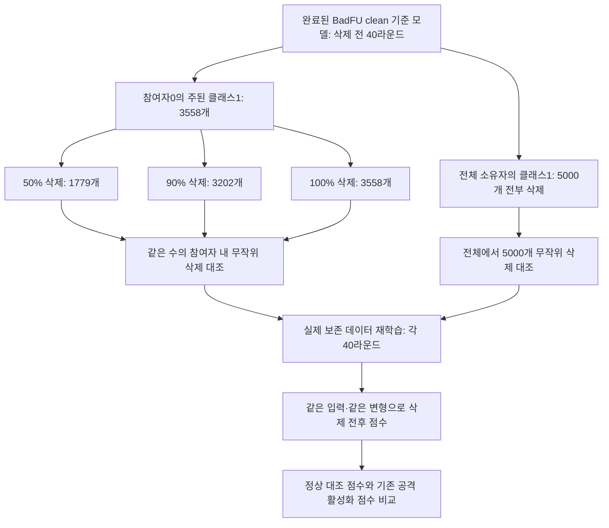

# BadFU 정상 클래스 집중 삭제 검증

2026-10-21 · 실행 중 · 기존 BadFU 공격 재현과 구분한 추가 정상 대조

**가설: 특정 클래스의 정상 데이터가 대량 삭제돼도, 패치 반응의 전후 차분과 클래스별 일관성 점수는 백도어 활성화와 구별 가능한 값을 유지한다.**

**현재 판정: 첫 조건 완료, 가설 일부 지지.** 참여자 내 주된 클래스 100% 삭제 3,558개 조건에서 국소 패치 차분 0.906%p, 클래스 하위 사분위 -0.0159%p였다. 전체 이미지 변형은 정상 삭제에서도 19.175%p로 커졌다. 같은 삭제 수 무작위 대조와 나머지 조건은 진행 중이며 오탐률은 확정하지 않는다. [최신 분석](RESULTS.md)의 첫 절에 조건과 한계를 기록했다.

## 기준 모델과 조건

- 이미 완료된 **Paper32 clean 모델**을 삭제 전 기준으로 재사용한다. 공격 모델을 다시 학습하거나 삭제 전 clean 모델을 새로 학습하지 않는다.
- 클래스는 학습 분할에서 가장 큰 참여자/클래스 집합으로 선택했다. **참여자0의 클래스1 3,558개**였으며 실제 공격 목표나 탐지 점수로 고르지 않았다.
- 원본 clean 데이터 50,000개를 사용하고, 공격·위장 샘플의 원래 CIFAR 이미지·라벨을 복원한 기존 clean 분할과 순서를 유지한다.
- 삭제 후는 동일 초기화에서 보존 데이터만으로 40라운드, 로컬 5에폭, 배치32로 재학습한 실제 모델이다. 원 BadFU local_train과 FedAvg를 사용한다. 근사 FU 알고리즘 실험과 구분한다.
- 8조건 모두 같은 pre 모델·초기화·시드를 공유한다. 8개 독립 시드가 아니다.

## 정확히 무엇이 얼마나 빠지는가

전체 클래스1 데이터는 삭제 전 5,000개다.

| 요청 범위 | 삭제 방식 | 삭제 수 | 참여자0에 남는 클래스1 | 전체에 남는 클래스1 |
|---|---|---:|---:|---:|
| 참여자0 | 주된 클래스의 100% | 3,558 | **0** | **1,442** |
| 참여자0 | 같은 수 무작위 | 3,558 | 2,397 | 3,839 |
| 참여자0 | 주된 클래스의 90% | 3,202 | **356** | **1,798** |
| 참여자0 | 같은 수 무작위 | 3,202 | 2,512 | 3,954 |
| 참여자0 | 주된 클래스의 50% | 1,779 | **1,779** | **3,221** |
| 참여자0 | 같은 수 무작위 | 1,779 | 2,967 | 4,409 |
| 모든 소유자 | 클래스1 전체 | 5,000 | **0** | **0** |
| 모든 소유자 | 같은 수 무작위 | 5,000 | 3,163 | 4,469 |

참여자 내 100% 삭제는 전역 클래스 전체 삭제와 다르다. 전역 클래스 전체 삭제는 모든 소유자가 정당하게 자기 데이터 삭제를 요청하는 별도 스트레스 조건이며 한 참여자가 다른 사람의 데이터를 지우는 설정이 아니다.

## 무엇을 비교하는가

1. 같은 삭제 전 모델과 각 조건의 실제 삭제 후 모델에 동일한 clean 이미지와 48개 고정 변형을 넣는다.
2. 선택 160장과 확인 160장을 분리해 패치 반응 차분, FC·FC 이전 특징 기여, 원본 클래스별 하위 사분위 점수를 계산한다. 클래스 삭제 정보는 실험 감사·정상 정답에만 사용하고 탐지 후보 선택에는 넣지 않는다.
3. 같은 삭제 수의 무작위 요청과 비교해 삭제량과 클래스 집중도를 구분한다.
4. 원래 10클래스 출력 과제를 유지하면서 삭제 대상 클래스와 그 외 클래스 정확도를 따로 평가한다. 정당한 망각에 따른 기능 변화가 공격 경보와 혼동되는지 확인한다.
5. 각 조건 완료 후 점수와 정확도 그래프를 자동 생성한다. 정상 모델 수가 부족하므로 이 8조건만으로 임계값을 맞추고 같은 자료의 오탐률을 성능으로 보고하지 않는다.

## 실행 상태와 보존 위치

- 서버: `DISLAB D:/BadFU_class_deletion_20261021`.
- 완료: `client_class_100`, 실제 삭제 후 재학습 40라운드 및 반응 측정 완료. 다음 `client_random_100` 학습 진행 중.
- 50,000개 데이터의 고유성, 삭제 집합의 소유자·클래스 조건, 동일 삭제량 대조, pre 체크포인트 SHA 및 초기화 텐서 일치를 검증했다.
- `plan.json`, `preparation_check.json`, 조건별 `deletion.json`에 구성·해시를 보존한다.
- 학습 중에는 `status.json`, 완료 조건은 `summary.json`·`class_deletion_results.png`로 확인한다. 라운드 체크포인트를 보존해 중단 시 재개할 수 있다.

기존 2시드×2분할 정상 대조 4쌍과 FUBA의 나머지 실험도 별도로 진행한다. 기존 BadFU 공격 재현의 완료 상태와 이 추가 검증의 완료 상태를 혼동하지 않는다.
