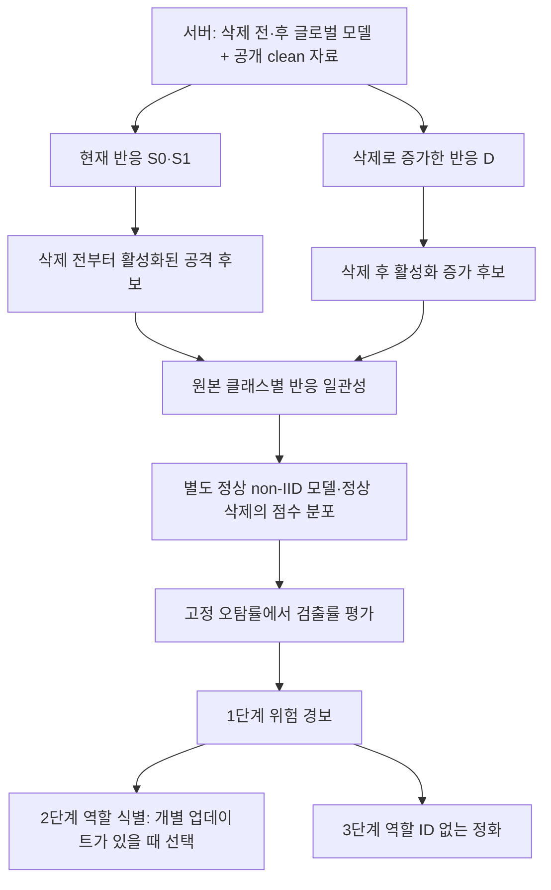

# BadFU·FUBA 탐지: 가능한 전략, 가까운 선행 연구, 검증 체계

**2026-10-22 후속 실행 완료:** [영향력 점수·정상 참조 보정의 실제 검증](../INFLUENCE_RUN_20261022/FINAL_REPORT.md). 완전 이력 7쌍과 부분 이력 2사례를 로컬에서 처리했다. FLForensics 점수와 저자 군집화를 미지 입력 후보에 적용한 결과이며, 원 논문 전체나 역 Hessian 삭제 영향 함수 재현과 구분한다. 정상 대조의 높은 점수가 남았다.

**2026-10-22 검증 상태 감사:** [실패 원인과 영향력 기반 선행 연구](../UNKNOWN_TRIGGER_RUN_20261021/INFLUENCE_AUDIT_20261022.md). 이전 영향력 계산은 위장 데이터 생성에 사용한 이력이며, 영향력 기반 탐지 비교군의 재현 결과는 아직 없다. FLForensics·PUMA·IndirectVerify·FedMUA의 목적과 관측 조건을 구분했다.

2026-10-21 · 1단계 모델/삭제 요청 결과 탐지 · 역할 식별과 정화는 후속 단계

**연구 주장 후보:** 서버가 관측하는 삭제 전후의 기능 변화와 여러 원본 클래스에 걸친 반응 일관성을 함께 측정하면, 정상 non-IID 삭제와 백도어 활성화를 구별하는 데 도움이 될 수 있다. **현재는 가설이며 검증 완료 주장이 아니다.**

현재 우선순위는 **단일 모델의 공격 반응, 실제 삭제 전후 변화, 별도 정상 모델에서의 오탐 보정**을 함께 비교하는 것이다. 전체 결과는 [실험 결과](RESULTS.md)에 따로 둔다.

## 1. 제시한 다섯 전략을 그대로 쓸 수 있는가

| 전략 | 기본 서버에서 가능한 부분 | 추가 정보·조건 또는 문제 | 판단 |
|---|---|---|---|
| 1. 언러닝 요청·그래디언트 감사 | 글로벌 전후 가중치 변화, 공개 입력의 출력·손실·활성 변화 | 개별 FU 업데이트를 받는 프로토콜에서만 그 업데이트의 norm/방향을 관측한다. 전후 글로벌 차이는 개별 언러닝 그래디언트와 다르다. non-IID 정상 삭제도 큰 변화를 만들 수 있다. | 기준 방법으로 실험. 분포 차이가 반드시 존재한다는 주장은 가설로 낮춤 |
| 1. 영향력 함수 | 공개 입력에 대한 기울기와 모델 차이의 내적 같은 1차 근사 | 원래 삭제 샘플의 gradient와 학습 손실 Hessian은 기본 서버에 없다. 공개 자료 근사는 원 영향력과 같지 않고, 깊은 모델에서 큰 전후 변화의 선형 근사 오차도 검증해야 한다. | 조건부 가능. 원 데이터 없이 정확한 영향력 함수라고 부르지 않음 |
| 2. 백도어·위장 gradient 충돌 | 개별 업데이트가 있으면 클라이언트 사이 방향 비교 가능 | 같은 클라이언트 안의 두 데이터 집합 gradient는 최종 평균 업데이트만으로 복원되지 않는다. 내부 활성 분포와 per-sample gradient 통계도 받지 않으면 볼 수 없다. 정상 클래스 간 충돌도 있다. | 기본 조건의 주 탐지법으로 채택하지 않음 |
| 3. 실제 삭제 전후 행동 검증 | 두 글로벌 모델과 공개 입력으로 바로 가능 | clean 정확도만으로는 부족. 변형 입력과 clean 입력을 같은 모델 쌍에 넣어 공통 변화와 변형 특이적 변화를 구분해야 한다. | 현재 가장 직접적인 검증 대상 |
| 3. 차분 모델에 Neural Cleanse 적용 | 두 모델의 출력 차이를 목적함수로 삼는 입력 최적화 가능 | 파라미터 차이를 새 네트워크에 넣는 것은 출력 차이를 계산하는 것과 다르다. 최적화로 만든 보편 적대 입력이 곧 실제 백도어라는 보장도 없다. | 두 모델을 각각 계산하는 탐색으로 수정; 정상 대조 필수 |
| 4. 클리핑·DP 노이즈 | 업데이트가 관측되고 병합 규칙을 바꿀 수 있으면 구현 가능 | 작은 파라미터 이동이 작은 ASR 변화라는 보장이 없다. 삭제 반영을 클리핑하면 실제 삭제 효과도 줄일 수 있다. 임의 노이즈는 DP 보증이 아니고, DP도 백도어 부재 보증과 다르다. | 탐지법보다 별도 방어·유틸리티·망각 검증 실험 |
| 5. 출처·권한 검증 | 누가 무엇의 삭제를 요청할 권한이 있는지, 등록 이력의 일치 확인 | 정당한 권한으로 위장 데이터를 삭제하는 공격을 막지는 못한다. 원 샘플의 패턴 검수는 샘플 접근·증명·신뢰 실행 환경 등 프로토콜 조건을 추가한다. | 시스템 보완책. 공격 의미를 구별하는 탐지기의 대체재는 아님 |

**기본 관측 조건:** 글로벌 모델 2개와 공개 라벨 clean 기준 자료. 실제 트리거, ASR, 원본 독성·위장 샘플 ID는 평가자만 갖는다. 개별 참여자 모델/업데이트·ID별 이력은 보안 집계를 쓰는 서버에서 자동으로 얻어지는 정보가 아니다.

BadFU에서는 같은 악성 참여자가 독성·위장 데이터를 가질 수 있다. FUBA의 주입·억제 역할과 함께 생각할 때도 처음부터 서로 다른 신원 두 개로 가정하면 안 된다. 보존 데이터에 독성이 남으면 정확한 재학습도 공격 모델을 만들 수 있으므로, ‘재학습 기준과 가까움’만으로 안전을 보장할 수 없다. [BadFU §IV–V](https://arxiv.org/html/2508.15541v1)

BadFU 역시 데이터 포이즈닝을 사용하며, 위장 데이터 삭제를 공격 활성화에 연결한다. 따라서 정당한 삭제가 정확히 수행됐는지와, 남은 모델에 위험한 기능이 있는지를 따로 검증해야 한다.

## 2. 가장 가까운 선행 연구

아래 마지막 열은 원문을 읽고 우리 관측 조건에 적용한 분석이다. 해당 방법을 전부 재현해 얻은 결과라는 뜻은 아니다.

| 선행 방법 | 핵심과 필요한 정보 | non-IID·우리 탐지에 주는 점 | 재현/적용 상태 |
|---|---|---|---|
| [MASA, WACV 2025](https://arxiv.org/html/2411.01040v1) | 개별 제출 모델을 융합한 뒤 공개 proxy 자료에서 진단 망각 동역학 비교 | non-IID 차이를 줄이는 model fusion과 TPR/FPR 절충을 직접 다룬다. 개별 제출을 식별하는 문제이며 실제 사용자 삭제와 다르다. | 원 MASA 미재현. 이번 전역 모델 clean-loss ascent는 더 단순한 별도 비교군 |
| [FilterFL, CCS 2025](https://arxiv.org/html/2308.11333v2) | 이전·새 글로벌 모델의 증분 지식을 입력으로 추출하고, 개별 오염 모델 제외 | 두 모델 차이로 입력을 찾아 백도어 기여를 보는 선행. 두 모델이나 입력 탐색 자체를 신규성으로 주장할 수 없다. | 이번 유한 변형·소규모 최적화는 원 CGAN 파이프라인 재현이 아님 |
| [FLForensics, NeurIPS 2025](https://arxiv.org/html/2407.07221) | 의심 입력과 비공격 참조 입력에 대한 이력 영향 점수로 악성 참여자 추적 | 같은 클래스를 많이 가진 정상 non-IID 참여자도 영향이 크므로 비공격 참조와 함께 비교한다. 주로 의심 입력과 개별 이력이 있어야 한다. | 2단계 역할 식별의 직접 비교 후보. 아직 본 실험에 재현하지 않음 |
| [Neural Cleanse, IEEE S&P 2019](https://people.cs.vt.edu/vbimal/publications/backdoor-sp19.pdf) | 클래스별 작은 마스크·패턴을 역추정하고 크기 이상치 비교 | 비교 기준이 필요하다. 일반 adversarial vulnerability와 비정상 backdoor를 구별하려면 정상 모델도 같은 예산으로 검사해야 한다. | 이번 고정 크기 입력 최적화는 전체 NC가 아님 |
| [CBD, NeurIPS 2023](https://arxiv.org/html/2310.17498v2) | 가우시안 주변의 클래스 집중도 LDP와 정상 shadow model 보정 | 탐지 조건과 오탐 보장을 분리한다는 점이 매우 가깝다. 보정 모델과 평가 모델의 분포에 대한 가정이 있다. | LDP 통계만 탐색적으로 측정. shadow 보정·인증 보증 재현은 아님 |
| [EBYD](https://arxiv.org/html/2410.19427) | 정상 기능을 진단용으로 망각시켜 숨은 기능을 노출한 뒤 탐지·정화 연결 | 실제 삭제와 진단 망각을 구별해야 한다. 공개 clean 자료로 해볼 수 있는 노출 비교군이다. | 고정 10스텝의 단순 clean-loss ascent만 측정; 전체 EBYD 미재현 |
| [UnlearnGuard, WWW Companion 2025](https://arxiv.org/html/2501.17396v1) | FL 이력으로 FU 중 업데이트를 예측·검증해 새 poisoning을 방어 | 이미 남아 있는 독성이 정당한 삭제로 드러나는 문제와 구분해야 한다. 이론의 강한 볼록성·smoothness와 악성 참여자 탐지 가정을 그대로 깊은 모델에 적용할 수 없다. | 요청 업데이트 감사의 관련 선행, 본 모델 쌍만으로 재현 불가 |
| [FLDetector, KDD 2022](https://arxiv.org/abs/2207.09209) | 개별 업데이트의 시간적 일관성을 예측하고 차이를 누적 | 이력 활용의 직접 선행이지만 표적 입력 없이 데이터 포이즈닝·위장을 반드시 잡는다는 뜻은 아니다. | 이력 방법의 기준 후보, 기존 실패 관찰을 모든 이력 방법의 불가능성으로 확대하지 않음 |
| [FLAME, USENIX Security 2022](https://www.usenix.org/conference/usenixsecurity22/presentation/nguyen) | 제출 모델 군집화·클리핑·노이즈 | 노이즈만 넣는 것보다 유틸리티와 공격 억제를 함께 다룬다. 학습 단계의 집계 방어를 실제 삭제 후 활성화에 그대로 이식할 수는 없다. | 4번 전략의 선행 방어 비교군 |
| [DeepSight, NDSS 2022](https://www.ndss-symposium.org/wp-content/uploads/2022-156-paper.pdf) | 제출 모델의 내부·출력 특성을 분석하고 학습 분포 차이를 고려해 군집화 | FC/뉴런 정보를 사용하는 것 자체는 선행된다. 개별 모델 접근과 전역 모델 탐지의 차이를 명시해야 한다. | 내부 지표 비교군 후보, 본 테스트에서 원 방법 미재현 |

**분류 성능을 읽는 예:** MASA Table 4의 non-IID CIFAR-10에서 기본 설정의 평균 TPR/FPR은 98.54%/6.83%, 더 엄격한 설정은 88.75%/4.50%다. 이는 해당 일반 공격·개별 제출 탐지 설정의 결과이며 BadFU/FUBA 전후 모델에서 보장되는 수치가 아니다. ‘방어 후 ASR이 낮다’와 ‘탐지 TPR/FPR이 좋다’도 다른 지표다. [MASA Table 4](https://arxiv.org/html/2411.01040v1)

BadFU 자체도 FL 종료 모델에서 NC의 오탐과 미탐을 보고한다. 이 결과를 모든 삭제 후 역추정 방법의 실패로 일반화하지 않는다. [BadFU §VII-G, Tables VI–VII](https://arxiv.org/html/2508.15541v1)

## 3. 어떤 점수를 제안하고 검증할 것인가

\(p_{m,k}(x)\)는 모델 \(m\)이 클래스 \(k\)에 주는 확률이다. \(T\)는 실제 공격 패턴을 넣지 않고 정한 입력 변형이다.

\[
R_m(T,k;x)=p_{m,k}(Tx)-p_{m,k}(x),\qquad
D(T,k;x)=R_1(T,k;x)-R_0(T,k;x).
\]

**가설 H1: 국소 변형 반응의 전후 차분은 일반적인 모델 변화보다 삭제 후 활성화 증가를 더 잘 드러낸다.**

- 비교: clean 정확도·출력 변화, 패치 입력의 모델 변화만, 삭제 후 반응만, 두 축을 함께 뺀 \(D\).
- 반증: 정상 non-IID 삭제의 \(D\)가 공격 활성화와 겹치거나, 같은 오탐률에서 단일 모델 기준보다 검출률이 낮으면 우위 주장 폐기.

**가설 H2: 여러 원본 클래스에서 일관된 반응을 요구하면 한 클래스에 치우친 정상 반응의 혼동이 줄어든다.**

원본 클래스별 평균 \(\mu_c(T,k)=\mathbb E[D(T,k;x)\mid y=c]\)를 구해 \(c\ne k\)의 하위 사분위수를 점수로 삼는다. 선택 자료에서 변형·목표 클래스를 고르고 확인 자료에서 고정해 평가한다.

\[
S_Q=\max_{T,k}Q_{.25}\big(\{\mu_c(T,k):c\ne k\}\big).
\]

- 여러 source class에 통하는 공격을 보는 조건이다. 특정 source class만 공격하는 경우 감도가 낮아질 수 있으므로 별도 평가해야 한다.
- 정상 데이터에서도 넓은 클래스 붕괴가 생기면 점수가 커질 수 있다. source 일관성만으로 공격임을 증명할 수 없다.

**가설 H3: FC 이전 특징 또는 Conv 기능 기여가 같은 정상 오탐률에서 추가 검출 정보를 준다.**

- FC/특징 분해는 실제 두 모델을 사용한다. 특징에는 BatchNorm이 포함된다. Conv 가중치 norm과 Conv 기능 분석을 구별한다.
- ‘기여가 크다’는 현재 관찰과 ‘오탐 보정 후 탐지 성능이 좋다’는 주장을 분리한다.

**가설 H4: 같은 예산의 두 모델 입력 최적화는 고정 변형 탐침이 놓치는 활성화를 찾는다.**

- 두 모델에 동일 변형 입력을 넣고 \(D\)를 최대화하는 방법과 삭제 후 모델만의 \(R_1\) 최대화를 비교한다.
- 작은 최적화 예산에서 실패하면 그 설정의 실패로 기록한다. 고정 패턴보다 좋은 입력이 자동으로 나온다고 가정하지 않는다.

**가설 H5: 단일 모델의 가우시안 주변 클래스 집중도는 고정 패치와 다른 공격 위험 정보를 제공한다.**

- CBD의 LDP 통계를 후보로 측정하고, 정상 모델들에서 보정 가능성을 확인한다. 본 실험의 Monte Carlo 통계에 원 논문의 인증 보증을 붙이지 않는다.

## 4. ‘일반 공격’과 ‘삭제 후 공격’을 분리하는 이유

| 관측 유형 | 필요한 측정 | 가능한 해석과 경계 |
|---|---|---|
| 삭제 전 낮고 삭제 후 높은 반응 | \(S_0,S_1,D\) 함께 측정 | 삭제에 따라 기능이 드러난 후보 |
| 삭제 전후 모두 높은 반응 | \(S_0,S_1\) | 이미 활성화된 공격은 \(D\)만으로 놓칠 수 있음 |
| 전후 반응 모두 낮음 | 다른 입력 탐색·주변 반응과 대조 | 탐침이 공격 패턴을 못 건드린 것일 수 있어 정상 확정 불가 |
| 전후 차이는 크지만 엉뚱한 클래스·전체 변형에 반응 | 정상 모델 대조, 실제 트리거 평가를 분리 | 보편적인 OOD/적대적 취약성인지 검증 필요 |

평가 정답은 세 개를 따로 저장한다: **공격 데이터 사용 여부**, 실제 트리거에 대한 **삭제 전·후 ASR**, **ASR 증가량**. 서버가 ASR을 알아야 동작하는 탐지기를 만들지 않는다. 알려지지 않은 트리거의 ASR 수치를 임의 clean probe만으로 정확히 추정할 수 있다고 가정하지 않는다.

## 5. 수학적으로 확인할 수 있는 것과 가정

**가설 M1: 최종 평균 업데이트만으로 클라이언트 내부의 상쇄 gradient 분산을 판별할 수 있다.**

반례: 두 샘플 기울기가 \(g+v,g-v\)인 경우와 \(g,g\)인 경우의 평균은 모두 \(g\)다. 분산은 다르지만 서버에 평균만 주면 구별되지 않는다. per-sample 통계·신뢰 계산 같은 추가 관측이 필요하다. 큰 내부 충돌이 악성이라는 별도 가정도 검증해야 한다.

**가설 M2: 파라미터 차이 네트워크는 원래 두 모델의 출력 차이를 계산한다.**

반례: 두 층의 스칼라 선형 망 \(f_{u,v}(x)=uvx\)에서 전이 \((u,v):(1,1)\to(2,2)\)의 출력 차이는 \(3x\), 차이 파라미터 \((1,1)\)의 출력은 \(x\)다. 따라서 두 실제 모델을 각각 계산해야 한다.

**가설 M3: 클래스 균형화는 reference 자료의 class prior 변화가 만드는 평균 점수 변화를 제거한다.**

각 조건부 반응 \(\mu_c\)가 고정이고 클래스별 표본을 관측할 수 있을 때, 빈도 평균은 \(\sum_{c\ne k}\pi_c\mu_c/(1-\pi_k)\)다. 클래스 균형 평균이나 클래스별 분위수는 \(\pi\)에 의존하지 않는다. 이는 reference class prior에 대한 성질이다. **FL 학습의 non-IID는 \(\mu_c\) 자체를 바꿀 수 있으므로 이 식으로 전체 non-IID 오탐 감소를 증명할 수 없다.**

**가설 M4: 별도 정상 보정 쌍과 새 정상 쌍이 교환 가능하면 사전 고정 점수의 conformal 경보는 주변 오탐률을 제어한다.**

고정된 점수 함수 \(S\), 별도 정상 보정 점수 \(s_1,\ldots,s_n\)에 대해

\[
p=\frac{1+\#\{i:s_i\ge S_{\rm new}\}}{n+1}
\]

를 사용하면, 교환 가능한 순위의 대칭성으로 \(\Pr(p\le\alpha)\le\alpha\)인 보수적 검정이 된다. 동점은 위의 부등호로 처리한다. 점수 선택·튜닝은 보정/평가와 분리해야 한다.

- 공유 모델의 이미지 160개나 reference profile 41개를 정상 모델 160개·41개로 세면 안 된다.
- non-IID 설정이 달라져 교환 가능성이 깨지면 이 보증을 그대로 쓸 수 없다. 설정별 보정 또는 별도의 분포 이동 검증이 필요하다.
- \(n=19\)에서 최소 p-value가 0.05, \(n=99\)에서 0.01이다. 이는 계산 가능한 유의수준의 해상도이지, 그 수의 모델만으로 실제 오탐률을 정밀 추정한다는 뜻이 아니다.
- 여러 경보 머리를 합치면 전체 결합 점수를 정상 모델에서 보정하거나 다중 검정 오차를 제어해야 한다.

이 보정 방향의 관련 선행인 CBD도 shadow 모델과 실제 정상 모델의 점수 분포에 가정을 둔다. 그 가정이 우리 FL·정상 삭제에서 성립하는지는 별도 문제다. [CBD §3–4](https://arxiv.org/html/2310.17498v2)

**가설 M5: 진짜 트리거를 모르는 상태에서 clean 탐침만으로 실제 ASR 수치를 유일하게 추정할 수 있다.**

\(\mathrm{ASR}(\theta;T,t)=\Pr[f_\theta(Tx)=t\mid y\ne t]\)는 모델뿐 아니라 트리거 변환 \(T\)와 목표 \(t\)의 함수다. 같은 모델에서도 다른 \(T\)에 대한 성공률은 달라질 수 있다. 따라서 \(T,t\)가 알려지지 않으면 모델의 clean 반응만으로 ‘공격자가 사용한 실제 ASR’을 유일하게 복원할 수 있다는 주장은 성립하지 않는다. 유한 탐침의 출력만 사용하는 검출기는 그 탐침 밖에서만 달라지는 위험도 놓칠 수 있다. 탐색할 공격군의 조건과 실제 공격에 대한 검출률을 함께 보고해야 한다.

## 6. 진행할 실험과 보고 단위

1. **완료:** 기존 BadFU 실제 모델 10개·6쌍, 새 공개 이미지 320개, 고정 48변형, 10개 점수 방식, 진단 망각, 동일 예산 입력 최적화, reference class prior 41개 비교. 공유 모델이 있으므로 독립 학습 6회가 아니다.
2. **완료:** 완료된 FUBA 학습·보존 재학습 모델의 진단 오류 수정 및 실제 전후 비교. 고정된 삭제 전 생성기로 두 모델을 평가해 입력을 통일한다.
3. **실행/상태 기록:** 2시드 × 2 non-IID 분할의 새로운 정상 FL·정상 삭제 재학습 4쌍. Dominant70은 기존 분할, Dirichlet α=.2는 새 분할이다. 같은 시드는 초기화를 공유하므로 시드 군집은 2개다.
4. **후속 성능 검증:** 정상 보정군과 정상·공격 평가군을 분리해 FPR 5%에서 TPR을 우선 비교한다. 더 낮은 1% 경보율은 정상 모델 수가 충분해진 뒤 다룬다. 현재는 이 목표를 달성했다고 보고하지 않는다.

최종 보고 지표는 탐지 TPR/FPR, ASR 수준과 증가량별 검출률, 정상 정확도·비용이다. 역할 식별의 precision/recall과 정화 후 ASR은 다음 단계의 지표로 분리한다.
