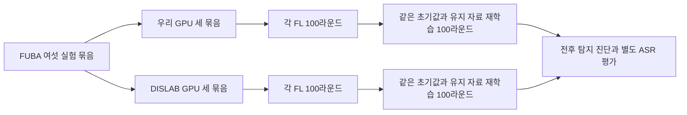

# FUBA 분산 GPU 실행과 BadFU 교차 검증

2026년 10월 20일. **FUBA의 여섯 FL 및 FU 실험 묶음을 우리 PC와 DISLAB에 세 개씩 배정해 두 GPU에서 실행했다. BadFU는 완료 모델 여섯 개를 독립적으로 재평가했고 최대 지표 차이가 0.023%p 미만이었다.**

## FUBA 실행 분배

**가설: GPU에서 원본 MPI 프로토콜을 유지한 분산 실행은 CPU 실행과 같은 초기값 및 자료 조건을 보존한다.**

| 실행 위치 | GPU | 배정한 학습 조건 | 각 조건의 후속 처리 |
|---|---|---|---|
| 우리 PC | RTX 4060 Laptop 8GB | 시드 20261021 공격·정상, 시드 20261022 정상 | FL 100라운드 뒤 같은 초기값·유지 분할로 재학습 100라운드 및 전후 진단 |
| DISLAB | RTX 3080 10GB | 시드 20261020 공격·정상, 시드 20261022 공격 | 동일 |

각 GPU는 세 묶음을 순서대로 실행하고 두 GPU는 동시에 계산한다. 한 묶음에는 FL과 유지 참여자 재학습이 모두 포함된다. 원래 지정한 세 시드의 여섯 조건을 중복 없이 배정했다. 시드 20261022는 공격과 정상 조건이 서로 다른 GPU에서 실행되므로 하드웨어 및 PyTorch 버전을 기록하며 비트 단위 학습 동일성을 가정하지 않는다. 두 시드 20261020·20261021은 공격과 정상 조건을 같은 장비에 유지한다.

검증한 실행 조건은 다음과 같다.

- 두 장비 모두 원본 협력 프로토콜의 MPI 5개 프로세스와 batch 64를 유지했다. 다섯 프로세스에서 CUDA 사용을 확인했다.
- 각 장비의 네 자료 보유 프로세스가 같은 20개 참여자 분할을 쓰고, 다섯 프로세스가 같은 시험 자료 분리를 쓰는지 확인했다.
- 공격자 강도 선택 및 원문 평가 9,280개, 서버 탐침 320개, 고정 전후 평가 400개가 겹치지 않는다. 이 자료 분리는 원문 전체 시험셋 사용과 다른 통제 조건이며 공격 핵심 구현은 보존했다.
- DISLAB의 GPU 시드 20261020 초기 모델 텐서가 기존 CPU 실행과 일치했고, 실제 자료 인덱스도 네 프로세스에서 일치했다.
- CPU의 완료 6라운드는 기존 폴더에 보존했다. 전체 난수 상태가 없는 체크포인트를 GPU 연속 궤적으로 합치지 않고 초기값부터 새로 시작했다. 기존 CPU 큐와 남은 다섯 MPI 프로세스는 종료했다.
- 사용자 승인으로 DISLAB의 LM Studio 서버를 종료했다. BadFU 학습은 계속 유지했다.

진행 라운드는 [우리 GPU 검증 기록](local_distribution_validation.json), [DISLAB GPU 검증 기록](DISLAB_distribution_validation.json) 및 각 실행 폴더의 상태 파일을 따른다. 초기 검증 시 DISLAB은 첫 공격 라운드를 포함해 6라운드, 우리 PC도 첫 공격 라운드를 포함해 6라운드를 완료했다. 초기 준비 단계에서는 원문 평가의 ASR이 `None`이며 공격 실패 판정이 아니다.

실행 경로는 로컬 `research/FU_gpu20261020/jobs`, DISLAB `C:/Users/DISLAB/Documents/FU_gpu20261020/jobs`다. 기존 CPU 기록은 DISLAB `C:/Users/DISLAB/Documents/badfu_FU_h20261020`에 남아 있다. [전체 배정](allocation.json).

## BadFU 저장 모델과 집계 검증

**가설: 보존된 BadFU 체크포인트는 선언한 초기값과 이전 모델 연결 및 샘플 수 가중 집계를 보존한다.**

조건은 기존 batch 64·PGD 위장 실행과 새 batch 32·일반 위장 실행을 분리해 검사하는 것이다. 새 위장은 같은 트리거와 원래 라벨을 가진 이미지 850개다. 원본 학습·집계 함수는 고정한 저자 소스에서 읽는다.

검사한 여덟 체크포인트에서 다음 항목이 통과했다.

- 전체 원자료 인덱스 50,000개의 누락·중복 여부, 독성 850개와 위장 850개의 분리, 위장 원래 라벨 및 이미지 해시.
- 선언한 원본 코드 해시, batch 32, 참여자 5명, 로컬 5 epoch 및 총 40라운드 설정.
- 초기 모델 텐서 일치, 저장 파일 해시, 이전 전역 모델과 다음 라운드 입력 모델의 연결.
- 개별 모델과 샘플 수 가중치로 전역 모델을 재구성했을 때 최대 절대 오차 0.

여덟 개는 기존 네 조건의 완료 40라운드 모델과, 논문식 세 조건의 완료 모델 및 진행 중 정상 삭제 조건의 17라운드 모델이다. 모든 과거 파일의 전수 검사는 아니다. 기존 batch 64 삭제 후 참조는 개별 클라이언트 갱신 없이 라운드별 전역 가중치를 저장했으므로 그 저장물만으로 집계를 다시 구성할 수는 없다. 해당 두 모델은 아래 독립 평가에 포함했다.

## BadFU 독립 평가

**가설: 별도 입력 처리와 모델 구성으로 재평가한 정확도 및 ASR은 DISLAB 평가와 0.1%p 이내로 일치한다.**

우리 PC에서 학습용 평가 함수를 가져오지 않고 torchvision의 CIFAR-10 시험 데이터를 읽었다. 선언된 3×3 트리거를 직접 재구성해 실제 독성 시험 이미지 9,000개 모두와 일치하는지 확인했다. 모델도 별도로 구성하고 모든 파라미터와 BN 상태를 엄격하게 불러왔다. 정상 시험 10,000개, 타깃 원래 클래스 제외 공격 시험 9,000개를 사용했다.

| 모델 | DISLAB 정확도 | 독립 정확도 | DISLAB ASR | 독립 ASR |
|---|---:|---:|---:|---:|
| 기존 batch 64 삭제 전 | 84.40% | 84.39% | 25.856% | 25.833% |
| 논문식 batch 32 삭제 전 | 88.23% | 88.23% | 16.144% | 16.133% |
| 논문식 위장 삭제 후 재학습 | 88.15% | 88.15% | 99.989% | 99.989% |
| 논문식 정상 대조 | 88.78% | 88.78% | 1.533% | 1.533% |
| 기존 위장 삭제 후 재학습 | 84.80% | 84.81% | 99.978% | 99.978% |
| 기존 정상 유지 자료 재학습 | 84.94% | 84.93% | 2.156% | 2.156% |

**판정: 검사한 여섯 완료 모델 모두 통과.** 최대 차이는 약 0.02223%p로 공격 시험 이미지 두 개 분량이다. 두 장비의 GPU 및 PyTorch 버전이 다른 재평가에서도 결과가 거의 일치했다. 작은 차이의 원인을 하나로 확정한 것은 아니다. [기계 판독 결과](badfu_independent_replay_result.json).

## 해석과 남은 검증

**가설: 논문식 위장 삭제는 정상 성능을 크게 바꾸지 않으면서 공격 반응을 증가시킨다.**

새 batch 32 실행에서 독립 평가 ASR은 약 16.13%에서 99.99%로 상승했고 정확도는 88.23%에서 88.15%로 변했다. 검사한 구현과 평가에서는 이 현상을 로그 오류나 잘못된 집계로 설명할 근거가 나오지 않았다.

다만 삭제 전에도 정상 대조의 ASR 1.53%보다 높은 공격 반응이 남아 있다. 완전한 잠복을 예측했다고 해석하지 않는다. [BadFU 원문](https://arxiv.org/html/2508.15541v1)의 해당 Table I 수치 21.55% 및 재학습 99.32%와 방향은 같지만 수치가 동일하지 않다. 우리 정확도도 원문보다 높다. 한 시드와 논문의 세 실행 평균, 확인되지 않은 저자의 라운드·초기값·자료 분할 선택 차이가 남아 있어 엄밀한 수치 재현 완료로 세지 않는다.

정상 자료 850개를 삭제한 대조는 아직 40라운드에 도달하지 않았다. 그 완료 결과와 같은 길이의 위장 삭제 결과를 비교해야 삭제 종류에 따른 차이를 판정할 수 있다. 근사 FU 방법의 재현, 공격 탐지 성공 및 정화 성공도 이 교차 검증의 결론에 포함하지 않는다.
