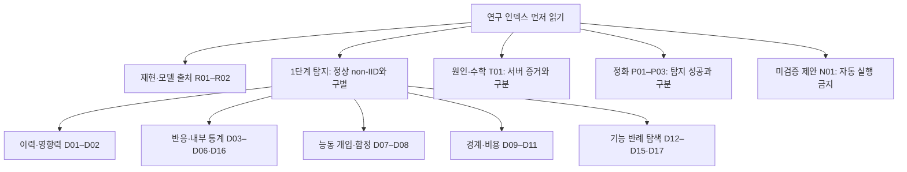

# 연구 실험 인덱스 — 제안·해석·실행 전에 먼저 읽기

**핵심 제약: 단순 반응량으로는 큰 정상 non-IID 참여자의 탈퇴와 공격을 구별하지 못했다.** 반응이 크다, 전후에 많이 변한다, 한 클래스로 쏠린다, 비용이 줄었다는 관측만으로 공격이라고 판단하지 않는다. **실제 트리거를 모르는 특정 패턴 탐색과 트리거 종류에 의존하지 않는 탐지는 다르다.**

2026-10-23 정리. 이 문서는 현재 해석의 입구다. 원 보고서·수치·실패 기록·체크포인트 경로는 보존했다. 옛 문서의 ‘현재 후보’, ‘다음 실험’, ‘진행 중’은 작성 당시 기록이며 자동 재개 지시가 아니다.

실험 과정을 읽으려면 [분야별 실험 목록](../experiments/README.md)에서 시작한다. 각 실험 폴더에 시작 이유·모델과 자료·실행 순서·결과·판단과 원 근거를 연결했다. 아래는 해석과 새 실험 검토를 위한 인덱스다.

## 매번 읽는 순서

1. **이 인덱스의 핵심 반례와 금지 사항**을 먼저 읽는다.
2. 제안하려는 방법과 관련된 **[실험 카드](EXPERIMENT_CARDS.md)**를 읽고, 카드에 연결된 **원 보고서의 조건·결과·정정**을 확인한다. 키워드만 보고 새 방법이라고 제안하지 않는다.
3. 모델을 사용할 때만 추가로 [궤적 README](00_trajectories/README.md)와 [catalog.json](00_trajectories/catalog.json)을 읽고 명시적 case ID·허용 용도로 선택한다.
4. [실험 원칙](EXPERIMENT_RULES.md)을 따른다. 새 제안에는 **관련 기존 카드 ID / 무엇이 새 관측인가 / 기존 non-IID 반례를 왜 구별할 수 있나 / 구별 못하면 중단할 기준**을 적는다. 근거가 없으면 미검증·보류다.

## 먼저 확인할 핵심 반례

| 이미 해본 것 | 실제 관측 | 남겨야 할 판단 |
|---|---|---|
| [D08 같은 잔류 참여자·능동 개입·정상 참조 보정](EXPERIMENT_CARDS.md#d08) | 공격0.75848, 큰 정상 탈퇴0.75525/0.76188 | 공격이 정상 두 값 사이. 협조·개입을 추가해도 반응량은 악성 표지가 아님 |
| [D06 정상 과제 망각](EXPERIMENT_CARDS.md#d06) | 공격 누적CE27.291, 큰 정상 탈퇴67.143 | 정상 기여 상실의 반응이 더 큼 |
| [D02 영향력과 정상 참조](EXPERIMENT_CARDS.md#d02) | 공격1.9765, 정상 주요 클래스 삭제2.0677 | 참조를 뺐다고 non-IID가 제거되지 않음 |
| [D05 특징 공간·출력 쏠림](EXPERIMENT_CARDS.md#d05) | 대표 공격12.983, 이전 정상14.570 | 잠재 공간으로 바꾸는 것만으로 해결되지 않음 |
| [D11 이미지별 변형 비용](EXPERIMENT_CARDS.md#d11) | 진단 공격11.30, 정상27.49; 최소 비용이 새 오류를 버리는 수학 예 | 경계·마진 요약도 공격 특이성을 보장하지 않음; FUBA 재현 한계 별도 |
| [D15 전후 공동 탐색+정상 협조자](EXPERIMENT_CARDS.md#d15) | 추가 학습 시드의 공개 오류 공격7.00%, 큰 정상8.00% | 정상 자료 추가 확인도 자동 해결책이 아님 |

숫자는 서로 다른 실험의 원문 단위·평가기록이다. 행 사이의 크기를 비교하지 않는다. 재학습·근사FU·진단 복사본, 독립 FL 시드·탐색 초기화, 정상 요청·깨끗한 모델을 각각 구분한다.

## 반복하지 않을 제안

- FC/Conv norm·cosine·CKA·RMS·민감도·drift 등 **단순 변화량을 이름만 바꿔 주력으로 재제안하지 않는다.** [D16 철회 기록](EXPERIMENT_CARDS.md#d16)
- ‘전후 차분’, ‘정상 참조’, ‘클래스 균등’, ‘협조 참여자’, ‘능동 함정’을 붙였다는 이유로 정상 큰 탈퇴를 제거했다고 주장하지 않는다. D02/D06/D07/D08/D15를 읽는다.
- ‘특징 공간’, ‘생성기’, ‘시맨틱 변환’, ‘최소 경계 거리’가 아직 안 해본 근본 해결책인 것처럼 소개하지 않는다. D05/D09/D11/D13/D14를 읽는다.
- **직전 신뢰 기준 모델 제안도 미검증·보류다.** 추가 정보의 획득 가능성과 정상 탈퇴에서도 같은 반례가 나오는지를 설명하지 못하면 새 실행의 기본 방향으로 삼지 않는다. [N01](EXPERIMENT_CARDS.md#n01)
- 모든 반응 기반 방법의 수학적 불가능성을 증명했다고 확대하지 않는다. 기각한 구체적 지표·조건과 미검증 영역을 구분한다.

## 최근 결과의 정확한 위치

**[D17 직접400/800·노출400](EXPERIMENT_CARDS.md#d17):** 직접400에서 두 BadFU 공격56.22/56.00%, 정상 대조14.78/5.22/7.33%의 제한된 분리를 관측했다. 유리한 관측은 지우지 않는다. 하지만 강한 후보는 마스크였고, 실제 학습2시드·같은 분할·큰 정상 탈퇴1건·FUBA 제외다. **트리거 종류에 독립적인 non-IID 탐지의 주력 주장은 미확보다.** 노출400은 공격2.67/69.22%로 갈려 안정적 개선 가설이 기각됐다. 이전 D15보다 나아진 이유를 횟수 하나로 확정하지 않는다.

**[R02 FUBA](EXPERIMENT_CARDS.md#r02):** 현재 승인된 잠복 활성화 전후쌍이 없다. 미완료·억제 실패·정상 모델로 생성기 전이가 큰 진단 조건은 유효한 잠복 공격 대조를 대체하지 못한다. FUBA와 별도 FedUBA 명칭을 섞지 않는다.

## 연구 갈래

## 카드 목록

### 재현·출처

| 실험 카드 | 현재 판정 |
|---|---|
| [R01 · 승인된 BadFU 모델과 삭제 방식](EXPERIMENT_CARDS.md#r01) | 검증 범위 한정 |
| [R02 · FUBA 재현 실패와 평가 혼동](EXPERIMENT_CARDS.md#r02) | FUBA 두완료실패 보존 / 사용자 FedUBA 대상정정으로 나머지queue중지 |
| [R03 · FedUBA 공식 배포본·논문 대응과 표본 정체 감사](EXPERIMENT_CARDS.md#r03) | FedUBA 정상FL20·독립10000 CA87.95 통과 / STG 실제 실행 시작 / 공격 미완료 |

### 이력·영향력

| 실험 카드 | 현재 판정 |
|---|---|
| [D01 · HRAC·GLR·정상 설명 집합](EXPERIMENT_CARDS.md#d01) | 기존 점수 보류 |
| [D02 · FLForensics식 영향력과 정상 참조 보정](EXPERIMENT_CARDS.md#d02) | 구별 실패 |

### 반응·내부 통계

| 실험 카드 | 현재 판정 |
|---|---|
| [D03 · 패치·전역·입력 의존 탐침의 반응 차분](EXPERIMENT_CARDS.md#d03) | 공통 구별 미확보 |
| [D04 · 최신 제출 제외 패치와 역할 판정](EXPERIMENT_CARDS.md#d04) | 구별·역할 판정 실패 |
| [D05 · 잠재 표현 출력 쏠림 — FreeEagle식 검사](EXPERIMENT_CARDS.md#d05) | 공통 특징 채택 안 함 |
| [D06 · 정상 과제 망각 반응 — MASA식 검사](EXPERIMENT_CARDS.md#d06) | 큰 정상 탈퇴 혼동 |
| [D16 · 후기 Conv·FC 변화량 추천 철회](EXPERIMENT_CARDS.md#d16) | 사용자 지시로 주력 제외 |
| [D18 · 클린 특징 부분공간에 직교하는 FC 변화 재검사](EXPERIMENT_CARDS.md#d18) | 한 시드 분리 관측·투영 추가 가치 미입증 |
| [D19 · FUBA 과거 진단 전후의 동일 FC 부분공간 점수](EXPERIMENT_CARDS.md#d19) | 진단 쌍 분리 미관측·유효 잠복 FUBA는 미검증 |

### 능동 개입·함정

| 실험 카드 | 현재 판정 |
|---|---|
| [D07 · 서버 OOD 진단 과제·유지율 함정](EXPERIMENT_CARDS.md#d07) | 파일럿 구별 실패 |
| [D08 · 같은 잔류 참여자·클래스 균등·Conv/FC 개입](EXPERIMENT_CARDS.md#d08) | 핵심 반례 — 구별 실패 |

### 경계·비용

| 실험 카드 | 현재 판정 |
|---|---|
| [D09 · 동일 성공률의 역산 비용](EXPERIMENT_CARDS.md#d09) | 제한적 관찰·안정성 미확보 |
| [D10 · 비용 보정·자료 증가·기존 체크포인트 재검사](EXPERIMENT_CARDS.md#d10) | 제한된 BadFU 지지 |
| [D11 · FUBA 이미지별 최소 비용과 수학적 반례](EXPERIMENT_CARDS.md#d11) | 주력 채택 안 함·입력 한계 |

### 기능 반례 탐색

| 실험 카드 | 현재 판정 |
|---|---|
| [D12 · 자료 없는 조건부 전환과 이력 결합](EXPERIMENT_CARDS.md#d12) | 독립 입력 재현 실패 |
| [D13 · 고정 조건·자유 마스크·특징 변환 비교](EXPERIMENT_CARDS.md#d13) | 범용 탐지 미확보 |
| [D14 · 색·가산·왜곡을 함께 학습한 입력 의존 규칙](EXPERIMENT_CARDS.md#d14) | 일반화·구별 실패 |
| [D15 · 전후 공동 탐색200회와 정상 협조자 확인](EXPERIMENT_CARDS.md#d15) | 두 시드 일관 구별 실패 |
| [D17 · 직접400/800과 노출 복사본400](EXPERIMENT_CARDS.md#d17) | 노출 가설 기각·직접 탐색 한정 관찰 |

### 기제·수학

| 실험 카드 | 현재 판정 |
|---|---|
| [T01 · 독성 유무의 원인 대조와 요약 점수 반례](EXPERIMENT_CARDS.md#t01) | 평가자 진단·조건부 증거 |

### 정화·별도 단계

| 실험 카드 | 현재 판정 |
|---|---|
| [P01 · 삭제 전후 반응 전이 정화](EXPERIMENT_CARDS.md#p01) | 제한된 정화 관찰 |
| [P02 · 마지막 분류층 교정](EXPERIMENT_CARDS.md#p02) | 제한된 정화 관찰 |
| [P03 · A/C 손실 분산·프루닝·헤드 증류 파일럿](EXPERIMENT_CARDS.md#p03) | 목표 판정 제외 — 입력 선택 오류 |

### 미검증 제안·보류

| 실험 카드 | 현재 판정 |
|---|---|
| [N01 · 신뢰 기준 모델을 추가하면 해결된다는 직전 제안](EXPERIMENT_CARDS.md#n01) | 미검증·자동 실행 대상 아님 |
| [N02 · 공개 코드 정체와 넓은 탐지 주장부터의 반증 감사](EXPERIMENT_CARDS.md#n02) | 필요기하반례 확인·공통 탐지 보류 |

## 범위와 유지 방법

- 대표 기록을 다시 읽어 **28개 카드**로 묶었다. 독립 실험 28회를 새로 했다는 뜻이 아니다. 한 폴더의 파생 방법은 관련 카드에 연결했다.
- [전체 폴더 색인](EXPERIMENT_FOLDERS.md): 지정한 연구 보관 경로의 직접 하위 **108개 폴더**, 그중 **60개**가 위 카드에 연결된다. 연결되지 않은 폴더는 **내용 판정 미재검토**로 명시했다. 실험 복제본·런타임·개별 모델 폴더 전체를 각각 독립 실험으로 세지 않는다.
- [구조화 원본](experiment_registry.json) · [문서 출처와 해시](INDEX_AUDIT.json). 판정은 원 보고서와 정정의 검토이며 원시 수치의 새 재계산이 아니다.
- 새 결과는 기존 실패를 삭제하지 않고 관련 카드에 연결한다. 새 카드에는 가설 한 줄, 조건, 정상 대조, 결과, non-IID 교훈, 반복 금지, 재검토 조건, 원문을 모두 넣는다.
- 유지보수: `python research/index_tools/rebuild_index.py`로 생성하고 `--check`로 파일·링크·출처 변경을 확인한다. 모델 카탈로그를 대신하는 도구가 아니다.
