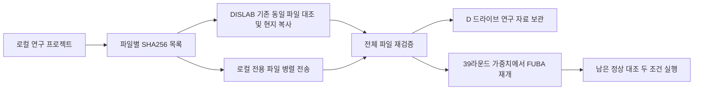

# 로컬 연구 자료의 DISLAB 전체 이전

2026년 10월 21일. 로컬 연구 프로젝트의 **38,317개 파일, 54.87GiB**를 DISLAB `D:/BFU_1021`에 보관한다. 학습 모델과 이력, 실행 코드, 결과, 논문 분석과 보고서를 포함한다. 설치 환경과 Git 내부 자료 및 캐시는 제외하며, 로컬 Python 패키지 목록은 별도로 보존한다. 로컬 원본은 삭제하지 않는다.

## 이전 상태 확인

[전송 상태](transfer_status.json)의 `status`가 `complete`이고 `safe_to_shutdown_local`이 `true`가 된 후 로컬 컴퓨터를 꺼도 된다. 그 전에는 전송에 이 컴퓨터가 필요하다. 전송과 검증은 한 번의 유한 작업으로 실행되며, 완료 뒤 DISLAB 자체 실행기를 시작한다.

- 보관 위치: DISLAB `D:/BFU_1021`
- 학습 위치: DISLAB `D:/BFU_jobs_1021`
- DISLAB 이전 제어 기록: `D:/BFU_1021/_migration`
- 기존 DISLAB FUBA: `C:/Users/DISLAB/Documents/FU_gpu20261020`에서 계속 실행
- 로컬 원본과 39라운드 이전 이력은 보존

## 학습 재개 조건

로컬 FUBA 시드 20261021 공격 실행은 39라운드를 저장한 뒤 중단했다. 최신 전역 모델, 공격 생성기, 실제 자료 인덱스와 관찰 이력을 전송한다. 남은 작업은 시드 20261021 공격의 나머지 라운드와 정상 대조, 시드 20261022 정상 대조이며, 각각 유지 참여자 재학습과 전후 진단도 포함한다.

참여자 추출 난수는 39개 저장 라운드의 실제 참여자 ID와 대조해 재구성했다. 그러나 학습의 전체 CPU 및 CUDA 난수 상태와 MPI 실행 순서는 저장되지 않아 같은 원래 궤적의 완전한 재생은 보장하지 않는다. 이 지점을 모델 이력에 기록하고 학습 난수를 명시적으로 초기화한다. 새 장비에서 같은 경계 모델의 반응도 재계산해 하드웨어 차이가 다음 전후 점수에 섞이는 것을 줄인다.

다른 작업을 덮어쓰지 않는 별도 실행 폴더와 실행기를 사용한다. 시드 20261022의 정상 대조는 기존 DISLAB 공격 모델이 준비된 뒤 같은 생성기로 평가한다. 후속 실험의 성능이 이미 검증됐다는 뜻은 아니다.
