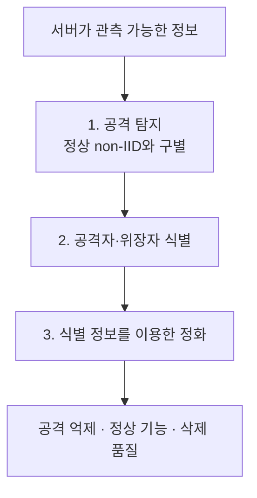

**실험 과정을 읽는 자료:** [전체 과정 정리](../reports/experiment_process_20261026/README.md). 각 실험의 시작 이유, 모델과 자료, 실행 순서와 결과를 풀어 썼다. 아래 문서는 초기 정리 기록으로 보존한다.

> **항상 먼저 읽기:** [연구 실험 인덱스](INDEX.md) → [관련 실험 카드](EXPERIMENT_CARDS.md) → 연결된 원 보고서의 조건·결과·정정 → [실험 원칙](EXPERIMENT_RULES.md). **단순 반응량으로는 큰 정상 non-IID 탈퇴와 공격을 구별하지 못했다.** 아래 과거 후보를 최신 권고로 읽지 않는다.
>
> [전체 폴더 색인](EXPERIMENT_FOLDERS.md) · [모델 선택과 검증된 출처](00_trajectories/README.md) · [구조화된 실험 목록](experiment_registry.json)
>
> **현재 판정:** 제한된 BadFU 마스크 탐색 관측은 보존하지만, 트리거 종류에 독립적으로 큰 정상 non-IID 탈퇴와 구별하는 방법은 확보하지 못했다. FUBA에는 현재 승인된 잠복 활성화 전후쌍이 없다. 이전 실행 상태 문구는 실시간 확인 결과가 아니다. `stcebra/FUBA`와 `ity207/FedUBA`를 같은 구현으로 취급하지 않는다.

# BadFU를 처음부터 이해하고 검증하기 — 초기 정리 기록

초기 출발점은 **위장 데이터를 지웠는데 왜 공격이 강해지는가, 그 효과를 무엇과 비교해야 하는가**였다. 아래는 당시의 논문·구현·검증 연결을 보존한 자료다. 당시 FUBA를 FedUBA라고 부른 기록이 있으나, 현재는 저장소와 논문을 확인해 구분한다.

연구의 전체 순서는 [세 단계 연구 기준](RESEARCH_STAGES.md)으로 고정한다. **① 서버에서 공격과 정상 non-IID 구별 → ② 공격자·위장자 식별 → ③ 그 정보로 정화**다. 각 단계의 성공을 따로 검증하고 전체 과정 성능도 함께 평가한다.

**지금의 선행 조건은 BadFU 원논문 재현 검증이다.** [31라운드 전체 시험 재평가와 설정 차이](01_reproduction/badfu/PRE_ASR_REAUDIT.md)를 먼저 확인한다. 현재 5인 혼합형의 ASR16.43%·정확도85.02%를 논문21.55%·84.84%와 비교하되, 중간1회·PGD 위장·batch64라는 차이를 남긴다. 논문식 위장·batch32 새 기준을 후속 실행으로 연결했고, 전후 탐지 진단은 재현 검토까지 기본 실행에서 보류한다.

**정리 원칙:** 모든 실험은 **가설 한 줄 → 조건 → 비교 → 결과와 그래프 → 판정 → 반증 기준**으로 쓴다. [가설 정리 원칙](EXPERIMENT_RULES.md)과 [교수 미팅용 연구 주장과 검증 카드](05_meetings/20261020/CLAIM_BOARD.md)를 먼저 읽는다. [패치의 정의와 선행 방법 비교](03_detection/PATCH_PROBING_SPEC.md)에는 기존 코드의 정확한 진단 구조, 차분의 조건부 증명과 정상 변화 반례를 연결했다.

**패치 실험의 핵심 구분:** [입력 축과 모델 축](03_detection/PATCH_VALIDITY.md). ‘원본/패치’의 입력 차이만으로는 FU 전후 검증이 아니다. 실제 삭제 전·후 두 모델에 동일 입력 쌍을 넣은 네 출력을 대조한다. 보존된 실제 유지 재학습 전후 출력 한 사례를 이 형식으로 재계산했다.

**현재 실행:** [새 학습 실험](stage1_fresh_20261020/experiment_manifest.json)은 사용자 요청으로 [DISLAB에 이전](stage1_fresh_20261020/DISLAB_MIGRATION.md)했다. 로컬 GPU 학습은 중지했다. BadFU는 GPU에서 이어가며 후속 처리를 원논문 재현 비교 우선으로 바꿨다. FUBA는 CPU의 MPI 5개 프로세스로 병행 실행 중이다. [중간 실행 검증](stage1_fresh_20261020/execution_audit.json)에서 선택 체크포인트의 연결·집계·초기화와 non-IID 분할이 통과했고, [과거 이력 30개](stage1_fresh_20261020/history_transfer_status.json)도 모두 전송·해시 검증됐다. 모델 이력의 관찰 점수와 실제 FU 전후 진단을 구분하며 탐지 성공 여부는 아직 판정하지 않았다.

**기존 궤적 준비 상태:** [미리 학습한 궤적의 재사용 판정](01_reproduction/TRAJECTORY_DECISION.md). 사전 학습·저장은 의도한 비교 준비이며 원본 궤적을 보존하고 재사용한다. 공개 코드 재현과 잠복 활성화 성공은 따로 표시한다. [1단계 탐지 방법](03_detection/STAGE1_METHODS.md)은 이력·구할 수 있는 비교 모델·패치·FC·Conv를 사용할 궤적과 연결한다. [ASR 원인과 α 재검증](01_reproduction/badfu/PRE_ASR_REAUDIT.md)은 그 판단의 실측 근거다.

## 먼저 이해할 원리

정상 데이터 N에 독성 P와 위장 C를 함께 학습한다. P는 트리거를 공격 타깃에 연결하고 C는 같은 트리거에 원래 라벨을 유지한다. C의 삭제 후에도 P는 남는다. 따라서 삭제를 정확하게 수행하는 일과 남은 모델을 안전하게 만드는 일은 다른 목표일 수 있다.

이 설명만으로 실제 신경망의 공격 성공이 증명되지는 않는다. 정확한 재학습에서도 나타나는 효과인지, FU의 근사 오차인지, FU 중 새로운 악성 갱신인지부터 나눠 확인한다. FUBA의 두 공격 역할은 BadFU의 두 데이터 역할과 비교하되 같은 구현으로 취급하지 않는다.



위 과정에 쓸 관측 방법은 [이력 예측과 실제 언러닝 전후 비교](03_detection/TWO_ROUTE_REVIEW.md)다. 두 방법을 연구의 전체 단계와 혼동하지 않는다. 공통 배경은 [서버 관측 조건](03_detection/COMMON_ATTACK_SURFACE.md)에서 확인한다. 앞으로 연구 방향은 **구조 그래프 → 서버의 정보 범위 → 필요한 가정 → 반증 실험**으로 설명한다. 수치가 없는 가설은 관계 그래프로, 실제 결과는 조건·분모·변동을 표시한 결과 그래프로 구분한다.

당시 [발전 후보와 분리 여부](03_detection/BEST_CANDIDATES.md)는 공통 크기 보정 HRAC, 패치 반응 대조, FC·Conv 분석을 다뤘다. **현재 권고가 아니다.** 후속 실패·추천 철회는 [D01–D17 실험 카드](EXPERIMENT_CARDS.md)에서 먼저 읽는다.

## 읽는 순서

| 순서 | 자료 | 짚을 포인트 |
|---|---|---|
| 연구 기준 | [세 단계와 단계별 성공 조건](RESEARCH_STAGES.md) | 공격 탐지·역할 식별·정화를 분리하고 연결 |
| 1 | [BadFU 논문 분석](01_reproduction/badfu/PAPER_ANALYSIS.md) | 공격자의 권한, 삭제 대상, 실제로 보여준 결과, 이론의 빈자리 |
| 2 | [BadFU 코드 분석](01_reproduction/badfu/CODE_AUDIT.md) | 논문의 샘플 삭제와 코드의 참여자 삭제, 집계·보정·평가 정의 |
| 3 | [FUBA 분석](01_reproduction/fuba/README.md) · [관련 논문](01_reproduction/RELATED_WORK.md) | 선행 아이디어, 공격 차이, 가져올 방법과 추가 가정 |
| 3a | [공통 공격 구조와 서버 관측 조건](03_detection/COMMON_ATTACK_SURFACE.md) | 두 공격에서 공략할 지점, 볼 수 없는 정보, 조건 완화의 효과와 한계 |
| 3b | [두 탐지 경로의 검증 검토](03_detection/TWO_ROUTE_REVIEW.md) | 이력·실제 전후 실험의 원리와 공백, 정확도 대리 신호의 재분석 |
| 4 | [기본 검증 계획과 현재 상태](01_reproduction/BASIC_VALIDATION.md) | 같은 시작 모델에서 위장·독성·정상 삭제와 무삭제 대조 |
| 5 | [방어 가설](02_purification/FOUNDATION_HYPOTHESES.md) · [탐지 문제](03_detection/FOUNDATION_QUESTIONS.md) | 어떤 공격 경로를 어느 정보로 막을 것인가 |
| 6 | [수학적 명제와 증명](04_theory/README.md) | 정확한 삭제의 한계, 선형 활성화 충분조건, 조건부 방어 보장 |

## 연구의 갈래

```text
research/
├─ 01_reproduction/              원문 이해와 재현 기준
│  ├─ badfu/                     논문 분석 · 코드 분석 · 작은 함수 검사
│  ├─ fuba/                      공격 역할과 코드 차이
│  ├─ RELATED_WORK.md            선행·비교 논문
│  └─ BASIC_VALIDATION.md        첫 이미지 실험의 비교 조건
├─ 02_purification/              공격 억제와 삭제·정상 기능의 양립
│  ├─ DETECTION_TO_PURIFICATION.md 3단계: 식별 정보별 정화 조건
│  ├─ FOUNDATION_HYPOTHESES.md    먼저 반증할 가설과 방어 후보
│  └─ derived/                   이전 파생 방법: 아직 재채택하지 않음
├─ 03_detection/                 위험한 삭제 결과의 구별
│  ├─ role_attribution/           2단계: 주입·위장 역할의 식별
│  ├─ 01_history_prediction/      이력으로 실제 FU 후 위험 예측
│  ├─ 02_pre_post_detection/      실제 FU 전후로 위험 발생 감지
│  │  └─ fc_conv/                FC·앞단 특징 변화의 분해와 검산
│  ├─ TWO_ROUTE_REVIEW.md         두 경로의 원리와 약했던 검증
│  ├─ FOUNDATION_QUESTIONS.md     탐지 대상 · 접근 정보 · 정상 대조
│  └─ derived/                   이전 파생 방법: 아직 재채택하지 않음
├─ 04_theory/                    가정 · 증명 · 정확한 작은 구성 예
└─ 90_archive/                   이전 정리와 보류한 시도
```

## 초기 정리 당시 확인한 것과 남았던 것

**확인:** 두 특징의 선형 모형에서는 정상 정확도 100%를 유지하면서 위장 삭제 후 트리거 예측이 공격 타깃으로 바뀌었다. 정확한 유지 데이터 재학습으로 얻은 결과다. 삭제 항등식 300조건과 활성화 공식 1,200조건을 유리수로 검산했다. 이미지 BadFU 재현 결과로 세지 않는다.

**확인:** 보존 소스의 작은 CPU 검사에서 BadFU의 학습 집계와 FU 보정의 가중 방식 차이, 0 갱신의 NaN, FUBA의 gamma 후보 재구성 차이를 확인했다. 전체 공격 성능에 미치는 영향은 측정하지 않았다.

**미확인:** 새 CIFAR-10 재현, 신경망의 활성화 충분조건, BadFU·FUBA에 대한 실제 방어 성공. FUBA는 공식 초록·공개 코드까지 확인했으며 전체 본문·보충자료 검토가 남아 있다.

당시 후속 계획은 [기본 검증 계획](01_reproduction/BASIC_VALIDATION.md)의 데이터·모델·삭제 이력을 연결하는 것이었다. 새 실행은 이 과거 계획이 아니라 [최신 인덱스](INDEX.md)의 판정과 기존 반례를 검토한 뒤 별도로 정의한다.

[공통 용어](TERMS.md) · [이번 검증 기록](FOUNDATION_VALIDATION.json) · [이전 시도](90_archive/README.md) · [연구 정리 원칙의 출처](ORGANIZATION_SOURCES.md)
