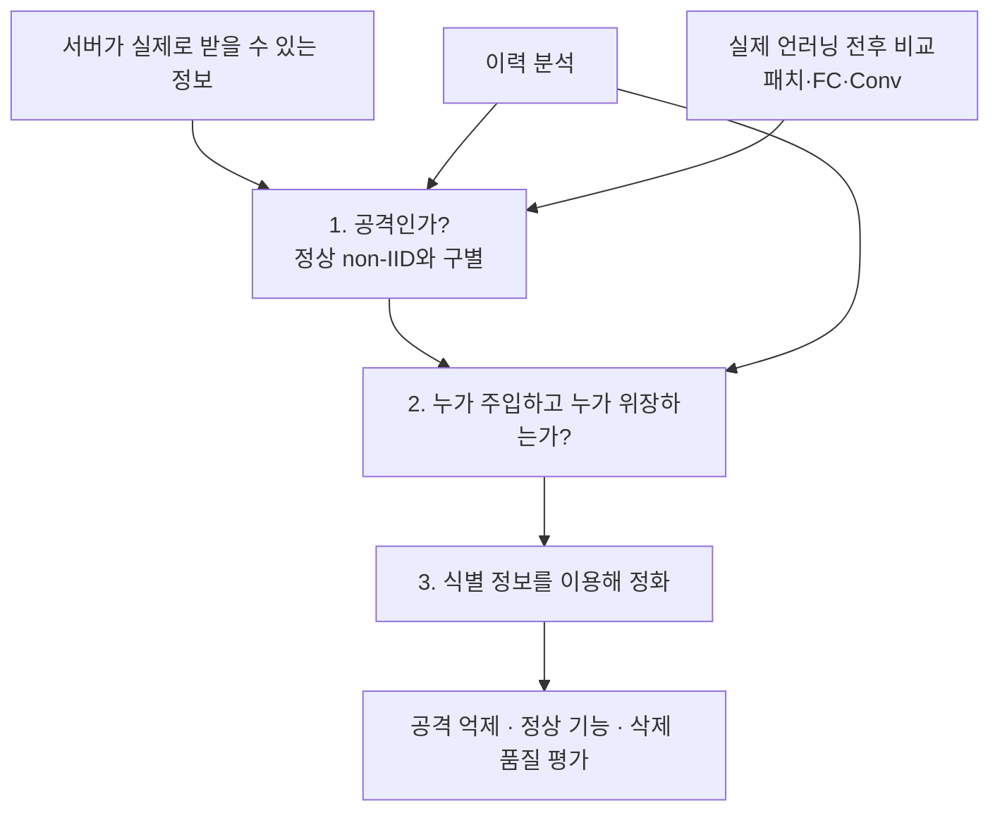

# 연구의 세 단계

2026년 10월 20일. 전체 연구 순서는 **서버의 공격 탐지 → 공격자·위장자 식별 → 식별 정보에 근거한 정화**다. 이력 분석과 실제 언러닝 전후 비교는 이 과정에서 사용할 두 관측 방법이다.

## 1단계 — 서버가 공격과 정상 non-IID를 구별

**질문:** 정상 참여자들의 데이터 차이로 생기는 변화와 공격이 만드는 변화를 서버 관측만으로 구별할 수 있는가.

| 항목 | 고정할 내용 |
|---|---|
| 입력 | 실제 허용한 이력·모델·공개 기준 자료. 개별 갱신 접근 여부와 라벨 자료 유무 명시 |
| 출력 | 공격 의심 점수·경보·미판정. 공격자 신원 정답은 출력으로 간주하지 않음 |
| 후보 | 공통 크기 보정 HRAC, 실제 pre/post 패치 반응, FC·Conv 변화 분석 |
| 기본 비교 | 정확도·클래스별 정확도·CE·출력 변화·갱신 크기 |
| 정상 대조 | 동일한 non-IID 수준의 무작위·저손실·고손실·클래스 편향·희귀 클래스 삭제, 무삭제 FU 처리 |
| 평가 | 같은 정상 오탐 수준에서의 공격 탐지율, 미판정률, 관측·계산 비용 |

같은 시드·기본 정상 자료·분할·모델 초기화·참여 일정에 공격 유무를 대응시킨다. 공격 실험과 정상 실험의 클래스 비중이 다르기 때문에 구별되는 결과를 성공으로 세지 않는다. 삭제 크기·클래스 구성·정상 정확도를 가능한 범위에서 맞춘 대조도 둔다.

공격 구성 여부와 실제 위험을 함께 채점한다. 실제 ASR·공격 역할·원래 트리거는 평가자만 본다. 잠복 공격과 이미 활성화된 공격을 구분한다. 큰 변화 하나를 악의의 증명으로 읽지 않는다.

**현재 상태:** 일부 보조 진단에서 유용한 분리가 있었지만, non-IID 정상 대조 전반을 통과한 서버 탐지를 확정하지 못했다. 기존84요청의 패치 검사는 R/F 추가 학습 진단이며 실제 FU 전후 탐지의 성공 수치가 아니다.

## 2단계 — 공격자와 위장자를 따로 식별

**질문:** 1단계의 의심 결과에서 누가 위험 기능을 주입했고, 누가 이를 억제하거나 위장했는지 구분할 수 있는가.

| 구분 | 식별할 것 | 주의할 점 |
|---|---|---|
| 공격 역할 | 위험 기능을 심거나 유지하는 참여자·갱신·자료의 후보 | 삭제 요청자와 같다고 가정하지 않음 |
| 위장 역할 | 위험 기능을 가리던 참여자·갱신·자료의 후보 | 위장 역할을 찾았다고 남은 주입 역할까지 찾은 것은 아님 |
| BadFU | 같은 참여자 내부의 P/C 역할도 구분 | 한 참여자가 양쪽 역할을 할 수 있어 서로 다른 두 ID만 찾는 문제가 아님 |
| FUBA | 주입 역할과 억제 역할의 참여자 후보 | 공식 구조의 역할명과 서버가 추정한 역할을 구분 |

참여자 ID만 식별하는 실험과 내부 자료·갱신까지 좁히는 실험을 나눈다. 표적·패치 후보가 있으면 보조 정보로 전달하지만 실제 트리거를 찾았다고 가정하지 않는다. 개인 원자료 없이 내부 역할을 식별하지 못하면 미관측·미판정으로 남긴다.

**평가:** 공격 역할과 위장 역할 각각의 정확도·재현율·후보 순위, 정상 참여자 오지목, 두 역할을 모두 맞힌 비율을 기록한다. 1단계를 통과한 사례만의 조건부 성능과 **전체 공격 중 최종 식별까지 성공한 비율**을 함께 보고한다.

**현재 상태:** HRAC에 억제 역할 후보를 찾은 기록이 있지만 주입·위장 양쪽 역할을 일반적으로 식별한 결과는 아니다. 코드의 `role`은 `label()`이 실험 설정에서 붙이는 평가 정답이다. `score_requests()`가 그 역할명을 알아낸 출력이 아니다.

[역할 식별의 정보 경계](03_detection/role_attribution/README.md)

## 3단계 — 이 정보를 이용해 정화

**질문:** 위험 경보만 있을 때보다 참여자·역할·패치·특징 정보를 추가로 주면 같은 비용에서 정화가 더 좋아지는가.

| 실제로 얻은 정보 | 정화 후보 | 추가로 확인할 것 |
|---|---|---|
| 위험 경보만 | 독립 정상 자료를 이용한 일반 정화 기준선 | 신원이나 트리거를 안다고 가정하지 않음 |
| 추정 패치·타깃 | 해당 변형에 대한 정답 학습과 정화 | 패치 추정의 오차·다른 트리거로의 일반화 |
| 의심 주입 참여자·갱신 | 해당 기여의 제거·제한 후 재학습 후보 | 오지목 피해·과거 오염의 잔존·추가 제거 범위 |
| 의심 위장 역할만 | 남은 주입 기여 조사에 사용 | 위장을 되살리거나 삭제를 취소하는 방식으로 안전을 대신하지 않음 |
| 내부 특징·층 변화 | 특징 교정·가지치기·미세조정 후보 | 변화한 부분이 악성이라는 근거와 정상 기능 손실 |
| 확인된 독성 자료 ID | 그 자료까지 정리한 재학습 비교 | 실제 방어로 얻은 정보인지 연구용 정답 제공인지 구분 |

정화 비교는 **정보 없음 → 실제 추정 정보 → 평가자가 준 정확한 정보**의 세 조건을 둔다. 마지막은 식별이 완벽할 때의 가능성을 보는 오라클이며 실제 방어 성능으로 세지 않는다. 오지목·패치 오차를 넣은 조건도 둔다.

**평가:** 정화 후 실제 ASR, 정상·클래스별 정확도, 삭제 품질, 추가 자료·계산 비용. 1·2단계에서 놓친 공격을 제외한 채 정화 성공률만 높게 보고하지 않는다.

[정보별 정화 연결](02_purification/DETECTION_TO_PURIFICATION.md)

## 기존 설명의 정정

‘모델 두 개를 복사해 R/F로 추가 학습’한 것은 실제로 삭제한 모델과 삭제하지 않은 모델의 비교가 아니다. 기존 패치 수치는 그 사전 진단 안에서의 결과다. 실제 전후 비교는 삭제 전 모델을 그대로 보존하고 **같은 시작점에 실제 FU를 수행한 모델**과 비교해야 한다. 기존 FC·Conv 자료는 요청대로 전후 갈래에 연결하되, 과거 R/F 기울기 진단을 실제 FU 전후 결과로 바꾸어 세지 않는다.

앞으로 실험은 **어느 단계인가 → 서버가 무엇을 받는가 → 무엇을 추정하는가 → 실제로 무엇을 검증했는가**를 먼저 적는다. 새 독립 실험에서 확인하기 전 단계 사이의 연결을 성공으로 간주하지 않는다.
