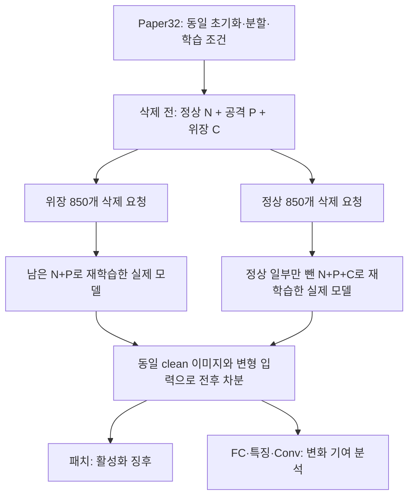

> **출처 고정:** 이 폴더의 주 비교는 `badfu.paper32.s20261020`의 유지 자료 재학습 쌍이다. 2026-10-23에 원본160라운드와 전체 평가를 다시 검증했다. 입력 모델은 [고정 목록](../00_trajectories/README.md)으로 선택하며, 파일 이름이 비슷한 seed42 분리형으로 대체하지 않는다.

# BadFU 실제 삭제 전후: 패치·FC·Conv 비교

2026-10-21 · DISLAB GPU 실행 완료 · VC는 앞선 대화의 FC로 해석

**현재 결과: 국소 패치의 삭제 전후 차분이 가장 뚜렷한 활성화 신호였다. FC만의 변화와 Conv 가중치 이동량은 약했고, 특징 표현과 Conv 기능 변화는 보조 근거가 됐다.**

이것은 현재 보존된 모델을 사용한 1차 대조 실험이다. 공격 유무 판별기, 공격자·위장자 식별기, 정화 알고리즘의 검증 완료를 의미하지 않는다.

추가 확인: [삭제 전후 변화량과 단일 모델의 직접 비교](model_delta_check/README.md). 정상 변화 상쇄는 확인했으나, 모든 조건에서 관측 점수 간격이 커지지는 않았다.

## 1. 어떤 모델을 실제로 비교했는가

- **주 비교 Paper32:** 클라이언트 5개, 지배 클래스 비율 70%의 non-IID, 40라운드, 로컬 5에폭, 배치 32, plain 위장, 시드 20261020.
- 위장 삭제와 정상 삭제는 **같은 공격 포함 삭제 전 모델**을 출발점으로 비교한다. 정상 삭제 후에도 공격·위장 데이터는 남아 있다.
- 삭제 후 모델은 동일 초기화에서 보존 데이터만으로 끝까지 재학습한 실제 체크포인트다. 근사 연합 언러닝 구현을 검증한 것은 아니다.
- **별도 보조 비교 PGD64:** 배치 64·PGD 위장 조건의 공격 모델 전후와, 깨끗한 non-IID 모델의 정상 데이터 삭제 전후. Paper32와 합쳐 표본 수를 늘리지 않는다.
- 실제 모델 8개·삭제 전후 쌍 4개를 측정했다. 추가 Conv 분석의 혼합 모델 4개는 분석용으로 명시해 구분했다.

서버에 필요한 것은 저장된 삭제 전 글로벌 모델, 반환된 삭제 후 모델, 라벨이 있는 공개 clean 기준 이미지다. 실제 트리거·공격 목표 클래스·ASR·공격자 ID를 탐지 함수에 제공하지 않았다. 공개 clean 기준 데이터 확보는 이 방법의 조건이다.

## 2. 패치가 정확히 무엇이며 어떻게 비교했는가

**가설: 위장 데이터 삭제는 정상 데이터 삭제보다 동일한 국소 변형에 대한 모델 반응을 크게 증가시킨다.**

여기서 패치는 clean 이미지의 작은 사각형을 고정 무늬로 덮어쓰는 입력 변형이다. 3×3/5×5, 네 모서리, 검정·흰색·체커·RGB의 32개를 사용했다. 별도로 전체 이미지에 체커·무작위·줄무늬를 약하게 섞거나 더하는 16개 변형도 비교했다. 총 48개 후보는 기존 코드의 목록을 유지했다.

삭제 전 모델을 \(M_0\), 삭제 후를 \(M_1\), 동일 이미지의 변형을 \(T\), 클래스 확률을 \(p_{m,k}\)라 하면:

\[
D_{T,k}(x)=\{p_{1,k}(Tx)-p_{1,k}(x)\}-\{p_{0,k}(Tx)-p_{0,k}(x)\}.
\]

공개 이미지 320개를 클래스별로 고르게 뽑아 후보 선택 160개와 확인 160개로 나눴다. 선택 집합에서 평균 양의 반응이 가장 큰 변형·클래스를 고르고, 그대로 확인 집합에 적용했다. 선택한 클래스의 원래 정답 이미지는 제외하므로 각 점수의 확인 표본은 144개다. 목표 클래스도 점수로 선택하며 실제 공격 목표를 넣지 않는다.

주 비교에서 선택된 것은 **오른쪽 아래 3×3 체커, 클래스 0**이었다. 같은 확인 이미지들에 대한 평균 확률은 다음과 같다.

| 실제 모델 | clean 입력 | 동일 체커 입력 | 입력 변형 반응 |
|---|---:|---:|---:|
| 삭제 전 | 1.68% | 4.93% | +3.26%p |
| 위장 삭제 후 | 0.52% | 81.90% | +81.38%p |
| 두 모델의 반응 차이 | | | **+78.12%p** |

이는 이미지 전후만 비교한 값이 아니다. **두 실제 모델 × 두 입력의 네 칸을 모두 사용했다.** 이 점수는 패치에 의한 클래스 확률 변화이며 ASR이 아니다.

| 확인 점수 | 위장 삭제 | 정상 삭제: 공격 데이터 잔존 | 판정 |
|---|---:|---:|---|
| 국소 32개 패치 차분 | **78.12%p** | **0.17%p** | 현재 대조에서는 큰 차이 |
| clean 출력 변화로 정규화 | 11.148 | 0.021 | 일반적인 모델 이동보다 큰 국소 반응 |
| 전체 이미지 16개 변형 차분 | 6.28%p | 10.20%p | 공격 쪽이 더 크다는 가설을 지지하지 않음 |

정규화 분모는 확인 이미지에서 두 모델의 clean 확률 벡터 간 평균 total variation이다. 분모·분자는 현재 관측량이며, 정상 반복 실험으로 보정한 임계값은 아니다.

**패치 중복 보완:** 실제 BadNet 평가 트리거는 오른쪽 아래 3×3 흰색이다. 그 패치와 이를 덮는 5×5 흰색을 빼도 점수는 78.12%p였다. 더 엄격하게 **오른쪽 아래 모든 패치 8개를 제외하자 27.10%p**, 정상 삭제는 0.17%p였다. 이때 선택된 패치는 왼쪽 아래 5×5 체커다. 정확히 같은 위치·무늬를 넣어야만 신호가 나온 것은 아니다. 이 제외 분석은 최초 점수 고정 뒤 시행한 사후 민감도 분석이며, 새로운 미지의 트리거에 대한 독립 검증으로 해석하지 않는다.

## 3. FC와 Conv는 무엇을 본 것인가

**가설: 국소 변형 반응의 삭제 전후 변화에서 FC 기여가 위장 삭제와 정상 삭제를 구별한다.**

마지막 층의 logit을 \(z_i=W_i h_i+b_i\)라 하면 다음은 정확한 항등식이다.

\[
z_1-z_0=
\underbrace{(W_1-W_0)(h_0+h_1)/2+(b_1-b_0)}_{\text{FC 기여}}
+\underbrace{(W_0+W_1)(h_1-h_0)/2}_{\text{상류 특징 기여}}.
\]

각 항에도 같은 입력 차분 \(T(x)-x\)을 적용한다. 클래스 공통 이동을 없애려고 logit의 클래스 평균을 뺀다. 여기서 특징 기여에는 **Conv와 BatchNorm을 포함한 FC 이전 전체 네트워크**가 들어간다. 이를 순수 Conv라고 부르지 않는다. FC의 bias 변화는 입력 차분에서 상쇄된다.

| 국소 반응 기여 | 위장 삭제 | 정상 삭제 | 판정 |
|---|---:|---:|---|
| FC, 원 logit 단위 | 0.222 | 0.116 | 차이는 있으나 작음 |
| FC, clean FC 변화로 정규화 | **0.462** | **0.426** | 주 비교에서 구별 근거 약함 |
| 상류 특징, 원 logit 단위 | 6.513 | 0.771 | 큰 차이 |
| 상류 특징, clean 특징 변화로 정규화 | **3.296** | **0.414** | 보조 분석으로 유망 |

각 방법은 자기 선택 집합에서 별도의 변형·클래스를 고르므로 표의 최대 점수들을 서로 더하면 안 된다. 동일한 패치 선택 좌표에서 분해하면 총 logit 차분 6.603 중 FC가 0.090, 상류 특징이 6.513이었다.

**가설: Conv 가중치의 단순 이동량이 위장 삭제와 정상 삭제를 구별한다.**

모든 Conv2d 가중치를 모아 \(\|C_1-C_0\|/\|C_0\|\)를 계산했다. 위장 삭제 **8.13%**, 정상 삭제 **7.63%**로 비슷했다. 가중치가 많이 움직인다는 사실만으로 공격 활성화를 판단하기는 어렵다.

**가설: Conv가 국소 변형 반응에 기여한 기능 변화가 위장 삭제에서 더 크다.**

원 결과를 확인한 뒤 Conv만의 기여를 추가로 분석했다. Conv 가중치를 \(C\), FC·BatchNorm과 나머지 상태를 \(R\)이라 하고, 실제 두 모델 \((C_0,R_0),(C_1,R_1)\) 외에 분석용 혼합 모델 \((C_1,R_0),(C_0,R_1)\)을 구성했다.

\[
A_C(x)=\tfrac12\{z(C_1,R_0;x)-z(C_0,R_0;x)+z(C_1,R_1;x)-z(C_0,R_1;x)\}.
\]

이는 Conv와 나머지 그룹의 상호작용을 대칭적으로 나누는 정의다. 혼합 모델은 실제 학습·삭제 과정에서 얻은 모델이 아니며, 고유한 인과 설명이나 새로운 탐지기의 검증 완료로 해석하지 않는다.

| Conv 그룹의 국소 기능 기여 | 위장 삭제 | 정상 삭제 |
|---|---:|---:|
| 원 logit 단위 | 4.967 | 0.903 |
| clean Conv 기여 변화로 정규화 | **1.886** | **0.381** |

현재는 **FC 단독보다 특징·Conv 기능 분석을 보조 근거로 두는 방향**이 타당하다. 이 추가 분석은 사후 실험이므로 다음 반복에서는 계산 방식을 미리 고정해야 한다.

## 4. 정상 non-IID와 정말 구별된 것인가

**가설: 공격이 없는 non-IID 환경의 정상 삭제에서는 공격 활성화와 같은 국소 차분이 나타나지 않는다.**

별도 PGD64 조건에서도 위장 삭제 **89.78%p**, 깨끗한 non-IID 모델의 정상 삭제 **0.93%p**였다. 오른쪽 아래 패치를 전부 제외하면 각각 **38.49%p**, **0.93%p**였다. 두 조건에서 같은 방향은 관측했으나 배치·위장 생성 방식이 다르므로 독립 반복 시드 두 개로 세지 않는다.

현재 정상 비교는 동일한 분할 방식·한 시드에 한정된다. 정상 삭제 대상·크기·클래스 편향과 초기화가 달라졌을 때의 정상 점수 분포를 모른다. 따라서 **‘현재 정상 대조와 다르다’까지 말할 수 있고, ‘non-IID와 확실히 구별된다’거나 정상 오탐률·AUROC를 말할 수는 없다.** 이미지 bootstrap 구간은 고정된 모델·선택 후보에서의 이미지 표본 변동만 나타낸다.

또한 Paper32 정상 삭제 모델은 공격이 없는 모델이 아니다. 공격이 남아 있어도 활성화 변화가 작으면 점수가 작을 수 있다. 현재 검증 대상은 **삭제에 따른 활성화 증가**이며 공격의 존재 전체가 아니다.

## 5. 정확도·단일 모델과 비교하면 무엇이 남는가

**가설: clean 정확도 변화만으로 위장 삭제 후 활성화를 알아낼 수 있다.**

전체 clean 테스트 10,000개에서 삭제 전 정확도는 88.23%, 위장 삭제 후 88.15%, 정상 삭제 후 87.72%였다. 공격 활성화가 큰 쪽의 정확도 저하는 **0.08%p**였고 정상 삭제 쪽은 **0.51%p**였다. 확인 이미지 160개만 보면 각각 -0.625%p, -3.75%p로 표본 변동도 컸다. 현재 결과는 정확도 저하 크기만으로 판단하는 방향을 지지하지 않는다.

**가설: 삭제 전후 차분은 삭제 후 단일 모델의 패치 반응보다 판별에 추가 이점을 준다.**

각 모델에서 별도로 후보를 선택한 단일 모델 국소 반응도 삭제 전 4.40%p, 위장 삭제 후 81.38%p, 정상 삭제 후 4.87%p, 공격 없는 clean 모델 0.93%p로 차이가 났다. 따라서 **이 데이터만으로 전후 차분이 단일 모델보다 더 낫다고 입증하지 못했다.** 정상 모델 자체의 높은 패치 민감도를 전후 차분이 상쇄하는 조건을 추가해야 이점이 검증된다.

별도 평가의 실제 트리거 ASR은 16.14%→99.99%(위장 삭제), 16.14%→16.33%(정상 삭제)였다. ASR은 점수를 고정한 뒤 결과 해석에 연결했다. 삭제 전 ASR도 0이 아니므로 완전히 잠복한 공격의 사전 예측 성공으로 부르지 않는다.

## 6. 다음 실험의 한 줄 가설과 판정 기준

| 우선순위 | 한 줄 가설 | 고정할 조건·판정 |
|---|---|---|
| 1 | 다양한 정상 non-IID 삭제에서도 국소 차분의 오탐률을 낮게 유지할 수 있다. | 독립 정상 보정군으로 임계값 고정; 별도 시드·분할·삭제 크기·클래스 편향의 정상/공격 평가군에 적용 |
| 2 | 전후 차분이 단일 모델 패치 반응보다 정상 패치 민감도에 덜 흔들린다. | 같은 평가 쌍에 두 점수 적용; 공격 데이터로 임계값 재조정 없이 고정 오탐률에서 비교 |
| 3 | Conv 기능 기여가 패치 차분의 오탐을 줄이는 보조 정보다. | 계산 방식과 조합 규칙을 보정군에서 고정하고 별도 모델에서 재검증 |
| 4 | FUBA와 전체 입력 트리거에서도 역할 ID 없이 활성화 신호를 얻는다. | 현재 BadNet 결과와 구분해 실제 완료된 전후 모델에 적용; 현재 global16 반응은 유효 탐지 근거가 아님 |

임계값 검증 전에는 결과를 공격/정상으로 자동 확정하거나 곧바로 정화하는 데 사용하지 않는다. 이번 단계는 1단계의 측정 타당성 확인이다.

## 7. 재현·검산 기록

- 서버 결과: `DISLAB D:/BadFU_probe_20261021`. 최초 측정 63.85초, 이후 Conv·위치 제외 보완 실행 완료.
- `protocol.json`: 최초 계산 전 고정한 방법·후보·선택 규칙·가설. 기존 모델의 ASR을 이미 알고 시작한 회고적 실험임을 명시.
- `provenance.json`: 실제 모델 경로·SHA256·라운드·기준 이미지 인덱스. 원 학습 trajectory 6개는 manifest SHA와 일치; 구형 재학습 2개는 자체 SHA를 기록했으며 manifest 결속은 없음.
- `scores_frozen.json`: 최초 고정 점수. `supplement_protocol.json`, `supplement_results.json`: 사후 Conv 분리·위치 제외 분석.
- 네 쌍 모두 기존 독립 점수 함수와 재계산한 패치·FC·특징 점수 차이 **0**. 네 칸 산술 검산 오차 최대 **2.22e-16**. FC/특징 분해 오차 **1e-8 미만**, Conv/나머지 가산 검산 오차 **0**.
- 이 산술 항등식은 분해 계산의 정확성을 확인한다. 공격/정상 점수 분리의 수학적 보장을 뜻하지 않는다.
- 원 관측 npz 8개와 혼합 모델 npz 4개는 서버에 보존했다. 로컬에는 결과 JSON과 그래프·실행 코드를 보존했다.
