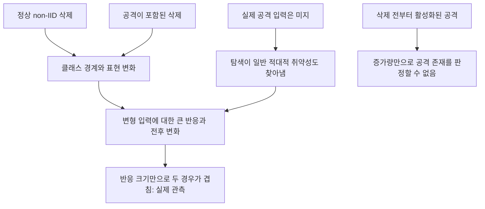

# 실패 원인과 영향력 기반 선행 연구의 검증 상태

**후속 실행 완료:** [영향력 기반 탐지 최종 결과](../INFLUENCE_RUN_20261022/FINAL_REPORT.md). 실제 전후 8쌍의 근사 대조와 완전 이력 7쌍·부분 이력 2사례에서 FLForensics 핵심 점수·저자 군집화 코드의 미지 입력 적용을 검증했다. 정상 non-IID와의 공통 분리를 입증하지 못했다. 원 논문 전체·실제 사고 입력 제공 조건·역 Hessian 기반 삭제 영향 실험을 완료했다는 뜻은 아니다. 아래 표는 이 후속 실행 전의 감사 기록이다.

2026-10-22 · 실행 기록 및 원문 대조 · 새 영향력 탐지 실험 결과가 아님

**현재 결론: 정상과 공격이 겹치는 관측 및 일부 혼동 요인은 확인했다. 영향력 기반 기존 방법을 BadFU·FUBA 탐지 비교군으로 재현한 검증은 빠져 있다. 따라서 그 계열이 실패했다고 결론 내릴 근거도 아직 없다.**

## 1. 왜 구별되지 않았는가

| 구분 | 검증한 사실 | 해석의 한계 |
|---|---|---|
| 실제 정상 대조 | 예약 확인 320장에서 최대 변형 반응의 전후 차분은 BadFU 공격 15.07pp, 정상 주요 클래스 삭제 16.87pp였다. FUBA 공격 83.86pp, 정상 삭제 80.68pp였다. | 이 수치는 실제 트리거 ASR이 아니다. 특정 변형군·예산으로 최적화한 반응 차분이다. 정상 반응의 큰 값은 확인했지만 그 값 전체의 원인을 분해한 것은 아니다. |
| 출력 확률의 혼동 | 입력 변형에 대한 logit 반응이 그대로인데 클래스 편향만 바꾼 수학 대조에서 확률 차분 20.16pp가 발생했다. | 확률 차분이 공격 특이적이지 않을 수 있음을 보인 반례다. 실제 정상 오탐이 전부 이 효과라는 뜻은 아니다. |
| 편향 보정 이후 | 실제 모델에서 logit 및 공통 배율 보정 점수도 정상·공격이 겹쳤다. clean 출력의 공통 배율·클래스 편향 근사에도 잔차가 남았다. | 정상 변화가 단순 편향·온도 변화만은 아님을 뒷받침한다. 미지 변형 입력에서의 잔차를 clean 잔차로 보장할 수는 없다. |
| 층 변화의 혼동 | 실제 정상 FUBA 특징의 채널 순서를 바꾸고 FC 열도 함께 바꾸면 출력은 약 1e-13 오차로 같지만 FC 가중치는 39.24% 달라졌다. | 큰 가중치 변화가 기능 변화·공격 위치를 바로 의미하지 않는다는 구성 반례다. 독립 학습 정상 모델을 추가한 실험은 아니다. |
| FUBA의 증가량 한계 | 평가자 전용 실제 생성기로 측정한 보존 쌍의 ASR은 전 99.72%, 후 83.61%였다. | 잠복 활성화 증가 사례는 아니다. 공격 존재 검사에는 포함해야 하며, 증가하지 않았다는 이유로 제외하면 안 된다. |
| 남은 탐침 문제 | 작은 입력별 생성기의 반응이 약했다. 원 FUBA 코드와 탐색기의 입력 clipping 범위도 다르다. | 생성기 용량·최적화 예산·입력 범위의 기여를 각각 통제한 실험은 미완료다. 전역 변형을 탐색해도 정상 반응이 컸으므로 국소 패치 불일치만으로 전체 실패를 설명할 수 없다. |

세부 결과 및 수학 대조는 [실험 결과](RESULTS.md), [수학 노트](MATH_NOTES.md), `bias_controls.json`, `coordinate_symmetry_check.json`을 함께 확인한다. 초기 공개 확인 자료와 공격자의 gamma 선택 자료가 겹쳤던 문제는 별도로 발견해 예약 자료로 재평가했다. 재평가 후에도 정상·공격의 겹침이 남았다.

## 2. 무엇을 실행했고 무엇을 실행하지 않았는가

| 항목 | 실제 상태 | 혼동하면 안 되는 점 |
|---|---|---|
| BadFU 위장 생성의 영향력 계산 | 이전 실행 로그 `cover.log`에 850개 샘플 영향 계산 완료 및 위장 perturbation 결과가 있다. `experiment.py`도 이 고정 공격 산출물을 읽는다. | 공격 데이터를 만드는 계산이다. 서버의 공격 탐지 정확도를 평가한 비교군이 아니다. |
| Hessian 기반 고전 영향력 함수 | 문헌 및 공격 생성 코드 사용 이력은 있다. 현재 8개 모델 쌍에서 정상·공격 탐지 기준으로 비교한 결과는 없다. | 공개 gradient와 실제 모델 차이의 내적만으로 원 학습 데이터 기반 영향력 함수를 재현했다고 부르지 않는다. |
| FLForensics | 이전 문헌 정리와 이번 원문 재확인. 현재 실험의 재현 결과 없음. | 개별 업데이트 이력과 의심 입력이 필요한 방법이다. 전후 글로벌 모델 두 개만으로 원 방법을 실행할 수 없다. |
| PUMA | 이번에 공식 초록·목적 재확인. 우리 모델에서 미실행. | 영향력을 이용한 삭제·성능 유지 방법이다. 그 자체가 미지 백도어 탐지기는 아니다. |
| IndirectVerify | 이번에 원문 절차·영향력 해석 재확인. 우리 모델에서 미실행. | 사용자가 미리 만든 샘플 쌍의 반응으로 삭제 실행을 검증한다. 미지 트리거 탐지와 입력 조건·목표가 다르다. |
| FedMUA의 방어 | 이번에 원문 §VI 확인. 우리 모델에서 미실행. | 공격은 영향력 기반 샘플 선정을 쓰지만 방어는 큰 개별 gradient의 IQR 선별·축소다. Hessian 영향력 탐지기로 분류하면 안 된다. |

### 핵심 원리와 관측 조건

[고전 영향력 함수, ICML 2017](https://proceedings.mlr.press/v70/koh17a.html)는 학습 샘플 가중치를 조금 높였을 때 평가 손실이 얼마나 변하는지 근사한다. 다음은 그 대표적인 형태이며, 큰 삭제·재학습 변화에 대한 정확한 등식은 아니다.

\[
I(z,x)=-\nabla_\theta\ell(x;\theta)^\top H_{\mathrm{train}}^{-1}\nabla_\theta\ell(z;\theta).
\]

학습 샘플 기울기와 학습 목적의 곡률이 필요하다. 기본 서버의 공개 clean 자료만으로 계산하면 공개 자료 기반 대리 점수가 된다. 클라이언트 계산·추가 통계 제공 등의 관측 조건을 완화하면 다른 구현이 가능하므로, 정보가 없다는 이유만으로 계열 전체가 불가능하다고 결론 내리지 않는다. 영향력의 큰 값은 중요한 정상 데이터에서도 생길 수 있어 별도 판정 기준이 필요하다.

[FLForensics §4.2·Appendix B/G](https://arxiv.org/html/2407.07221)는 의심 입력에 대한 개별 업데이트의 이력 영향과 비공격 참조 입력에 대한 영향을 함께 비교한다. 특정 클래스가 많은 정상 non-IID 참여자도 첫 점수가 클 수 있다는 것이 두 점수를 쓰는 동기다. 참조에는 실제 입력 외에 무작위 입력도 평가한다. 주 절차는 의심 오분류 입력 확보 이후의 추적이며, 논문에는 주어진 오분류 입력이 표적 입력인지 판별하는 확장도 있다. 이를 미지 입력의 탐색 자체를 해결했다고 확대하지 않는다.

**우리 공격에 대한 추가 검증점:** 논문의 이론은 공격자·정상 참여자의 입력별 손실 기여에 대한 순서 가정을 둔다. BadFU·FUBA의 위장/억제 기여는 백도어 출력을 낮추는 방향일 수 있으므로, 일반 공격자의 부호·순위를 위장 역할에 그대로 적용할 수 있다는 보장이 없다. 이는 원문과 공격 구조를 대조한 추론이며 실제 영향 점수로 검증한 결과는 아니다. BadFU에서 독성과 위장이 같은 참여자 안에 있으면 최종 업데이트에서 기여가 상쇄될 가능성도 별도로 검사해야 한다.

[PUMA, AAAI 2022](https://ojs.aaai.org/index.php/AAAI/article/view/20846)는 삭제에 따른 성능 저하를 남은 학습 데이터의 재가중으로 보완한다. 이 목적의 성공 여부와 공격 부재는 서로 다른 평가다.

[IndirectVerify §IV–V](https://arxiv.org/html/2406.10953v1)는 미리 설계한 trigger/reaction 샘플 쌍을 학습에 넣고, 전자를 삭제한 뒤 후자의 분류 변화로 삭제를 검증한다. 이때 trigger sample은 논문이 정의한 검증용 학습 샘플이며, 우리가 모르는 백도어 트리거 패턴과 구별한다. 삭제 검증이 통과해도 남은 모델의 안전성을 자동으로 증명하지 않는다.

[FedMUA §VI](https://arxiv.org/html/2501.11848v1)는 개별 gradient 크기 이상치를 선별해 축소하는 방어를 제안한다. 정상 클래스 집중 삭제와 크기를 맞춘 비교가 필요하다. 글로벌 전후 차이로 개별 gradient를 대신한 결과를 원 방어 재현이라고 부르지 않는다.

## 3. 다음 검증의 순서

아래는 미실행 설계다. 문헌 원 조건 재현과 서버 관측을 제한한 변형 실험을 구분한다.

**가설 IF-1: 영향력 기반 삭제 영향 근사는 실제 재학습 전후의 입력별 손실 변화를 충분히 예측한다.**

- 연구용 삭제 샘플 접근을 허용한 원형 계산과 공개 자료만 사용하는 대리 계산을 나눈다. 전자는 서버 실현 가능 탐지 결과로 세지 않는다.
- 삭제량을 맞춘 정상 무작위·클래스 집중 삭제와 공격 삭제에서 예측 변화/실제 변화의 부호, 순위, 오차를 비교한다. 작은 부분집합 삭제부터 크기를 늘려 근사 오차를 기록한다.
- 곡률 감쇠·연립방정식 잔차 및 최적화 정지점 가정을 확인한다. FC만 계산하면 FC 제한 근사임을 표시하고 전체 모델 영향력 검증과 구분한다.

**가설 IF-2: 의심 기능에 대한 영향에서 정상 참조 기능의 영향을 보정하면 정상 non-IID의 오탐이 줄어든다.**

- 개별 이력 보존 여부를 먼저 확인한다. 없으면 이후 새 학습에서 기록하고, 원 FLForensics를 실행했다고 소급하지 않는다.
- 원 논문 조건의 의심 입력을 제공한 상한 비교와, 실제 트리거 없이 얻은 후보 입력을 사용하는 파이프라인을 나눈다. 후자의 결과에 후보 입력을 못 찾은 경우도 포함한다.
- 영향 크기만, 두 입력 영향 비교, 실제 삭제 전후 기능 차분을 같은 정상 오탐률에서 비교한다. 새로운 학습 시드를 평가용으로 남긴다.
- 공격자와 위장자의 부호·상쇄를 별도로 기록한다. 참여자 추적 성능을 1단계 공격 존재 탐지 성능으로 바꿔 쓰지 않는다.

**가설 IF-3: 삭제 실행의 정확성을 확인한 뒤에도 남은 모델의 백도어 위험은 별도 검사를 필요로 한다.**

- 삭제 검증 점수와 공격 탐지 점수를 분리한다. 남은 학습 데이터에 독성이 포함된 재학습 대조를 둔다.
- IndirectVerify를 비교하려면 사전에 설계한 쌍을 학습에 넣는 별도 조건부터 구현한다. 현재 보존 모델에 사후 대리 점수만 붙여 재현으로 계산하지 않는다.

판정 보고는 **근사 타당성 → 정상 오탐 보정 → 공격 검출 → 역할 추적** 순서로 한다. 현재 독립 정상 모델 수가 적어 1%와 같은 낮은 오탐률에서 성능을 확정하지 않는다.
