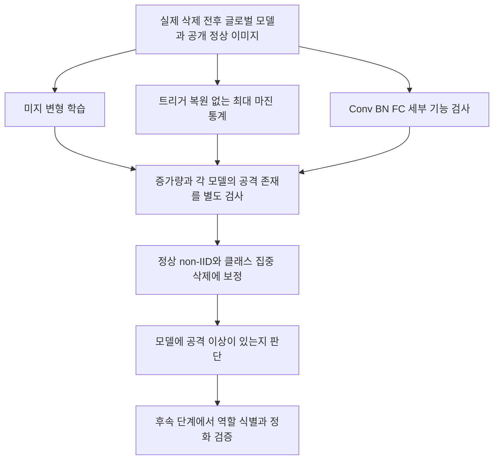

# 미지 트리거 조건의 공격 탐지 실제 검증 결과

2026년 10월 21일 · 탐지 1단계 · 실제 삭제 전후 모델 8쌍

**두 방향을 실제 실행했고 Conv·BN·FC 세부 검사도 완료했다. 현재 점수만으로 BadFU와 FUBA를 정상 non-IID 삭제에서 공통으로 확실히 분리했다고 주장할 수 없다.** 다만 BadFU Paper32에서 작은 마스크 비용, FUBA에서 전후 마진 프로필 변화라는 서로 다른 후보 신호를 확인했다. 이미 활성화된 공격도 탐지 대상에 포함했다.

## 무엇을 구별하려는가

감염 모델 탐지와 악의적인 요청 판별을 구분한다. **BadFU 감염 모델의 정상 삭제**는 정상 사용자의 요청이지만 깨끗한 정상 모델은 아니다. 이 사례를 깨끗한 음성 모델로 취급하지 않았다. 이번 결과는 공격자·위장자 ID를 찾았다는 결과가 아니다.

FUBA는 현재 보존한 stcebra/FUBA의 IBA 조건이다. 별도 FedUBA 논문과 구분하며, FUBA 전체를 한 종류의 전역 노이즈 공격으로 정의하지 않는다. [공식 구현](https://github.com/stcebra/FUBA)

## 공통 조건

- 탐지 입력: 실제 전후 분류기 가중치, 서버가 아는 분류기 구조·전처리, 공개 정상 이미지. 탐색 160장, 최초 확인 160장, 추가 예약 확인 320장이다.
- 제외: 실제 트리거·위치·크기·공격 목표·공격 생성기·클라이언트 역할·실제 ASR.
- 이미지 분리: 최초에는 클래스마다 탐색 16개와 확인 16개를 사용했다. 추가 예약 확인은 클래스마다 32개이며 목표 클래스 제외 후 점수 표본은 288개다.
- 목표·변형·모델 시점 선택은 탐색 자료에서만 수행했다. 아래 주요 반응 표는 선택을 고정한 예약 확인 값이다.
- 비교: 공격 활성화 BadFU 2쌍, 공격 데이터가 남은 모델의 정상 삭제 1쌍, 이미 활성화된 FUBA 1쌍, 깨끗한 정상 삭제 4쌍. 같은 시드와 모델을 공유하므로 독립 학습 8회가 아니다.
- 주요 클래스 삭제: 정상 non-IID 참여자0의 클래스1 데이터 3,558개를 전부 삭제했다. 전역 해당 클래스는 5,000개에서 1,442개로 줄었다. 전역 클래스 전체 삭제와는 다르다.

주요 클래스 삭제와 같은 수 3,558개의 무작위 삭제 대조는 별도 학습 중이다. 이번 새 정상 시드의 무작위 삭제 수는 850개여서 삭제량을 일치시킨 인과 비교가 아니다. 완료된 사례에 대한 스트레스 검사로 해석한다.

FUBA 전후 모델의 초기 가중치 텐서가 실제로 모두 같음을 다시 확인했다. 후 모델은 보존 참여자 재학습 결과이며 남은 악의적 참여자의 공격 주입도 계속된다. 관측 차이를 위장 효과 해제 하나의 원인으로 해석하지 않는다.

### 확인 자료 분리의 보완

최초 확인 이미지는 탐지 학습·선택에서 분리했지만 FUBA 원 학습의 γ 선택용 9,280장에 포함되어 있었다. 그래서 원 학습 때 γ 선택에서 제외한 예약 320장을 추가 확인에 사용했다. 새 학습·후보 선택·임계값 조정 없이 이미 고정한 탐침을 적용했다. 원본 학습 기록에서 공격·정상 및 전·후 네 조건 모두 예약 320장과 γ 선택 집합이 겹치지 않음을 확인했다.

이 예약 자료는 과거 수동 진단에도 쓰인 서버 기준 자료이므로 연구 과정 전체에서 한 번도 살펴보지 않은 최종 블라인드 벤치마크를 새로 확보했다는 뜻은 아니다. 추가 확인 결과에서도 정상과 공격의 점수 겹침이 유지되었다.

## 실험 1 미지 입력 변형과 실제 모델 전후 비교

**가설 한 줄: 실제 트리거 없이 학습한 변형의 전후 반응 차분은 공격과 정상 non-IID 삭제를 구별한다.**

입력 변형은 자유 위치 마스크, 전역 공통 변형, 입력별 작은 CNN 변형 세 종류다. 마스크 예산은 L1 질량 32, 나머지 둘은 최대 픽셀 변화 16/255다. 목표 10개를 모두 탐색했고, 후보당 100회 학습했다. 후 모델 반응 최대화와 전후 차분 최대화에 더해 전 모델 반응 최대화 대조도 수행했다. 총 720개 후보를 학습했다.

$$R_{j,k}(T)=E[p_{j,k}(Tx)-p_{j,k}(x)],\qquad D_k(T)=R_{1,k}(T)-R_{0,k}(T).$$

같은 변형을 고정한 뒤 실제 전후 모델에 적용했다. 원본·변형 이미지 차이만 비교한 실험이 아니다. 단일 모델 반응은 전체 후보에서 탐색 점수가 가장 큰 전/후 모델과 변형을 골라 확인 점수를 보고한다. 기존 감염을 함께 검사하기 위한 보조 점수이며 감염 확률을 뜻하지 않는다.

| 실제 비교 | 선택한 차분 pp | 자동 선택 목표 | 단일 모델 반응 pp | 최소 마스크 질량 전 → 후 |
|---|---:|---:|---:|---:|
| BadFU 위장 삭제 | 15.07 | 6 | 84.07 | 57.04 → 13.02 |
| BadFU 감염 모델 정상 삭제 | 16.18 | 2 | 80.74 | 57.04 → 57.01 |
| 정상 non-IID 주요 클래스 삭제 | 16.87 | 3 | 83.90 | 55.41 → 68.27 |
| 정상 non-IID 새 시드 무작위 삭제 | 13.21 | 6 | 84.79 | 66.81 → 35.52 |
| FUBA 공격 모델 | 83.86 | 9 | 94.87 | 31.75 → 29.18 |
| FUBA 정상 삭제 | 80.68 | 9 | 95.20 | 31.11 → 29.58 |
| BadFU PGD64 위장 삭제 | 16.60 | 3 | 78.40 | 66.08 → 62.74 |
| BadFU PGD64 정상 삭제 | 22.34 | 0 | 78.99 | 55.79 → 67.77 |

**결과:** 예약 확인에서 BadFU Paper32 공격 차분은 15.07pp인데 정상 클래스 집중 삭제는 16.87pp였다. FUBA 공격은 83.86pp, 정상 삭제는 80.68pp였다. 큰 차분을 만드는 변형이 정상 모델에서도 발견되었다. 단순 최대 반응이나 반응 증가량은 공통 판정식으로 부족하다.

목표가 실제 공격 목표와 다르다는 사실만으로 이진 탐지 자체를 실패라고 판정하지는 않는다. 다만 이런 반응을 공격 트리거 복원이나 공격 기능의 활성화라고 부를 근거도 없다. 핵심 기준은 정상 모델과의 구별이며 현재 그 검증이 부족하다.

입력별 작은 CNN 변형은 이번 예산에서 고정 전역 변형보다 유리하지 않았다. 이는 현재 탐색의 용량·최적화 조건에 대한 결과이며 원래 공격 생성기를 충분히 근사했다는 의미가 아니다.

이번 입력 탐색은 변형 후 [0,1]로 클리핑한다. [FUBA IBA 원 코드](https://github.com/stcebra/FUBA/blob/main/train_method_iba.py)의 마지막 클리핑은 [-1,1]을 허용하므로 입력 영역 차이가 있다. 이 차이와 생성기 용량·학습 예산은 탐침 포괄성의 추가 검증 조건이며, 이것만을 이번 실패 원인으로 확정하지 않는다.

### 탐색적 보완 확률 편향과 로짓 배율의 제거

**가설 한 줄: 클래스 편향과 모델별 공통 로짓 배율을 상쇄하면 정상 non-IID와 공격의 혼동이 줄어든다.**

두 클래스의 구성 반례에서 원본·변형 로짓이 [-4,0], [-3,0]이고 후 모델이 두 입력 모두에 [3,0]을 더하면, 로짓 차분은 0이지만 확률 차분은 20.162pp가 생긴다. 확률의 비선형 변환만으로도 의심 점수가 생길 수 있다는 반례다.

그래서 같은 보존 후보에서 중심화 로짓 차분과 추가 정규화 점수를 비교했다. 중심화 출력 q의 clean 탐색 자료 표준편차를 모델별로 σ라 할 때 `(q1(Tx)-q1(x))/σ1 - (q0(Tx)-q0(x))/σ0`를 쓴다. 변화가 모든 입력에서 `q1=a*q0+b`, a>0인 경우 클래스별 고정 편향과 공통 배율이 정확히 상쇄된다. 구성 대조의 최대 수치 오차는 1.18e-14였다.

후보 선택은 기존 탐색 자료에서만 했고 예약 확인 자료에서는 고정한 후보를 측정했다. 이 보정은 최초 실행 후 추가한 탐색적 점수다. 마지막 열은 최초 공개 확인 자료에서 측정한 clean 출력의 배율·편향 근사 잔차이며 사후 구조 설명이다.

| 실제 비교 | 선택한 로짓 차분 | 편향·배율 보정 차분 | clean 근사 잔차 비율 |
|---|---:|---:|---:|
| BadFU 위장 삭제 | 5.965 | 0.983 | 0.334 |
| BadFU 감염 모델 정상 삭제 | 3.931 | 0.637 | 0.295 |
| 정상 non-IID 주요 클래스 삭제 | 5.132 | 0.821 | 0.363 |
| 정상 non-IID 새 시드 무작위 삭제 | 3.974 | 0.634 | 0.255 |
| FUBA 공격 모델 | 12.780 | 3.593 | 0.379 |
| FUBA 정상 삭제 | 9.992 | 2.881 | 0.311 |
| BadFU PGD64 위장 삭제 | 3.388 | 0.616 | 0.355 |
| BadFU PGD64 정상 삭제 | 3.867 | 0.676 | 0.348 |

보정 후에도 PGD64 공격 0.616과 정상 0.676처럼 순위가 뒤집혔다. 정상 모델의 출력 변화에도 단순 클래스 편향·공통 배율로 설명되지 않는 성분이 남았다. 즉 보정이 없애는 특정 변화는 수학적으로 확인했지만, 모든 non-IID 변화를 없애는 식은 아니다.

발상은 미지 변형 학습 선행과 두 모델 상호작용 비교에서 가져왔다. 이번 구현은 [UNICORN](https://arxiv.org/abs/2304.02786)의 원 제약과 구조 전체를 재현한 것은 아니다. 두 모델에서 입력을 찾는다는 발상 자체의 신규성을 주장하지 않는다. 가까운 선행은 [FilterFL](https://arxiv.org/abs/2308.11333)이다.

## 실험 1 보완 반응 크기와 최소 변형 비용의 구분

**가설 한 줄: 목표 예측을 만드는 최소 마스크 비용은 큰 반응 자체보다 공격에 특이적인 신호가 될 수 있다.**

[Neural Cleanse의 목적함수](https://bolunwang.github.io/assets/docs/backdoor-sp19.pdf)를 바탕으로 CE와 마스크 L1 비용을 함께 최적화했다. 모든 분류기 15개와 목표 10개에 같은 초기화 규칙과 400회 예산을 적용했다. 탐색 이미지의 목표 예측률 95%를 만족하는 후보 중 작은 마스크를 저장했다. PyTorch 이식 대조이며 원 구현의 전체 설정 재현은 아니다.

- BadFU Paper32 후 모델의 최소 마스크는 **목표0·질량13.02**였다. 탐색 목표 예측률 96.53%, 최초 확인 91.67%, 예약 확인 95.49%였다. 실제 공격 목표와의 일치는 점수 계산 후 평가자 정보로 확인했다.
- 정상 non-IID 새 시드의 후 모델도 **질량35.52·예약 확인 목표 예측률93.40%**를 보였다. 강한 목표 예측 자체로는 공격을 판정할 수 없다.
- 클래스 간 마스크 비용 MAD 이상 점수는 BadFU Paper32 후 모델 **2.10**, 새 정상 후 모델 **4.34**였다. 이 이상도만 사용하면 정상 모델이 더 의심스럽게 나온다.
- 기존 PGD64 BadFU 후 모델에서는 최소 비용 목표가 1로 선택되었다. 이번 제한 예산 탐색은 BadFU 보존 쌍 전체에서도 실제 공격 목표를 안정적으로 찾아내지 못했다.
- FUBA 공격 후 모델의 최소 질량은 **29.18**, 정상 후 모델은 **29.58**이었다. 이 마스크 비용은 FUBA를 분리하지 못했다.

작은 마스크라는 신호를 버릴 이유는 없지만, 성공한 한 BadFU 쌍을 일반 성능으로 확대할 수 없다. 아래 그림의 마스크는 공개 이미지로 학습한 후보이며 실제 공격 패턴을 제공한 것이 아니다.

## 실험 2 트리거 복원 없는 최대 마진 검사

**가설 한 줄: 입력 모양을 지정하지 않는 클래스별 최대 마진 통계는 이미 활성화된 공격도 탐지한다.**

[MM-BD](https://arxiv.org/abs/2205.06900)의 유효 픽셀 영역 최대 마진 목적함수를 적용했다. 15개 모델의 10개 클래스마다 균일 난수 시작점 4개를 썼다. 처음 120회 이후 마진이 계속 증가해 전 모델에 같은 추가 240회를 수행했다. 총 360회이며 원 논문의 전체 하이퍼파라미터 재현은 아니다.

**결과:** 정상 non-IID에서도 강한 마진 이상도가 생겼다. FUBA 공격 후 모델을 의심스럽게 만드는 통계는 나왔지만, 깨끗한 정상 모델도 의심스럽게 나오고 PGD64 BadFU 후 모델은 약하게 나왔다. 단일 모델 p값을 실제 오탐률 보정 없이 공격 판정으로 쓸 수 없다.

### 탐색적 보완 전후 마진 프로필

**가설 한 줄: 공통 클래스 선호와 전체 로짓 배율을 나누면 공격 관련 클래스별 변화가 더 드러난다.**

최대 마진 $r_{j,k}$에서 $u_k=\log(r_{1,k}/r_{0,k})$, $d_k=u_k-\mathrm{median}_\ell u_\ell$, $S_M=\max_k d_k$를 계산했다. 이 정규화는 이번 결과 검토에서 추가한 탐색적 통계이며 MM-BD의 원 판정식과 다르다.

| 실제 비교 | 120회 점수 | 360회 점수 | 시작점 하나씩 제외한 범위 | 자동 선택 목표 |
|---|---:|---:|---:|---:|
| BadFU 위장 삭제 | 0.140 | 0.127 | 0.110–0.129 | 2 |
| BadFU 감염 모델 정상 삭제 | 0.078 | 0.091 | 0.091–0.150 | 2 |
| 정상 non-IID 주요 클래스 삭제 | 0.092 | 0.070 | 0.055–0.080 | 8 |
| 정상 non-IID 새 시드 무작위 삭제 | 0.133 | 0.078 | 0.065–0.131 | 5 |
| FUBA 공격 모델 | 0.510 | 0.508 | 0.504–0.539 | 6 |
| FUBA 정상 삭제 | 0.180 | 0.190 | 0.180–0.190 | 4 |
| BadFU PGD64 위장 삭제 | 0.151 | 0.189 | 0.106–0.212 | 1 |
| BadFU PGD64 정상 삭제 | 0.172 | 0.114 | 0.059–0.193 | 0 |

FUBA 공격 0.508, 같은 구조의 정상 삭제 0.190로 차이가 관측되었고 120회와 360회에서도 비슷했다. 이미 공격이 활성화된 FUBA를 평가 범위에 유지한 상태에서 나온 후보 신호다. 다른 클래스의 변화도 쓰므로 공격 목표를 알아낸 결과는 아니다. **단일 FUBA 학습 쌍의 탐색적 차이**이며 임계값이나 검증 정확도로 보고하지 않는다.

BadFU와 정상 모델은 점수 차이가 작고 최적화 반복 수에 따라 순위가 바뀌기도 했다. 시작점 민감도는 모델 학습 시드의 신뢰구간을 뜻하지 않는다.

## 실험 3 Conv BN FC 세부 검증

**가설 한 줄: 세부 모듈의 기능 변화는 가중치 변화량보다 공격과 정상 삭제의 차이를 더 정확하게 설명한다.**

각 모델의 Conv 20개, BN 20개, FC 1개를 나누었다. Conv 출력 채널별 가중치 변화, BN의 γ·β, running mean, running variance, FC 행별 변화를 따로 저장했다. 확인 이미지에서 활성화 상대 RMS·코사인·2×2 공간 풀링 표현의 선형 CKA·클래스별 변화도 측정했다.

Conv는 합성곱 층, BN은 배치 정규화 층, FC는 마지막 특징을 클래스 점수로 바꾸는 완전 연결 층이다.

이 절의 표현·교체 분석은 최초 공개 확인 160장 조건의 사후 구조 진단이다. 예약 자료에서 검증한 이진 분류기 성능으로 해석하지 않는다.

추가로 잔차 블록 8개를 묶어 개별 모듈과 블록 총 49개 그룹을 양방향 교체했다. 8쌍에서 **784개 모듈 교체 검사**를 수행했다. 입력은 원본, 미지 차분 변형, 미지 후 모델 변형, 최소 마스크 변형 네 조건이다.

### FC와 FC 이전 표현의 정확 분해

$$\Delta z=\Delta W(h_0+h_1)/2+\Delta b+(W_0+W_1)\Delta h/2.$$

다음 비율은 **원본 clean 이미지에서** 전체 로짓 변화 노름 대비 각 성분 노름이다. 벡터가 상쇄되므로 두 비율의 합은 1이 아닐 수 있다. FC 이전 표현에는 Conv 외에 BN·비선형·잔차 경로도 포함된다.

| 실제 비교 | FC 가중치 대칭 상대 L2 | clean FC 성분 비율 | clean 이전 표현 비율 | 공개 확인 ACC 전 → 후 % |
|---|---:|---:|---:|---:|
| BadFU 위장 삭제 | 17.03% | 0.224 | 0.966 | 85.625 → 86.250 |
| BadFU 감염 모델 정상 삭제 | 13.25% | 0.142 | 0.986 | 85.625 → 85.000 |
| 정상 non-IID 주요 클래스 삭제 | 16.89% | 0.507 | 0.923 | 86.875 → 85.000 |
| 정상 non-IID 새 시드 무작위 삭제 | 10.81% | 0.125 | 0.997 | 86.875 → 85.000 |
| FUBA 공격 모델 | 26.58% | 0.526 | 0.653 | 75.000 → 74.375 |
| FUBA 정상 삭제 | 19.28% | 0.260 | 0.903 | 75.625 → 74.375 |
| BadFU PGD64 위장 삭제 | 17.32% | 0.250 | 0.955 | 83.125 → 81.250 |
| BadFU PGD64 정상 삭제 | 15.64% | 0.211 | 0.951 | 83.125 → 82.500 |

BadFU Paper32에서 FC 가중치 변화는 정상 클래스 집중 삭제와 비슷한 수준이었다. FUBA에서는 clean 출력 변화의 FC 성분 비율이 공격 0.526, 정상 0.260으로 차이를 보였다. 그러나 정상 클래스 집중 삭제도 0.507이므로 모델 구조와 정상 분포를 무시한 공통 기준으로 사용할 수 없다.

clean 정확도만으로도 분리되지 않았다. BadFU Paper32 공격에서 공개 확인 ACC는 85.625%에서 86.250%로 올랐고, FUBA 공격은 75.000%에서 74.375%로 바뀌었다. 정상 삭제에서도 유사하거나 더 큰 변동이 있었다. 확인 이미지 160개라는 표본 크기도 함께 고려해야 한다.

### 어느 부분이 기능을 바꾸는가

아래는 **후 모델의 최소 마스크로 선택한 기능**에서, 삭제 전 모델에 해당 모듈만 삭제 후 값으로 교체했을 때 가장 큰 절대 반응 변화를 보인 항목이다. 확인 자료의 사후 설명용 순위이며 탐지 모듈을 선택·학습한 성능이 아니다.

| 실제 비교 | 개별 Conv 최대 항목 | 개별 BN 최대 항목 | FC 교체 |
|---|---|---|---|
| BadFU 위장 삭제 | layer3.1.conv1 +14.29pp | layer4.1.bn2 -13.43pp | fc -3.45pp |
| BadFU 감염 모델 정상 삭제 | layer3.0.conv1 -1.70pp | layer3.1.bn1 -4.03pp | fc -0.23pp |
| 정상 non-IID 주요 클래스 삭제 | layer4.1.conv1 +7.42pp | layer2.1.bn2 +5.05pp | fc +1.63pp |
| 정상 non-IID 새 시드 무작위 삭제 | layer3.1.conv1 -2.23pp | layer3.1.bn1 +1.20pp | fc +0.20pp |
| FUBA 공격 모델 | layer3.0.conv1 -57.62pp | layer2.0.bn2 -32.11pp | linear +2.40pp |
| FUBA 정상 삭제 | layer2.0.conv2 -48.69pp | layer4.0.bn1 -51.18pp | linear -8.78pp |
| BadFU PGD64 위장 삭제 | layer4.1.conv1 +6.97pp | layer3.0.bn1 -7.08pp | fc -4.97pp |
| BadFU PGD64 정상 삭제 | layer3.0.conv1 -4.41pp | layer2.1.bn2 -3.72pp | fc -0.53pp |

BadFU Paper32에서 세 번째 stage의 두 번째 잔차 블록인 layer3.1 전체 교체는 선택한 목표 반응을 +17.01pp 바꿨다. 정상 클래스 집중 삭제에서도 layer4.1 블록 교체가 +9.97pp였으므로 큰 블록 변화 자체가 공격의 증거는 아니다. FUBA에서는 공격과 정상 양쪽 모두 큰 음의 교체 반응이 있었다. 결합된 층을 따로 바꾸면서 기능이 깨지는 효과가 섞일 수 있다. 원점 재학습 후에는 같은 초기화에서 시작했더라도 특징의 좌표 대응이 유지된다는 보장이 없다.

FC 등식의 double 계산 최대 오차는 1.28e-13, 정방향·역방향 블록 합산의 float 최대 오차는 1.53e-05였다. 전체 블록을 교체하면 실제 후 모델 출력으로 돌아오는지까지 검사했다. 정확 분해가 성립한다는 것과 공격 분류가 성공한다는 것은 별개다.

추가로 실제 정상 FUBA 특징의 채널 순서를 바꾸고 FC 열을 같은 순서로 바꾸는 구성 대조를 했다. 출력은 최대 9.95e-14 오차로 같았지만 FC 가중치 상대 변화는 39.24%였다. FC·이전 표현 성분도 각각 큰 값으로 생겼다가 상쇄됐다. 따라서 층 분해의 항등식이 정확해도 기여 크기는 좌표계에 의존하며, 큰 층 변화만으로 공격 위치를 확정할 수 없다. 이 구성 대조는 독립 학습 정상 모델 수에 더하지 않았다.

## 분리해서 해석해야 할 실패 원인

| 관측 | 이번 결과로 말할 수 있는 것 | 추가로 확인할 조건 |
|---|---|---|
| 고정 예산 최대 반응에서 정상도 큼 | 탐색이 정상 모델의 적대적 취약성도 찾는다 | 반응 크기와 필요한 변형 비용을 분리 |
| BadFU 한 쌍에서 작은 마스크 | 제한된 미지 탐색에서도 유용한 패턴을 찾는 사례가 있음 | 시작점·예산·다른 BadFU 학습 시드 |
| 입력별 변형이 약함 | 현재 작은 생성기를 유효 탐침으로 확보하지 못함 | 원 생성기를 제공하지 않는 상태에서 용량·예산 민감도 |
| FUBA는 전부터 실제 ASR이 높음 | 공격 존재 검사에 반드시 포함해야 함 | 양의 증가량과 기존 감염 점수를 함께 검사 |
| 정상 non-IID도 강한 반응·마진·층 변화 | 차분만으로 정상 변화가 소거되지 않음 | 삭제량 일치·클래스 집중도·새 시드 보정 |
| FUBA 전후 정규화 마진이 큼 | 트리거를 모르는 조건의 후속 후보 신호 | 새 FUBA 공격·정상 쌍에서 고정한 식 재검증 |

기존 평가자 전용 결과에서 같은 생성기로 측정한 FUBA 실제 ASR은 전 99.72%, 후 83.61%였다. 이번 탐지기는 그 생성기나 ASR을 받지 않았다. 이 모델을 “새로 활성화되지 않았다”는 이유로 공격 평가에서 제외하지 않는다. ASR 변화와 이번 미지 변형 차분의 수치는 서로 다른 입력 조건이므로 같은 척도로 바꿔 읽지 않는다.

## 이어갈 공통 탐지 절차

**가설 한 줄: 변형 비용의 전후 변화와 정규화된 모델 기능 변화를 함께 보정하면 단순 최대 반응보다 정상 non-IID 혼동이 줄어든다.**

1. 모든 모델에 동일하게 마스크·전역·입력별 탐색을 수행한다. 공격 종류를 보고 탐색 종류를 골라 주지 않는다.
2. 큰 반응뿐 아니라 그 반응에 필요한 변형 비용과 전후 비용 비율을 기록한다. 전역·입력별 변형도 최소 예산 곡선으로 확장하는 것이 다음 검증점이다.
3. 같은 모델 쌍에서 전후 마진 프로필과 clean FC·상위 표현 변화가 추가 정보를 주는지 검사한다.
4. 삭제 수·클래스 집중도·모델 구조를 맞춘 정상 삭제 쌍으로 보정한 뒤, 새로운 공격·정상 학습 시드에서 임계값을 고정해 평가한다.

이번에는 통합 판정식을 학습·검증한 것이 아니다. 특히 추가 점수를 사후 조합하여 현재 8쌍을 전부 맞힌다는 주장은 하지 않는다. 목표는 두 공격을 같은 절차로 평가하고, 어떤 신호가 실패하고 무엇이 후속 검증 가치가 있는지 확인하는 것이다.

## 재현성과 수학 검증

- 두 컴퓨터의 공개 데이터 해시·참조 이미지 ID·분류기 가중치 해시가 일치했다. 같은 clean 입력의 예측 클래스도 모두 같았다.
- 기본 GPU 연산에서 고정 입력 확률의 최대 차이는 4.14e-05였다. TF32를 끄고 정밀도를 맞춘 로짓 최대 차이는 2.67e-05였다.
- 입력 탐색 주 결과는 로컬의 동일 실행 환경에서 계산한 8쌍으로 통일했다. DISLAB 반복은 별도 민감도 비교다. 작은 연산 차이도 반복 최적화 경로와 선택 목표를 바꿀 수 있어 결과를 섞지 않았다.
- 전후 마진 정규화의 공통 클래스 배율·모델별 공통 배율 불변성 계산 오차는 4.58e-16였다. 정상 non-IID의 임의 변화를 소거하는 보장은 아니다.
- 정상 모델 수가 적고 학습 시드를 공유한다. 낮은 오탐률이나 새 모델에서의 검출률을 추정했다고 해석하지 않는다.

다음은 최초 공개 확인 160장에서의 실행 환경 민감도다.

| 실제 비교 | DISLAB 차분 pp | 로컬 차분 pp |
|---|---:|---:|
| BadFU 위장 삭제 | 21.90 | 15.79 |
| BadFU 감염 모델 정상 삭제 | 14.19 | 14.80 |
| 정상 non-IID 주요 클래스 삭제 | 15.37 | 17.04 |
| 정상 non-IID 새 시드 무작위 삭제 | 21.37 | 15.57 |
| FUBA 공격 모델 | 86.92 | 85.54 |
| FUBA 정상 삭제 | 80.14 | 80.65 |
| BadFU PGD64 위장 삭제 | 15.24 | 20.41 |
| BadFU PGD64 정상 삭제 | 21.58 | 17.16 |

다음은 동일 로컬 탐침을 고정한 확인 자료 간 비교다.

| 실제 비교 | 최초 공개 확인 160장 pp | 예약 확인 320장 pp |
|---|---:|---:|
| BadFU 위장 삭제 | 15.79 | 15.07 |
| BadFU 감염 모델 정상 삭제 | 14.80 | 16.18 |
| 정상 non-IID 주요 클래스 삭제 | 17.04 | 16.87 |
| 정상 non-IID 새 시드 무작위 삭제 | 15.57 | 13.21 |
| FUBA 공격 모델 | 85.54 | 83.86 |
| FUBA 정상 삭제 | 80.65 | 80.68 |
| BadFU PGD64 위장 삭제 | 20.41 | 16.60 |
| BadFU PGD64 정상 삭제 | 17.16 | 22.34 |

[수식과 증명 및 식별 한계](MATH_NOTES.md) · [가설과 조건 기록](PROTOCOL.json) · [최초 수치 요약](SUMMARY.json) · [예약 확인 수치](reserved_confirmation/results.json)
