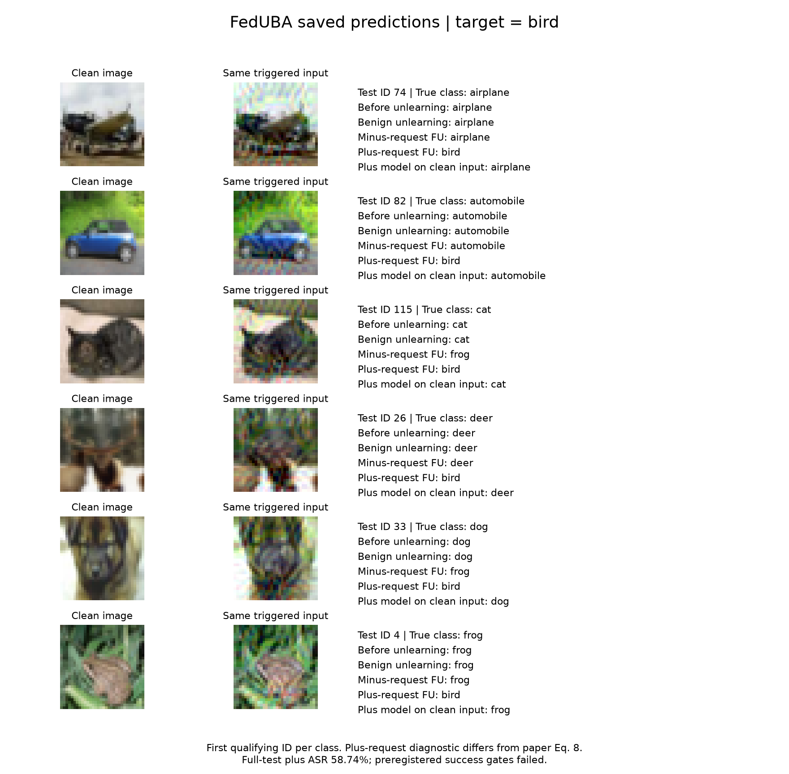

# FedUBA 언러닝 전후의 실제 예측 전환

DISLAB의 2026-11-03 완료 실행에서 보존한 공식 CIFAR-10 시험 예측을 2026-11-15에 교차 집계했다. 실제 FedEraser 20라운드 전후 모델에 연결된 평가 자료다. 이번 작업은 사전에 고정한 조건으로 이미지별 예측 교집합을 확인했다. 관련 카드 R03/R02/D08/D15, 새 기록 R05. [검토 조건](PROTOCOL.txt)

| 모델 | 정상 정답 / 10,000 | 정상 정확도 | 목표 예측 / 9,000 | ASR |
|---|---:|---:|---:|---:|
| 언러닝 전 | 8,553 | 85.53% | 1,813 | 20.14% |
| 정상 삭제 후 | 8,474 | 84.74% | 1,500 | 16.67% |
| 음의 요청 변형 삭제 후 | 8,469 | 84.69% | 1,244 | 13.82% |
| 양의 요청 변형 삭제 후 | 8,445 | 84.45% | 5,287 | 58.74% |

**같은 트리거 이미지에서 삭제 전과 정상 삭제 후 모두 정답이며, 양의 요청 변형 삭제 후에는 목표인 새를 내고, 해당 후 모델의 깨끗한 입력 정답도 유지된 사례는 1,510장이다.** 이 조건의 확인은 저장 logits의 argmax를 공식 시험 ID로 연결하여 수행했다.

삭제 전의 목표 예측을 제외하면 새 목표 예측으로 전환한 이미지는 3,482장이다. 반대로 목표 예측에서 벗어난 이미지는 8장이므로 전체 순증가 3,474장과 일치한다. 엄격한 1,510장 조건은 정상 삭제 모델과 깨끗한 입력까지 요구해 전체 전환보다 좁다.

각 클래스에서 조건을 만족하는 가장 낮은 시험 ID를 택하고 클래스 순서상 첫 여섯 장을 표시했다. 이 선택 규칙은 결과를 읽기 전에 고정했다.

양의 요청 실행은 x+delta를 사용했다. 원문 식8의 x-delta 실행은 위 표의 음의 요청 변형 행이다. 양의 요청 실행은 별도로 선언한 관련 helper 해석이며, 기존 80% ASR과 증가폭 50%p 등 사전 성능 기준을 통과하지 못했다. 완전한 논문 재현은 미완료다. D08·D15의 큰 정상 non-IID 탈퇴와 공격의 구별도 미검증이다.

원격의 세 diagnostic case 선택·보관본 해시 검사를 통과했다. 79개 입력 및 네 모델의 316개 logits 배치를 해시·ID·입력/모델 결속과 함께 읽어 모든 기존 CA/ASR 정수 집계가 일치함을 확인했다. 원 독립 평가 영수증도 고정 SHA로 검증했다. 이번 새 학습·모델 추론 횟수는 0이다.

새 결과는 DISLAB `D:/FEDUBA_ACTIVATION_EVIDENCE_20261115/result`와 이 PR에 있다. 네 결과 파일의 원격·로컬 SHA256 일치를 확인했다. [집계](result/summary.json) · [전체 시험 예측](result/predictions.csv) · [프로세스 종료 확인](result/terminal.json)
