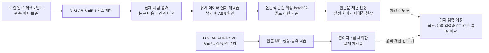

# DISLAB 이전과 실제 언러닝 전후 검증

2026년 10월 20일 갱신. 사용자는 로컬 학습 이전에 이어 대기 없이 동시 실행을 요청했다. **DISLAB에서 BadFU는 GPU, FUBA는 CPU로 병행 실행을 시작했다.** 로컬 학습은 중지했으며 원본 데이터와 결과는 보존한다.

**우선순위 변경:** 사용자는 탐지보다 먼저 BadFU가 원논문의 결과를 재현하는지 검증하도록 요청했다. 현재 FL은 유지하며 후속 처리는 **전체 시험 재평가 → 실제 유지 자료 재학습의 논문 비교 → 논문식 위장·batch32 기준 실행** 순서다. 전후 탐지 진단은 기본 실행에서 보류했다. [원논문 대비 1차 검증](../01_reproduction/badfu/PRE_ASR_REAUDIT.md) · [31라운드 전체 평가](paper_full_test_round_0031.json) · [검증 판정과 다음 실행](paper_first_validation.json). 아래의 기존 탐지 실행 계획은 이 우선순위에 종속된다.

## 실행 순서

## 학습 이력의 이전

**가설: 동일한 완료 체크포인트와 데이터·시드를 복원하면 실험 조건을 유지해 나머지 학습을 이어갈 수 있다.**

- BadFU 전환 스냅샷은 정상5·공격5 각각 8라운드, 정상6·공격6 각각 7라운드다. 스냅샷 이후 로컬에서 진행한 분기는 원본으로 보존하되 DISLAB 분기와 합치지 않는다.
- 초기화·완료 모델·정상 참조 이미지·클라이언트 분할·관측 이력을 복사하고 파일 해시를 확인했다. 이전 라운드 전체 이력 약 9.34GiB, 30개 파일의 전송과 SHA256 검증도 완료했다.
- 다른 GPU와 Torch 버전의 수치 차이가 다음 탐지 점수에 섞이지 않도록 같은 가중치의 기준 관측을 DISLAB에서 다시 계산했다. 이 기준을 같은 배치로 재검사한 최대 로짓 오차는 네 조건 모두 0이었다.
- 배치 64의 역전파를 점검했고, 원격 재개 라운드가 실제 완료된 뒤 로컬 학습을 중지했다. 향후 경로의 비트 단위 동일성은 주장하지 않는다.
- 14시 확인에서는 네 조건 모두 9/40라운드를 완료했다. 최근 원격 처리 속도 기준 FL 잔여 시간은 약 3시간이다. GPU 경쟁에 따라 바뀐다.

## 실제 삭제 전후 검증

**가설: 실제 삭제 후 모델의 입력 변형 반응 변화는 공격성 삭제와 정상 non-IID 삭제에서 다르게 나타난다.**

- BadFU는 같은 초기화에서 유지 자료로 40라운드 전체 FedAvg 재학습한 결과를 삭제 후 기준으로 만든다. 원본 FedEraser의 재현이나 삭제 인증 결과와 구분한다.
- 5인 조건은 client0 내부의 위장 850개 삭제, 6인 조건은 위장 참여자5 전체 삭제다. 두 조건의 잔류 5인 자료가 같으므로 정상·공격 각각 하나의 재학습 후 모델을 공유한다. 별개의 독립 결과 네 개로 세지 않는다.
- 같은 clean·변형 입력을 실제 pre/post 모델 모두에 적용한다. 국소 32개·전역 16개 진단 입력을 개발/확인 이미지 160장씩 나눠 측정하고 FC·앞단 특징의 출력 기여도 분해한다.
- 실제 트리거와 ASR은 진단 점수 저장 후 평가한다. 임계값은 미설정이며 점수만으로 검증된 탐지 성공을 선언하지 않는다.
- BadFU 후속 재학습은 두 조건 합계 80라운드이며, 현재 처리 속도로 약 2시간을 추가 예상한다. 전역 진단 입력 추가와 Blended 공격 재현은 다른 일이다. 이 작업의 BadFU 공격은 기존 BadNet 계열 자료다.

## FUBA의 실제 삭제 기준

**가설: 위장 역할 참여자 삭제 후의 입력 반응 변화는 정상 참여자 삭제와 구별되는 정보를 준다.**

- 3개 시드의 정상/공격 원본 MPI 학습을 각각 100라운드 수행한다. 각 실행 뒤 원래 초기 가중치와 실제 저장된 분할을 사용해 참여자4를 제외하고 같은 학습 절차를 재실행한다.
- 원본 공격 코어를 유지하고, 삭제 후 재실행에서 참여자4가 선택되지 않는지 확인한다. 임의의 새 균등 분할로 교체하지 않는다.
- **남은 공격자는 재학습 중 원래 공격 절차를 계속한다.** 따라서 위험 증가에 재주입이 포함될 수 있으며, 순수한 잠복 해제 증명으로 해석하지 않는다.
- 실제 전후 모델을 동일 입력으로 진단하고, 평가에는 삭제 전 공격 실행의 고정 생성기 한 개를 두 모델 모두에 사용한다. 정상 모델의 일반 적대적 취약성을 악성 학습의 증거로 바꾸지 않는다.
- 사용자의 동시 실행 요청에 따라 `--n_gpu 0` 원본 CPU 경로로 시작했다. MPI 5개·배치 64·20명 중 8명 선택·100라운드·공격 코어는 유지한다. CPU/GPU의 수치 결과가 비트 단위로 같다는 보장은 하지 않는다. CPU는 느리며, 초기 진단과 공격 단계까지 속도를 확인하기 전 전체 완료 시각을 제시하지 않는다.
- Windows에서는 빈 GPU 비활성화 환경변수가 하위 프로세스에서 사라질 수 있어 `CUDA_VISIBLE_DEVICES=-1`을 사용한다. 실제 5개 MPI 프로세스 모두 CUDA 비활성화와 새 삭제 어댑터 가져오기를 확인했고 원본 ResNet·UNet의 배치 64 역전파가 통과했다.
- 삭제 후에도 매 라운드 선택 수는 8명으로 유지하되 후보는 19명이다. 이는 삭제 전의 8/20과 삭제 후의 8/19 비교이며, 정상·공격 대조에 동일하게 적용한다.

**가설: 탐지·평가 이미지를 FUBA 공격 강도 선택에서 제외하면 검증 자료의 역할 중복을 제거할 수 있다.**

- 실제 문제: 원본 `train_method_iba.py`의 gamma 선택이 `testloader`의 ASR을 사용한다. 처음 연결한 탐지 320장과 최종 평가 400장은 같은 전체 시험 자료에 포함돼 있었다. FL의 분류 학습에서 빠졌다는 것만으로 공격 최적화에서도 제외된 것은 아니었다.
- 수정: 클래스별 고정 순열로 탐지 32장과 별도 평가 40장을 먼저 확보하고, 나머지 9,280장만 원본 `testloader`에 제공한다. 세 집합은 겹치지 않는다. 실제 전후 진단과 고정 생성기 평가에 쓰는 인덱스가 이 예약과 일치한다.
- 원본 IBA 학습 함수의 바이트는 유지한다. **시험 자료 사용 조건을 바꾼 통제 실험이며, 손대지 않은 원본 실행이라고 표시하지 않는다.** 저자식 온라인 평가의 분모도 10,000장 전체가 아닌 이 9,280장 부분집합을 따른다.
- MPI 5개 프로세스와 FL/FU 공통 어댑터에서 분리 규칙을 검증했다. 수정 후 본 실행에서도 5개 역할 분리 파일과 4개 private 분할 파일의 동일성을 재확인했다.
- 수정 전 CPU 시도는 공격 단계 이전에 중지했고 원래 폴더 `C:/Users/DISLAB/Documents/badfu_FU_20261020/attack_s20261020`에 보존한다. 폴더 이동은 열린 핸들 때문에 실패해 이동을 강행하지 않았다. 이 시도의 결과는 새 실행과 합치지 않는다.
- 수정 후 실제 출력은 `C:/Users/DISLAB/Documents/badfu_FU_h20261020`다. 확인 시 BadFU 네 조건은 각각 26/40라운드, FUBA는 재시작한 초기 탐침 계산 25개 배치까지 진행했다. FUBA의 완료 학습 라운드는 아직 0이다.
- 판정: 자료 역할 중복 제거 검사 **통과**. 공격 구별 성능의 독립 검증이나 낮은 오경보율은 아직 증명되지 않았다. [검사 결과](holdout_validation.json) · [실제 병행 상태](concurrent_live_check.json).

## 중간 실행 점검

**가설: 현재 이전 실행은 선언한 동일 초기화·non-IID 분할·체크포인트 연결과 집계 조건을 유지한다.**

| 점검 | 실제 확인 결과 | 범위 |
|---|---|---|
| 초기 모델 | 네 조건의 초기 텐서가 공통 초기화와 일치 | 통과 |
| 이전 경계와 최신 모델 | 정상5·공격5의 8→9 및 24라운드, 정상6·공격6의 7→8 및 23라운드 해시·연결·집계 검사 | 선택 체크포인트 검사 통과; 전 라운드 전수 텐서 검사는 아님 |
| 학습 자료 | 기본 정상 48,300개 + 독성 원본 인덱스 850개 + 위장 원본 인덱스 850개가 중복 없이 50,000개 | 통과; 6인 구성의 clean0 복제는 의도된 별도 조건 |
| non-IID | 기본 각 참여자의 두 클래스가 약 70%, 나머지 클래스는 각각 약 4% | IID 대조군으로 잘못 실행한 것은 아님 |
| 비교 조건 | 각 정상/공격 쌍의 자료 개수, 초기 모델, 공개 탐침 이미지 해시 일치 | 통과 |
| FUBA private 분할 | 실제 실행의 rank1~4가 동일한 20개 분할 사용, 중복 없이 50,000개, 최소 503개 | 통과 |
| 향후 실패 지점 | MPI 자식에게 삭제 재학습 어댑터 경로가 전달되지 않던 구성 | 경로 수정 후 실제 MPI 가져오기 검사 통과 |

**가설: 현재 중간 결과만으로 잠복 공격의 삭제 후 활성화 탐지가 검증된다.**

- 판정: **미검증**. 중간 snapshot에서 정상5/공격5는 24라운드, 정상6/공격6는 23라운드다. 공격 PC5 ASR 22.81%, split6 ASR 56.76%이며 모두 삭제 전 평가다. 이 수치만으로 코드 오류나 잠복 실패를 확정하지도, 잠복 예측 성공을 선언하지도 않는다.
- BadFU는 한 학습 시드와 한 Dominant 분포다. 독립 정상 보정·추가 시드·분포 변화 검증을 완료하기 전 오경보율이나 보편적 구별 성능을 주장할 수 없다.
- BadFU cover는 기존 생성 자료를 사용한다. 현재 ResNet 학습에 새로 맞춰 최적화한 위장이 아니며, 이로 인한 전이 효과는 별도 검증 대상이다.
- FUBA 유지 자료 재학습에서 공격자가 재주입하는 문제는 그대로 남는다. 이 실험은 실제 재학습 비교지만 순수 잠복 해제와 재주입을 식별하는 대조를 대신하지 못한다.
- FC와 앞단 특징(Conv·BN 등)은 실제 전후 로짓 변화의 분해이며, 순수 Conv 가중치만의 인과 효과를 뜻하지 않는다.

**가설: 전체 FUBA 이력을 현재 저장 공간만으로 안전하게 보존할 수 있다.**

- 현재 여유는 약 598GiB다. 모든 12회 FL/재학습 실행의 매 라운드에 최대 5개 개별 생성기와 집계 생성기가 들어간다고 가정한 텐서 크기 상한은 약 604.5GiB이며, 직렬화 부가량과 남은 BadFU 결과도 필요하다. 실제 크기는 선택된 공격 참여자 수에 따라 더 작다.
- 따라서 전체 완료의 저장 공간을 확약하지 않는다. 다음 FL/재학습 쌍 시작 전 160GiB 여유가 없으면 파일을 보존한 채 명시적으로 중단하도록 보호 검사를 넣었다. 기존 이력 자동 삭제는 하지 않는다.

## 실행 위치와 검증

| 항목 | DISLAB 위치 또는 상태 |
|---|---|
| 작업자와 BadFU | C:/Users/DISLAB/Documents/antigravity/dazzling-lovelace/research_20261020/stage1_migrated_20261020 |
| FUBA 출력 | C:/Users/DISLAB/Documents/badfu_FU_h20261020 |
| 로컬 GPU | 학습 중지, 사용 메모리 0MiB 확인 |
| 과거 이력 | 로컬 원본 보존, 30개 전송·전체 SHA256 검사 완료 |
| 준비 검증 | 두 모델 네 출력 항등식·FC 분해·FUBA 원본 실행 준비·삭제 배제·분할 어댑터·BadFU 유지 자료 준비 통과 |

[확인 당시 원격 상태와 코드 해시](dislab_execution_status.json) · [전환 체크포인트 기록](migration_snapshot.json) · [전체 이력 전송 상태](history_transfer_status.json) · [실험 설정](experiment_manifest.json).
